# Glimmer Plate: Neon Rain Market

Version: 1.0.0 · Package: glimmer-plate-full · Scope: full game (promoted from the built slice `glimmer-plate` 0.1.0)

Design by Nimble Fox. The creator's words, the slice's `full_game_adds` (copied as requirements), the creator's note during design and the assumptions are in `docs/brief.md`. Files, provenance and status are in `manifest.json`. The builder extends the game that already exists (its build record is `NimbleFox/Design/BUILD-NOTES.md` in the Unity project, and the built slice's package is `NimbleFox/Design/glimmer-plate/`): everything not named as changed below stays as built. Where this GDD says "as the slice", the slice behaviour is restated here or is the built behaviour in the project; this GDD governs any difference.

## Scope and player journey

**Player fantasy.** You are a small figure in a raincoat, wandering a rainy neon night market that now spreads over three districts. You find seven little restaurants, peek at their glowing menus, turn their dishes in 3D in a holographic AR Portal, collect a passport stamp from each, and place a pretend order at an Order Portal, where the dishes appear as holograms at the table. Along the way you greet cats, chat with locals, scan silly hologram ads, find secret charms in the puddles and unlock new raincoats and hats. A Market code you write down lets you continue on your next visit.

**Audience.** Casual players of all ages on desktop or a phone in landscape, and food lovers who meet the restaurants through the game. Calm sessions with no fail state; the pull is curiosity, collecting and dressing up.

**Core action.** Walk → notice a glow, sound or name label → interact → small reward (a menu, a stamp, a 3D dish, a find, an unlock, a saved dish, a served order).

**Meaningful choices.** Which district and lane to explore next; which dishes to save to the Tasting List and which to put on the Order Tray (max 6 lines); how to dress from the unlocked items.

**Pressure.** No timer, enemy or failure, by design. The tension is the open set: 7 stamps and 28 finds counted in the passport, locked wardrobe items with their find thresholds, and the tray's 6-dish limit. Rejected actions are bumps, empty presses, a full tray, a locked swatch and a mistyped code.

**Payoff.** Stamps thunk in, finds sparkle and unlock outfits every 4 finds, each completed district shows a finale card, an order rings the counter bell and its dishes appear as turning 3D holograms, and all seven stamps start the Grand finale.

**Exact quantities.**
- 3 districts: Rain Alley 44 × 32 tiles (the slice map, with two new exits), Lantern Steps 40 × 28, Fogline Pier 40 × 28.
- 7 restaurants: Rain Alley 3 (4, 5 and 6 dishes), Lantern Steps 2 (4 and 4), Fogline Pier 2 (4 and 5). 32 SAMPLE dishes, each with 2D dish art and a 3D model.
- 28 hidden finds (12 + 8 + 8). 1 kiosk (Rain Alley), 3 Order Portals (one per district), 2 signposts in Rain Alley and 1 in each other district.
- Wardrobe: 8 raincoat colours × 4 headwear = 32 looks; 4 colours and 2 hats are open from the start, and 6 items unlock through finds.
- Benches: Rain Alley 3 (2 sittable), Lantern Steps 2 (1 sittable; Auntie Mei's is not), Fogline Pier 2 (both sittable). Umbrella walkers: 4 + 3 + 3. Chefs: 7.
- Session: about 25–40 minutes to stamp all seven restaurants, 45–70 minutes to find everything. A Market code continues later.

**Exclusions.** No real payment, prices, accounts, network, external links or XR connection: orders are demo orders and the XR order code is display only. Nothing saves automatically; only the Market code carries progress. No combat, day/night cycle or interiors (overlays only). No real partner menus or names (see Original names).

**Session.**
1. **Start.** The title card over the Rain Alley gate offers "Start" and "Continue with code". The first press starts the audio. Start begins a new market; Continue opens Code entry, and a good code restores progress and starts at the gate.
2. **Taught first actions.** As in the slice: the gate walk-in, the walk hint, then the interact hint the first time something is in reach. The menu's buttons ("View in AR Portal", "Add to order") and the Order Portal's prompt teach themselves by their labels. The Market Guide and Pause → Controls show every control again.
3. **Escalation.** The three Rain Alley restaurants come first. Signposts at the west end of the upper street and the east end of the lower street lead to Lantern Steps and Fogline Pier. Each district adds two restaurants, an Order Portal and eight finds in side lanes, stairs and piers. Unlocks every 4 finds pull the player into corners.
4. **Peak.** A district's last stamp shows its district finale card; the seventh stamp starts the Grand finale.
5. **Outcome.** The Grand finale shows all seven stamps, the Tasting List count, finds x/28 and orders placed, and offers the Market code. The player keeps wandering to finish the passport and the wardrobe.
6. **Replay.** Pause → Restart market clears everything and returns to the title. A Market code written down earlier still restores that earlier progress.

### The six additions and how they are delivered

| Requirement (`docs/brief.md`) | Delivered as | Platform limit and decision |
| --- | --- | --- |
| XR dish ordering | Order Tray + Order Portal demo orders with an order ticket, a 10-character XR order code and 3D hologram dishes at the portal table (Rules: Order Tray, Order Portal and ticket) | No network, payment or headset link: nothing is charged or sent. The code is how the creator's XR app could take over later (release gate). |
| Real partner restaurant menus | One data file, `fixtures/restaurants.json`, drives every screen. Its 32 records are generic SAMPLE dishes with "Price TBA", ready to be replaced. | No real menu data was supplied, and real dishes and names need the partners' rights (release gate). |
| More market districts | Lantern Steps and Fogline Pier, each with 2 restaurants, an Order Portal and 8 finds, joined to Rain Alley by walkable exits (Rules: Districts and travel) | — |
| 3D dish previews in the AR portal | The `ArPortal` overlay turns every dish's 3D model on a holo pedestal: orbit, zoom, reset, previous/next, save, add to order | No camera passthrough on this platform, so "AR" is a holographic portal inside the game. The creator's linked chirashi bowl is style inspiration only (not copied or packaged). |
| Saved progress between visits | An 18-character Market code shown in Passport, Pause and the Grand finale, and entered at the title screen | The platform keeps nothing after the page closes; the code is the only carrier. |
| More outfits and hidden finds | 8 colours × 4 headwear (6 items unlock by finds); 28 finds | — |

**Creator's note during design.** "replace all the red UI elements in #F89537": every red element of the UI (panels, flaps, buttons, icons, focus and error accents, the heart) uses #F89537 and its derived shades, as the UI section's colours define. World art, dish art, restaurant emblems and passport stamps are restaurant and world identity and keep their colours.

### Retained, changed and removed from the built slice

**Retained** (as built, including the builder's departures in `NimbleFox/Design/BUILD-NOTES.md`, which are now design decisions):
- Rain Alley's map, buildings, props, finds, NPCs, cats, kiosk and gate; movement, collision, click/tap-to-walk with A*, camera, focus rules, sitting, walkers, chefs, steam, rain, glows, reflections, the player's reflection and Pause.
- Builder decisions kept: sorting bands on the default layer with SortingGroups for storefronts; sprite sheets cut at runtime; toasts under the overlay scrim and stamp toasts deferred to the street; the gate-top turning 45 % see-through while the player is under it; the left 40 % of the screen always starting the joystick; tap accepted within 250 ms or two frames; walking to the nearest free tile when a collider covers a zone tile; focus-loss pause in the browser only; rain 90 / 60 (mobile) / 30 (Reduced motion); tap copy on the title on mobile; labels above the focus; the Market Guide keeping the kiosk tabs; the A-frame chalkboard not placed; the café table steam left out; puddle and wet-street glow pools; the seated player in front of the bench; finale banner width min(1400, W − 96).
- All slice art, audio, fonts and UI parts (unchanged files, same IDs).

**Changed:**
- Rain Alley's grid opens two exits (`fixtures/market-map.json` rows 11–13 at x 0–2 and rows 23–25 at x 41–43) and gains `exits`, the Order Portal at (13.0, 23.0) and two signposts.
- Counts and copy: stamps n/7, finds n/28. The finale is replaced by district finale cards plus the Grand finale.
- The dish detail gains "View in AR Portal" and "Add to order"; the non-interactive note "3D / XR view: not linked yet" is removed, since every dish's `xr` now names its model.
- The wardrobe has 8 × 4 looks with locked states, and is also a tab of every Order Portal.
- The Passport and Market Map have one page/tab per district. The title has Start / Continue with code. Pause gains Market code.
- Restart also clears the Order Tray, the orders count, unlocks and visited districts.
- Every red UI element follows the creator's #F89537 note.

**Removed:** the slice's single finale screen (superseded by the Grand finale) and the "not linked yet" XR note. No slice content is removed.

### Original names

Platform rules replace requested brands with original names; each is a single data field (`fixtures/restaurants.json` → `name`; game title and kiosk/gate labels in the UI copy), so real names can be restored once rights are cleared (release gate).

| Requested / real world | In this game |
| --- | --- |
| PeekaPlate (service, gate, kiosk, portals, XR table) | Glimmer Plate |
| Noka Ramen | Yuge Ramen |
| Son & Garden | Petal & Arbor Café |
| Thai Farm Table | Lemongrass Lane |
| Partner restaurants of the new districts (none named by the creator) | Pearl & Pepper, Ember Skewers, Tideline Chowder, Kaigan Chirashi (original) |
| Tokyo alleys / Taiwanese night markets / San Francisco waterfront | Rain Alley / Lantern Steps / Fogline Pier (original places, no real landmarks) |

Hologram ad brands (ZAPPU COLA, NEKO-NET, HYPER NOODLE 9000, BOBA-BOT 3000, FOGWAVE RADIO) are invented.

## Rules and content

### Game states

`Title` → (`CodeEntry`) → `Entering` → `Explore`. From `Explore`: `Travel` (non-modal transition), and the modal states `Sitting`, `Dialogue`, `Menu` (list or detail), `ArPortal` (over the dish detail), `Kiosk`, `OrderTray`, `OrderPortal` (Order tab, `OrderConfirm`, `Ticket`; Wardrobe tab), `Passport`, `MarketCode`, `TastingList`, `Map`, `DistrictFinale`, `GrandFinale`, `Pause` (with `Confirm`). One modal state is open at a time, except: `Confirm` over `Pause`; `ArPortal` over the dish detail (closing returns to it); the dish detail opened from `TastingList` returns there; `MarketCode` opened from `Passport`, `Pause` or `GrandFinale` returns to its opener. While an overlay is open the world keeps animating, but the player cannot move. `Pause` freezes walkers, chefs, steam, rain and signs and ducks music −6 dB (as built).

- **Title.** The world renders behind the title card. The first key, click or tap starts audio (2 s fade) and focuses "Start". Start → `Entering` with a new market. "Continue with code" → `CodeEntry` (see Market code).
- **Entering.** As in the slice: spawn at (22.0, 29.6) in Rain Alley, auto-walk to (22.0, 27.0); input ignored except Esc/P.
- **Explore.** Free movement and interaction in the current district.
- **Travel.** Entered by walking into an exit rect (see Districts and travel); all input is ignored except that focus loss is recorded; ends in `Explore` in the new district.

### Districts and travel

| District | ID | Fixture | Tilesets (ground / facade) | Restaurants | Music / ambience |
| --- | --- | --- | --- | --- | --- |
| Rain Alley | `d1-rain-alley` | `fixtures/market-map.json` | `tiles-ground` / `tiles-facade` | r1-ramen, r2-cafe, r3-thai | `mus-market` / `amb-rain` |
| Lantern Steps | `d2-lantern-steps` | `fixtures/district-lantern-steps.json` | `tiles-ground-steps` / `tiles-facade-steps` | r4-pearl, r5-ember | `mus-steps` / `amb-rain` + `amb-steps-crowd` |
| Fogline Pier | `d3-fogline-pier` | `fixtures/district-fogline-pier.json` | `tiles-ground-pier` + `tiles-water` / `tiles-facade-pier` | r6-tide, r7-kaigan | `mus-pier` / `amb-rain` + `amb-pier` |

**Exits** (rects in tiles `[x, y, w, h]`; each fixture's `exits` array is authoritative):

| From | Exit rect | To | Arrive at (feet, tiles) | Facing |
| --- | --- | --- | --- | --- |
| Rain Alley, west end of the upper street | (0, 11, 1, 3) | Lantern Steps | (37.5, 22.5) | left |
| Rain Alley, east end of the lower street | (43, 23, 1, 3) | Fogline Pier | (1.5, 11.5) | right |
| Lantern Steps, east edge of Lantern Row | (39, 21, 1, 3) | Rain Alley | (3.5, 12.5) | right |
| Fogline Pier, west edge of the quay | (0, 10, 1, 3) | Rain Alley | (40.5, 24.5) | left |

**Travel rule.**
- The player's foot point entering an exit rect while in `Explore` starts `Travel`. Held input is released and the click destination cleared.
- Sequence: fade to night-ink #05071a over 0.2 s → the district title card (UI) for 1.2 s, while the new district loads → place the player at `arrive_at` with the given facing; the camera snaps to the player → fade in 0.2 s → `Explore`. `sfx-district-travel` plays at the start; music and the district ambience crossfade over 1.5 s; the shared rain bed never restarts.
- The arrive points are 1.5 or more tiles from the exit rects, so arriving never re-triggers travel.
- The first arrival in Lantern Steps / Fogline Pier this market shows the toast "New district: …" and sets that district's visited flag.
- Each district keeps its own state while away (cats asleep again, walkers continue their paths); finds, stamps and holograms stay as earned. The order holograms clear on travel (see Order Portal).
- Exits never trigger from an overlay or `Sitting`. Click/tap-to-walk may path into an exit; arriving there travels.
- Focus loss during `Travel`: the travel completes, then `Pause` opens.

**Signposts** (`prop-signpost`): Rain Alley (3.5, 11.0) "To Lantern Steps" and (40.5, 27.0) "To Fogline Pier"; Lantern Steps (38.0, 21.0) "To Rain Alley"; Fogline Pier (1.5, 9.9) "To Rain Alley". Verb "Look": a one-line Dialogue: "This way to Lantern Steps: tea stalls and grills up the stone stairs." / "This way to Fogline Pier: chowder and sushi by the bay." / "Back to Rain Alley, where the market began."

### Map and placement

Every district fixture uses the slice schema: `rows` (`#` solid, `.` walkable; `=` walkable steps or boardwalk; `~` water, solid, drawn with `tiles-water`), `objects` (id, kind, asset, pivot = x centre, y bottom edge in tiles, origin top-left, y down; puddles by their centre), `walker_paths`, `player_spawn` (arrival from Rain Alley), plus `district`, `name`, `tilesets` and `exits`. Lantern Steps also carries `ground_tiles` / `facade_tiles` (per-cell indices, −1 = none) to match its target exactly. Schematics: `market-map-schematic`, `map-lantern-steps-schematic`, `map-fogline-pier-schematic` (SCHEMATIC).

Cat find objects carry `"asset": "cats"`, `"sprite"` (the sheet ID, e.g. find `cat-5` uses sheet `cat-2`, find `cat-6` uses sheet `cat-5`) and `"sprite_file"`; the find `id` is never a sheet name. Use `sprite` to pick the sheet.

- **Rain Alley** (unchanged areas from the slice):
  - **Upper street** (y 10–14, x 3–40). Yuge Ramen (pivot 10.5, 10.0) and Petal & Arbor Café (32.0, 10.0) face south onto it.
  - **North dead-end lane** (x 19–22, y 3–9). A hidden cat, a puddle charm and a holo ad.
  - **Connector alley** (x 19–24, y 15–21). The gate line runs north through it; Rin the busker and a holo ad are here.
  - **Narrow west alley** (x 3–4, y 15–21). A cat hides here.
  - **Lower street** (y 22–27). Lemongrass Lane (32.5, 22.0), the kiosk (10.0, 23.0), the vending machine, Kenta and a bench.
  - **Gate** (pivot 22.0, 30.0), opening x 20–23. An invisible collider at y = 30 keeps the player inside.
  Block tiles are drawn with `tiles-facade`. Each block's street-facing edge shows a building front 3 tiles tall, then a roof-edge row, then roof fill (see the facade spec). Streets use `tiles-ground`: base cobbles placed randomly with a fixed seed, about 8 % glint tiles near neon signs, kerb tiles along block edges, and drain grates and manholes as decoration.
  New in the full game: the exits and signposts above and the Order Portal at (13.0, 23.0) on the lower street's north side between the kiosk and lamp-3 (collider x 12.0–14.0; zone in front, reachable). The exit tiles x 0–2 and x 41–43 are street; the blocks beside them end in wall-corner tiles.
- **Lantern Steps** and **Fogline Pier**: below.

#### Lantern Steps layout

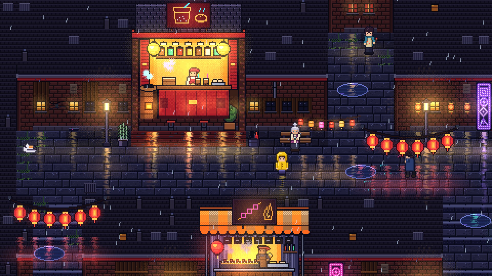

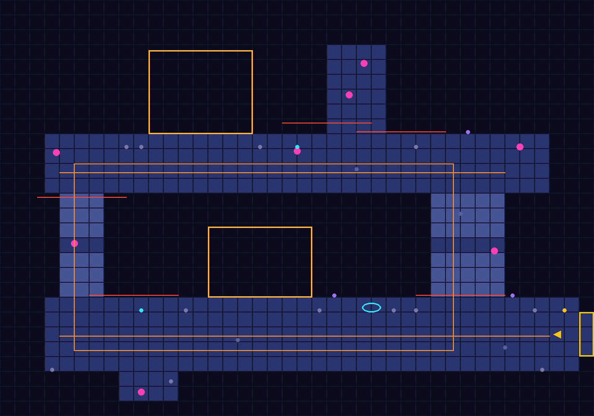

Lantern Steps is a hillside lane of stall carts under strings of round red lanterns. It has old brick and tin-roofed walls, granite slabs and stone steps, in rain. The map is 40 × 28 tiles and uses the D1 schema (`rows`, `objects`, `walker_paths`, pivots in tiles: x centre, y bottom edge; origin top-left, y down; puddles by their centre). It adds `district`, `tilesets` {ground `tiles-ground-steps`, facade `tiles-facade-steps`}, `exits` and `arrive_from`. Legend: `#` solid, `.` walkable slabs, `=` stone steps (walkable; ground tile 18 with slab landings). The fixture also carries `ground_tiles` and `facade_tiles`: per-cell tile indices (−1 = none) painted by the script, so the build can match the target exactly, or the builder can repaint them with the rules below.

Areas:
- **Lantern Row (main lane)**, y 20–24, x 3–38. This is the entry lane. The player arrives on the east edge. Ember Skewers (pivot 17.5, 20.0) faces south onto it, and the Order Portal (25.0, 21.0) is near the east stair. It also holds the sittable bench-1 (9.5, 21.0), two lantern arches, and magenta and cyan neon.
- **East exit**, rect (39, 21, 1, 3) → `d1-rain-alley`, arrive_at (3.5, 12.5), facing right. Coming from D1, the player arrives at (37.5, 22.5) facing left (`player_spawn`). The signpost `signpost-d1` (38.0, 21.0) stands at the exit; its live label names Rain Alley.
- **West stair (the Lantern Steps)**, x 4–6, y 13–19, with a landing at y 16 and a lantern arch over its top. It climbs from Lantern Row to the Upper Steps.
- **East stair**, x 29–33, y 13–19, with a landing at y 16.
- **Upper Steps lane**, y 9–12, x 3–36. Pearl & Pepper (pivot 13.5, 9.0) faces south onto it. Auntie Mei sits on bench-2 (20.0, 10.0). It has a lantern string and an arch, violet neon, and lamps.
- **Painter's Nook**, x 22–25, y 3–8: a dead end north off the Upper Steps.
- **Cat alcove**, x 8–11, y 25–26: a pocket south off Lantern Row.
- **Wish landing**, x 33–36, y 9–12: the east end of the Upper Steps.

Finds (8), all off the entry lane:

| Find | Where | Pivot (tiles) |
| --- | --- | --- |
| `cat-4` (calico, sheet `cat-4`) | West end of the Upper Steps, by the mossy corner at the top of the west stair | (3.8, 10.4) |
| `cat-5` (black with white socks, sheet `cat-2`) | Cat alcove south of Lantern Row, beside a crate | (9.5, 26.5) |
| `charm-jade` (puddle-1 + `find-charms-2` row 0) | Puddle on the west stair landing | (5.0, 16.5) |
| `charm-blossom` (puddle-1 + `find-charms-2` row 1) | Puddle in the Painter's Nook | (23.5, 6.5) |
| `npc-mei` (Auntie Mei, seated on bench-2, not sittable) | Upper Steps, east of Pearl & Pepper | (20.0, 10.3) |
| `npc-jun` (Jun, lantern painter) | Back of the Painter's Nook | (24.5, 4.4) |
| `ad-4` (`holo-ad-4` BOBA-BOT 3000) | East stair landing, against the east wall | (33.3, 17.0) |
| `wish-board` (`prop-wish-board`, "Hang a wish") | Wish landing, east end of the Upper Steps | (35.0, 10.0) |

Walker paths (umbrella walkers, as the slice): walker-1 runs along Lantern Row (4, 22.6) ↔ (37, 22.6); walker-2 runs along the Upper Steps (4, 11.6) ↔ (34, 11.6); walker-3 is a loop that goes up the west stair and down the east stair: (8, 23.6) → (5, 23.6) → (5, 11.0) → (30.5, 11.0) → (30.5, 23.6) → (8, 23.6).

Decor: 5 lamps, 3 plants, 2 crates, a barrel, an umbrella stand, 3 vertical neons (magenta 22.5, 20.0; cyan 34.5, 20.0; violet 31.5, 9.0), 4 lantern arches (5.5, 13.0), (9.0, 19.6), (31.0, 19.6), (27.0, 8.6) (top-centre pivots), the slice lantern string (22.0, 8.0) and 4 decor puddles. All are in the fixture.

Ground painting (`tiles-ground-steps`): random base slabs 0–3 (fixed seed); dark slabs 6/7 in the first row under walls; stall floor 19/20 in front of each stall (Pearl row y 9, x 10–16; Ember row y 20, x 14–20); kerb 9 along the south block (row 24); glints 4/5 under magenta/cyan neon and near the portal; moss 30 at the west end, in the nook, in the alcove and on the stairs; red paper scraps 31 near the wish board; grate 16 and well cover 17 as decoration. Stairs: tile 18 on every `=` row, base slabs on the landing row (y 16).
Facade painting (`tiles-facade-steps`): the slice's wall-front convention. Blocks facing a lane to their south get 3 wall rows (bottom = base/kerb 19/22 or red shutters 16–18; middle = window/sconce/AC/cables/neon strip; top = brick/plank 7–11, 31), with wall-corner 23/24 at run ends, then one roof-edge row 0/1/2/30, then roof fill 3–6 (mostly 3). Closed shutters run at x 24–26 and 35–37 (row 19) and x 31–33 (row 8).

Reachability (checked by script): a flood fill at 4 px resolution from the arrival point, with a 10 × 6 px player footprint and every object collider subtracted (buildings, portal, signpost, wish board, benches, lamps, plants, crates, barrel, umbrella stand, holo base, cats and NPCs). Every walkable tile is reached, the exit is reached, every restaurant zone, find and the portal/bench fronts are reached, and all three walker paths lie on free ground. Results are in the fixture's `checks` (`problems: []`, `unreached_walkable_tiles: []`).

#### Fogline Pier layout

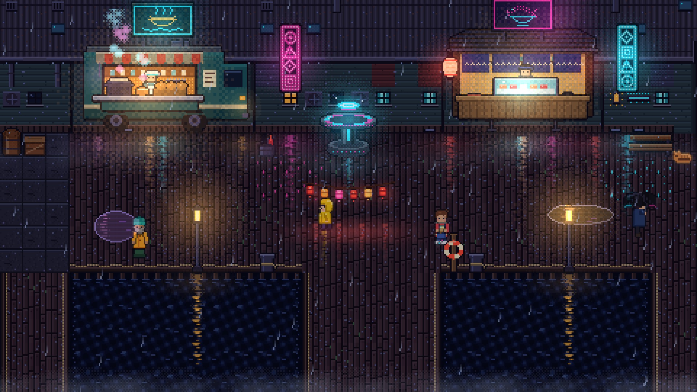

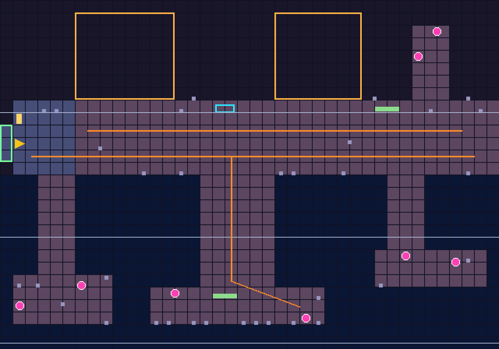

`fixtures/district-fogline-pier.json` (40 × 28 tiles, same schema as `market-map.json` plus `district`, `tilesets`, `exits`, `player_spawn_facing`). Legend: `#` solid warehouse block (`tiles-facade-pier`), `=` walkable wet boardwalk (`tiles-ground-pier`), `.` walkable wet concrete quay (`tiles-ground-pier` 19/20/31), `~` bay water (`tiles-water`, animated, solid collider). Schematic: `references/map-fogline-pier-schematic.png` (SCHEMATIC, 32 px per tile, same key as the slice's: dark = solid, blue-violet = walkable, deep blue = water, amber boxes = storefront footprints, cyan box = Order Portal, green bars = benches, magenta dots = finds, grey dots = props, orange lines = walker paths, thin pale lines = fog bands, green outline = exit, yellow arrow = spawn).

- **Warehouse row** (y 0–7, all x). Clapboard warehouses with corrugated roofs; their fronts face south onto the boardwalk (wall rows 5–7, roof-edge row 4, roof fill 0–3). Tideline Chowder (pivot 10.0, 8.0; footprint x 6–13) and Kaigan Chirashi (25.5, 8.0; x 22–28) sit in it. The Order Portal stands against the wall between them at (18.0, 9.0); a lantern string hangs over the boardwalk at (18.0, 10.0).
- **Net Lane** (x 33–35, y 2–7). A dead-end gap between warehouses north of the boardwalk: cat-6 (ginger) curls at the end (35.0, 3.0), the FOGWAVE RADIO holo ad (ad-5) flickers at (33.5, 5.0).
- **Main boardwalk** (y 8–13, x 1–39); the first 5 columns are a concrete **quay** (x 1–5). Entry and exit on the WEST edge: rows 10–12 at x 0. The signpost (label "Rain Alley Market") stands at (1.5, 9.9). Benches: bench-2 (sittable) at (31.0, 9.0). Lamps along the south rail at (11.5, 14.0), (27.5, 14.0), (37.5, 14.0); neon on the warehouse walls at (15.5, 8.0) magenta, (30.0, 8.0) cyan, (37.5, 8.0) violet; fish crates, a crate, a barrel and an umbrella stand along the wall.
- **West finger pier** (x 3–5, y 14–21) to the **Fishing platform** (x 1–8, y 22–25): Captain Ola (npc-ola) fishes at (6.5, 23.4); cat-7 (smoky) hides in the platform's south-west corner (1.6, 25.0), past a crate of fish and the platform lamp.
- **Centre pier** (x 16–21, y 14–22) to the **Pier head** (x 12–25, y 23–25): bench-1 (sittable) faces the bay at (18.0, 24.0); the seashell charm puddle (charm-shell) at (14.0, 24.0) on the west end; the message in a bottle (bottle) is wedged at the south rope rail at (24.5, 26.0) on the east end, among rail posts.
- **East finger pier** (x 31–33, y 14–19) to the **East landing** (x 30–38, y 20–22): Pip the street artist (npc-pip) at (32.5, 21.0); the anchor charm puddle (charm-anchor) at (36.5, 21.5) by the end lamp.
- Everything south of the boardwalk that is not pier is water (solid). Fog bands drift over the water at y 19 and y 27.5 and faintly over the boardwalk at y 9.
- **Exits.** `to-d1`: rect (0, 10, 1, 3) → `d1-rain-alley`, arrive_at (40.5, 24.5) facing left (travel: 0.2 s fade out, 1.2 s title card, 0.2 s fade in). Arriving from D1, the player appears at `player_spawn` (1.5, 11.5) facing right.
- **Walkers.** walker-1 (2.5, 12.5) ↔ (38.0, 12.5); walker-2 (37.0, 10.5) ↔ (7.0, 10.5); walker-3 (18.5, 12.5) → (18.5, 22.5) → (24.0, 24.6) (ping-pong).
- **Finds (8):** cat-6 Net Lane end; cat-7 fishing platform corner; charm-shell pier head west; charm-anchor east landing; npc-ola fishing platform; npc-pip east landing; ad-5 Net Lane; bottle pier-head rail. Six of eight are off the main boardwalk on piers or in the lane, so they reward walking out over the water.
- **Checked by script (`make_map.py`, `checks/map-reach.json`):** a 2 px configuration-space flood fill from the spawn with the player's 10 × 6 px feet box against solid tiles, water and every object collider: every free cell is reachable (one connected region), the exit is reachable, every restaurant zone, the portal, the signpost, both benches and all 8 finds have a reachable cell within 24 px, and every point on the 3 walker paths is free. Only 3 boardwalk tiles are fully covered by props (x 17–18, y 8 behind the Order Portal; x 38, y 8 behind a fish crate), by design.

### Movement and collision

- **Speed.** The player walks at 72 px/s (4.5 tiles/s) in 8 directions, with diagonals normalised. Reaching full speed takes 80 ms; stopping takes 60 ms.
- **Facing.** The sprite faces the dominant axis of the movement (on an exact diagonal tie, keep the previous facing).
- **Animation.** Walk frames run at 125 ms per frame at full speed. Idle frames alternate every 500 ms.
- **Collision.** The player collider is a 10 × 6 px box at the feet. It slides along solid tiles and the colliders of buildings, props, cats and street people. Walkers are soft obstacles (see NPCs).
- **Footsteps.** One `sfx-step-wet` variant (random, never the same twice in a row) plays on walk frames 2 and 4.
- **Bump.** Pushing into a wall for 0.25 s with no progress plays `sfx-bump` once. It plays again only after the player moves freely for 0.5 s.
- **Tuning.** Speed range 60–90 px/s. Raise it if crossing the map (about 9 s) feels slow; lower it if players overshoot zones.

**Click/tap to move.**
- **Ground.** A click or tap on walkable ground sets a destination and shows a gold ring marker there. The path is A* on the tile grid (8-way, with no corner cutting past solid tiles; tiles overlapped by a prop collider count as blocked), smoothed by line of sight.
- **Interactable.** A click or tap on an interactable's sprite or zone sets the destination to its zone centre. On arrival, if that object is the focus, its interaction runs.
- **Cancel.** Any keyboard or joystick movement cancels the destination. A tap on an unreachable or solid spot plays `sfx-bump` and shows the ring in red for 300 ms. If the player makes no progress for 0.6 s, the destination is dropped.
- **Exclusions.** Clicks on HUD elements never move the player.

### Camera

- **Style.** Orthographic and pixel-perfect: the world is rendered at native pixel size and upscaled by an integer factor `s = max(1, floor(screenHeightDevicePx / 240), ceil(screenWidthDevicePx / 640))`, so the view is never wider than 640 px (the map is 704 px wide). At the 1920 × 1080 reference s = 4 and the view is 270 px tall (about 17 tiles). Width follows the aspect: 4:3 shows 22.5 tiles, 21:9 shows 39 tiles.
- **Follow.** The camera follows the player with smoothing time 0.15 s and a 12 px look-ahead in the walk direction, clamped to the map bounds, and is pixel-snapped when rendered.
- **Small screens.** If the view is ever larger than the map on an axis, the map is centred on that axis and the outside is filled with night-ink #05071a.
- **Reduced motion.** It sets the look-ahead to 0.

### Interaction focus

- **Candidates.** Every interactable has a zone. The focus is the interactable whose zone contains the player's foot point. With several, the nearest zone centre wins. On an exact tie, the order is restaurant, kiosk, person, holo ad, cat, puddle, bench, vending, gate.
- **Feedback.** While something is in focus, its name label and interact prompt show above it (see UI), and the touch Action button's ring pulses.
- **Empty press.** Interact with nothing in focus does nothing (no sound), so mashing is harmless.
- **Repeats.** An interaction cannot be repeated until its overlay or animation ends, and a held key does not repeat it.

| Object | Zone (px, relative to the object's pivot unless noted) | Verb | Result |
| --- | --- | --- | --- |
| Restaurant | Per building spec: ramen (24, −20, 64, 20) from the canvas bottom-left; café (56, −20, 64, 20); Thai (28, −20, 56, 20) | Open menu | `Menu` opens on its list view. The first open earns the stamp. |
| Kiosk | (4, −16, 24, 16) from the canvas bottom-left | Use kiosk | `Kiosk` opens on its Wardrobe tab |
| Cat | 32 × 24 box centred 8 px below the cat's pivot | Greet | Cat plays happy (cols 4–5) for 2.0 s, a heart rises 10 px over 0.8 s, `sfx-cat-mrrp` then `sfx-cat-purr`, and a one-line `Dialogue`. The first greet counts as a find. |
| Street person | 32 × 20 box directly below the pivot | Talk | `Dialogue` with their lines (talk frames while text types). The first talk counts as a find. |
| Holo ad | 32 × 20 box below the projector base | Scan | Glitch frame 4 for 400 ms with `sfx-holo-glitch`, then a holo `Dialogue` line. The first scan counts as a find. |
| Secret puddle | Ellipse = puddle frame inset by 3 px | Look closer | Revealing and recording the charm, below |
| Bench (bench-1, bench-2) | 32 × 12 box in front of the seat | Sit | `Sitting` |
| Vending machine | 24 × 12 box below the pivot | Buy a soda | A can drops (300 ms) and fades after 1.2 s, with `sfx-vending` and the toast "A fizzy yuzu soda. Refreshing!". 1.5 s cooldown, during which the prompt hides. |
| Gate | Opening strip x 20–23, y 27.0–28.0 tiles | Look | One-line `Dialogue`: "The Glimmer Plate gate. The market stays open all night." |

**Full-game additions to focus.**
- New interactables and zones: Order Portal (zone (4, −16, 40, 16) from its canvas bottom-left, verb "Order"), signpost (24 × 16 box below the pivot, verb "Look"), wish board (zone from `prop-wish-board`'s spec, verb "Hang a wish"), message bottle (zone from `prop-message-bottle`'s spec, verb "Read the note"). The new cats, people and holo ads use the slice zones for their kind; new restaurants use the zones in their building specs.
- Exact-tie order: restaurant, Order Portal, kiosk, person, holo ad, wish board, bottle, cat, puddle, bench, vending, signpost, gate.

### Restaurants and menus (modular)

- **Data.** `fixtures/restaurants.json` holds 7 restaurant records in this order: r1-ramen, r2-cafe, r3-thai, r4-pearl, r5-ember, r6-tide, r7-kaigan. Each has `id`, `name`, `cuisine`, `palette`, `emblem`, `stamp`, `stampEmpty`, `storefront`, `district`, `xr` (null at restaurant level) and `dishes`. Each dish has `id`, `name`, `sample: true`, `price: "Price TBA"`, `description`, `ingredients`, `allergens`, `dietary`, `image` and `xr` = `{"model": "assets/models/dishes/<id>.obj", "previewScale": 1.0}`. The 32 dishes in file order define the **dish index** 0–31 used by the codes.
- **Real partner menus.** This file is the only place menu content lives. Replacing a record's `name`, dishes, descriptions, prices and images with a partner's real data needs no code change; `sample: false` hides the SAMPLE tag and a real `price` string replaces "Price TBA". Changing the number or order of dishes changes the dish indices, so codes made before such a change stop matching (the Market code version bits must then be raised). Real menus are an external release gate.
- **Building, menus and stamps.** As the slice: a `Restaurant` prefab per record; the menu, passport, map pins, minimap, Tasting List and finale read the record list. Opening a restaurant's menu for the first time this market adds its stamp (toast "Stamp n/7: <name>").
- **Menu rules.** As the slice (list → detail, prev/next wrap within the restaurant, Save toggles the Tasting List, Back/Close), plus the detail's "View in AR Portal" (or V) and "Add to order" / [−] "In order ×n" [+] (rules in Order Tray).

### Hidden finds

28 finds, each counted once per market, in the order found. Toast "Find n/28: <label>" (labels in UI Toasts) when the overlay that earned it closes (immediately for puddles), with `sfx-find` and a sparkle. Found objects stay interactive and repeat their content without a toast. Behaviour per kind is the slice's (cats sleep/wake/greet, puddle reveal rule, street people idle/talk, holo scan). The two new kinds:
- **Wish board** (`wish-board`). "Hang a wish": a new tag flutters (frame 2 for 1.2 s), `sfx-wish-tag`, then a one-line Dialogue; the first time counts as the find.
- **Message bottle** (`bottle`). "Read the note": `sfx-bottle`, then a one-line Dialogue in the person skin titled "A note"; the first time counts as the find.

**Find order** (bit order in the Market code, 0–27; IDs as in the fixtures):

| # | ID | District | Kind / sheet | Where (pivot, tiles) | Content (exact) |
| --- | --- | --- | --- | --- | --- |
| 0 | cat-1 | Rain Alley | cat `cat-1` | (14.5, 11.0) | "Mrrrp. The cat leans into your hand and purrs." |
| 1 | cat-2 | Rain Alley | cat `cat-2` | (20.5, 4.0) | same line |
| 2 | cat-3 | Rain Alley | cat `cat-3` | (4.6, 16.2) | same line |
| 3 | charm-koi | Rain Alley | puddle charm | (25.0, 12.5) | Koi charm |
| 4 | charm-moon | Rain Alley | puddle charm | (13.5, 25.5) | Crescent moon charm |
| 5 | charm-star | Rain Alley | puddle charm | (20.5, 7.0) | Star lantern charm |
| 6 | npc-suzu | Rain Alley | person | (37.0, 11.3) | slice lines (UI Dialogue) |
| 7 | npc-kenta | Rain Alley | person | (25.5, 26.0) | slice lines |
| 8 | npc-rin | Rain Alley | person | (23.5, 18.0) | slice lines |
| 9 | ad-1 | Rain Alley | holo `holo-ad-2` | (20.0, 16.0) | slice line |
| 10 | ad-2 | Rain Alley | holo `holo-ad-1` | (22.0, 5.0) | slice line |
| 11 | ad-3 | Rain Alley | holo `holo-ad-3` | (39.5, 23.0) | slice line |
| 12 | cat-4 | Lantern Steps | cat `cat-4` (calico) | (3.8, 10.4) | "Mrrp? The calico blinks slowly, then headbutts your knee." |
| 13 | cat-5 | Lantern Steps | cat `cat-2` | (9.5, 26.5) | "The cat stretches one white paw toward the warm stall lights." |
| 14 | charm-jade | Lantern Steps | puddle charm (`find-charms-2` row 0) | (5.0, 16.5) | Jade coin charm |
| 15 | charm-blossom | Lantern Steps | puddle charm (row 1) | (23.5, 6.5) | Peach blossom charm |
| 16 | npc-mei | Lantern Steps | person `npc-street-mei` | (20.0, 10.3) | "Auntie Mei: Sit, sit. Tea tastes better when it rains." / "Auntie Mei: The pepper buns sell out by midnight. Don't tell anyone I said so." |
| 17 | npc-jun | Lantern Steps | person `npc-street-jun` | (24.5, 4.4) | "Jun: I paint a new lantern every night. This one's for you, maybe." / "Jun: Red for luck, gold for good food. Easy rule." |
| 18 | ad-4 | Lantern Steps | holo `holo-ad-4` | (33.3, 17.0) | "BOBA-BOT 3000: Now with 40% more pearls! Bounce responsibly." |
| 19 | wish-board | Lantern Steps | `prop-wish-board` | (35.0, 10.0) | "You hang a little red tag: 'More noodles for everyone.'" |
| 20 | cat-6 | Fogline Pier | cat `cat-5` (ginger) | (35.0, 3.0) | "The ginger cat purrs like a tiny boat motor." |
| 21 | cat-7 | Fogline Pier | cat `cat-3` | (1.6, 25.0) | "The smoky cat watches the fog roll in, then you. Mostly the fog." |
| 22 | charm-shell | Fogline Pier | puddle charm (row 2) | (14.0, 24.0) | Seashell charm |
| 23 | charm-anchor | Fogline Pier | puddle charm (row 3) | (36.5, 21.5) | Anchor charm |
| 24 | npc-ola | Fogline Pier | person `npc-street-ola` | (6.5, 23.4) | "Captain Ola: Forty years on this bay and the fog still surprises me." / "Captain Ola: Fish aren't biting. The chowder truck is, though." |
| 25 | npc-pip | Fogline Pier | person `npc-street-pip` | (32.5, 21.0) | "Pip: I'm chalking a giant sushi on the planks. The rain keeps editing it." / "Pip: Art tip: if it washes away, you get to draw it again!" |
| 26 | ad-5 | Fogline Pier | holo `holo-ad-5` | (33.5, 5.0) | "FOGWAVE RADIO: All fog, all night, all smooth. Tune in, drift off." |
| 27 | bottle | Fogline Pier | `prop-message-bottle` | (24.5, 26.0) | "A note: 'To whoever finds this: try everything once, and dessert twice.'" |

Cats in other districts use the slice's sleep/wake timings. Each street person shows their lines in order; the last line repeats on later talks.

### Kiosk, wardrobe, outfit and unlocks

- **Where.** The Wardrobe is a tab of the Rain Alley kiosk and of every Order Portal, so the player can change outfit in any district.
- **Items.** Colours in this order (index for the Market code): 0 Yellow, 1 Cherry, 2 Teal, 3 Lavender, 4 Mint, 5 Coral, 6 Midnight, 7 Peach. Headwear: 0 Hood, 1 Bucket hat, 2 Cat beanie, 3 Sou'wester. The sheet is `player-<colour>-<hat>.png` (32 sheets).
- **Open from the start:** Yellow, Cherry, Teal, Lavender, Hood and Bucket hat.
- **Unlocks** by total finds: 4 → Mint, 8 → Cat beanie, 12 → Coral, 16 → Sou'wester, 20 → Midnight, 24 → Peach. An item unlocks in the same rule step that records the find; its toast and `sfx-unlock` queue right after the find toast. Unlocks are derived from the finds count, so a restored code restores them.
- **Choosing** an open item applies at once (sheet swap, `sfx-ui-select`, toast "New look: …"). Choosing a locked item changes nothing; it plays `sfx-code-bad` and shows the toast "Find n to unlock <item>".
- **Defaults.** Yellow and Hood. The outfit is part of the Market code. Restart resets it.

### AR Portal (3D dish previews)

- **Open.** From the dish detail ("View in AR Portal" or V), or from the Tasting List's dish detail. `sfx-portal-open`; the portal ring opens over 0.35 s (scale 0.9 → 1, alpha 0 → 1; Reduced motion: a 0.15 s fade). Music ducks −6 dB while it is open.
- **View.** The dish's model (`dish-models`, the record's `xr.model`) stands on `model-portal-pedestal` (model base on the pedestal top, y = 0.04 m). A dedicated camera renders them to a RenderTexture shown in the UI's holo window. Camera: FOV 30°, start yaw 30°, pitch 30°, distance = bounding-sphere radius × 2.2 / sin(15°) × zoom, looking at the sphere centre. Lights: warm key, cyan and magenta rim lights, navy background #0f1533 with soft bokeh. The model renders only while the portal is open. Unity's OBJ import mirrors X, so the camera orbits on the +Z side (`dish-models` spec).
- **Auto-turn.** The yaw turns at 20°/s. A drag stops it, and it resumes 3 s after release. Reduced motion: no auto-turn and no scan-line shimmer.
- **Orbit.** Drag (mouse or one finger) inside the view: yaw is free at 0.4°/px; pitch is clamped to 10°–70°. The drag threshold is 6 px; a shorter press on a button is a click. Keys: ←/→ yaw ±45° (0.25 s ease-out), ↑/↓ pitch ±10°, R resets.
- **Zoom.** Wheel, pinch, or +/− keys and buttons, from 0.7× to 1.6× (wheel and keys step by 0.1×). `sfx-orbit-tick` plays at a limit, on snaps and on reset, at most once per 80 ms.
- **Reset view** returns to yaw 30°, pitch 30°, zoom 1× over 0.3 s.
- **Other buttons.** Prev / Next dish (same restaurant, wraps; the view resets), "Add to order" / [−] "In order ×n" [+], Save dish / Saved, and Close. Esc or Backspace returns to the dish detail with `sfx-portal-close`.
- **Missing model.** If the model fails to load, the view shows the 2D dish art ×4 on the pedestal glow with "3D view unavailable", and every other button works.

### Order Tray, Order Portal and ticket (XR dish ordering, demo)

- **Tray.** An ordered list of up to 6 lines {dish, qty 1–3}, across all restaurants and districts.
  - Add: a new line at qty 1, appended, with `sfx-order-add` and the toast "Added to your order".
  - + raises qty (disabled at 3). − lowers qty; at 1 it removes the line, with `sfx-order-remove` and the toast "Removed from your order".
  - Adding a 7th different dish changes nothing: toast "Your tray is full (6 dishes)" and `sfx-code-bad`.
  - The tray is kept across districts. It is not saved in the Market code, and Restart clears it.
- **Order Tray overlay** (HUD tray button or O, from `Explore` or `Sitting`): lists the lines, each with its emblem, dish, restaurant, −/+ and Remove, and "Place your order at any Order Portal." Empty state as the UI.
- **Order Portal** (`prop-order-portal`, one per district, verb "Order") opens the `OrderPortal` overlay on its Order tab (the tray list + "Place demo order", disabled while the tray is empty), with a Wardrobe tab.
  - "Place demo order" → `OrderConfirm`: "Place this demo order? Nothing is paid or sent." with "Place order" and "Back".
  - "Place order":
    1. The orders count +1, capped at 15 in the code; the passport shows "9+" from 10.
    2. Order number `GP-<count>`.
    3. The XR order code is computed from the tray.
    4. The tray empties, `sfx-order-place` plays and `Ticket` shows (order number, lines, code, the line "Use this code to open your order in the Glimmer Plate XR table.", "Demo order: nothing is charged or sent.", Done).
  - Done returns to `Explore`.
  - **Order ready.** 8.0 s after the order is placed (world time, paused while `Pause` is open), the dishes of the first 3 lines appear above this portal's hologram anchor (24, 30) as small turning 3D holograms. Each is 0.5 m wide in world space (scaled to fit), spaced 20 px apart, turning at 30°/s, with a cyan additive glow. `sfx-order-ready` plays with the toast "Your order is ready at the portal table". The holograms stay until the next order is placed or the player travels.
  - If the player travels before the 8 s are up, the holograms appear at the next arrival's Order Portal instead, when the player is in that district. The toast shows wherever the player is.
- **XR order code** (display only), 50 bits, MSB first:
  1. 3-bit line count.
  2. For each line: a 5-bit dish index (0–31) and a 2-bit qty − 1.
  3. Zero padding to 45 bits.
  4. A 5-bit checksum: the sum of the nine 5-bit groups of the 45 bits, mod 32.

  It is encoded as 10 Crockford base32 characters (alphabet `0123456789ABCDEFGHJKMNPQRSTVWXYZ`, 5 bits each) and shown as `XXXXX-XXXXX`. Example (computed by script, `work/codes/codes.py`): r7-1 ×2 and r4-2 ×1 → bits `010 11011 01 10000 00` + zeros, checksum 8 → **`BDG00-00008`**.

### Market code (saved progress between visits)

- **What it holds**, 81 payload bits, MSB first:

  | Field | Bits | Contents |
  | --- | --- | --- |
  | version | 2 | `01` |
  | stamps | 7 | restaurant order r1 … r7 |
  | finds | 28 | find order 0–27 |
  | Tasting List | 32 | dish index 0–31; restored in menu order, since the save order isn't kept |
  | colour | 3 | wardrobe colour index |
  | headwear | 2 | wardrobe headwear index |
  | Grand finale shown | 1 | |
  | orders placed | 4 | 0–15, capped |
  | visited | 2 | Lantern Steps, then Fogline Pier |

  Not saved: the Order Tray, current district (always the Rain Alley gate) and Tasting List order. Derived on restore: unlocks (from the finds count), district finale cards shown (shown when that district's stamps are all set) and the visited flags' "New district" toasts.
- **Checksum.** Append 7 zero bits to the 81 payload bits (88 bits = 11 bytes b0…b10, MSB first). checksum = (Σ bᵢ × (i + 1)) mod 512, as 9 bits.
- **Encoding.** The code is payload (81) + checksum (9) = 90 bits → 18 Crockford base32 characters, shown as `XXXXXX-XXXXXX-XXXXXX`.
- **Decoding.**
  1. Normalise the input: uppercase; I and L → 1; O → 0; U → V; drop dashes and spaces.
  2. It must be exactly 18 alphabet characters.
  3. Recompute the checksum.
  4. Version must be `01`, and the colour/headwear values must be in range.
  5. Any failure is a bad code.
- **Worked example** (computed by script, `work/codes/codes.py`). Stamps r1 and r2; finds 0–2 (the three Rain Alley cats); Tasting List r1-2 and r2-4; Teal + Bucket hat; no Grand finale; 1 order; Lantern Steps visited. The checksum is 58 and the code is **`E1R000-021000-00J31T`**. A brand-new market encodes as `800000-000000-000020`.
- **Show.** Passport → "Market code", Pause → "Market code", or Grand finale → "Show market code" opens `MarketCode`. It shows the current code (always live), "Write this down. Enter it at the title screen next time to continue." and Done.
- **Enter.** Title → "Continue with code" → `CodeEntry` with 18 slots. Typing on a physical keyboard or tapping the on-screen keypad (32 symbols + Delete + Continue) enters characters. Each key plays `sfx-code-key`. Continue is disabled until all 18 are filled.
  - **Bad code:** the slots shake for 0.3 s, `sfx-code-bad` plays and "That code doesn't match. Check each character and try again." shows. Nothing else changes.
  - **Good code:** `sfx-code-ok` plays, progress is restored and `Entering` starts at the Rain Alley gate with the saved outfit, followed by the toast "Welcome back!". The finale cards and the Grand finale don't replay for restored stamps.
  - Back returns to the title.
- **Restart market** clears the live progress; any written code still restores its own progress.

### Sitting

- **Sit.** E on bench-1 or bench-2 moves the player's feet to the sit point (bench pivot +5 px) over 150 ms and shows the sit pose (row 0, col 7). The music ducks −4 dB, the rain rises +3 dB and the bench line shows.
- **Stand.** Any movement input, E, Space, a click on the ground or the joystick stands the player at the zone centre. The Pause button and Esc still pause.
- **Not sittable.** Bench-3 is Grandma Suzu's.

### NPC walkers

- **Paths.** 4 umbrella walkers (`npc-walker-1..3`; walker-4 reuses sheet 1) move ping-pong along their `walker_paths` at 28 px/s, with 4 frames × 160 ms. They pause 1–3 s (random) at each end and turn toward the next segment.
- **Blocking.** When the player's collider is within 10 px ahead, a walker waits. After 2 s of waiting it reverses along its path.
- **Collisions.** Walkers never push the player. Their 12 × 6 foot box blocks the player. They don't collide with each other (the paths only cross in open plazas and pass through each other there).

### Chefs, steam and kitchens

- **Chefs.** Each restaurant's chef loops its 4-frame work animation (ramen 180 ms, café 200 ms, Thai 120 ms per frame) in the chef window from the building spec, between the `-back` and `-front` layers.
- **Steam.** Puffs (`fx-steam-puff`) spawn at each kitchen's steam points: 3 per second per point, lifetime 1.6 s, rising 10 px/s with ±4 px sideways drift. They play frames 0–3 across the lifetime and fade out over the last 40 %.
- **Steam tints.** Ramen steam-cyan #9ff6ff; café steam-magenta #ff9be0; Thai alternating cyan and magenta. The tint matches the look's glowing magenta and cyan steam.
- **Wok.** `fx-wok-flame` loops (4 × 80 ms) on the Thai cart burner.
- **Kitchen sounds.** `sfx-sizzle-loop` plays at Lemongrass Lane and `sfx-simmer-loop` at Yuge Ramen as positional loops: full volume within 2 tiles, silent beyond 8 tiles, linear rolloff.

### Weather, light and reflections

The scene uses painted lighting with no real-time lights, for phone performance.
- **Rain.** `fx-rain-streak` particles fall at 10° from vertical at 260–320 px/s across the camera view. Counts: 90 on desktop, 60 on phones and 30 with Reduced motion. `fx-rain-splash` spawns about 10 per second at random street points in view (3 frames × 60 ms).
- **Glows.** `fx-glow-radial` sprites with additive blending sit at each lamp, lantern, neon sign and lit window, tinted to their colour at alpha 0.25–0.45. They flicker together with their sign.
- **Neon reflections.** Each neon sign, lantern and lit window has a matching `fx-glow-reflection` streak on the wet street below it. Each streak is tinted, additive at alpha 0.35, and shimmers ±1 px sideways every 250 ms.
- **Player reflection.** A vertically flipped copy of the current player frame draws under the feet at alpha 0.25 (darkened 30 %), only on street tiles. This matches the yellow reflection in the look.
- **Puddles.** `prop-puddles` decals have the ripple (4 × 120 ms) spawning every 1.5–3 s.
- **Floating lanterns.** 4 `prop-floating-lantern` near the gate bob ±2 px over 3 s.
- **Reduced motion.** Shimmer, bob and sign flicker stop; rain drops to 30.

**Full-game additions (all districts).**
- **Benches.** Sittable benches: Rain Alley bench-1 and bench-2, Lantern Steps bench-1 (bench-2 is Auntie Mei's), Fogline Pier bench-1 and bench-2. Same sit rule.
- **Walkers.** Lantern Steps and Fogline Pier have 3 walkers each, on their fixtures' paths. They use sheets 1–3 and the same speed, pause and blocking rules. Lantern Steps walker-3 is a closed loop, not ping-pong.
- **Chefs.** chef-pearl 180 ms, chef-ember 140 ms, chef-tide 200 ms and chef-kaigan 160 ms per frame, in the chef windows of their building specs.
- **Steam and smoke.** Pearl & Pepper steam is steam-cyan. Ember Skewers emits smoke: `fx-steam-puff` tinted #b9a7c9 at alpha 0.8, rising 14 px/s, 4 per second. Tideline Chowder steam is steam-magenta. Kaigan Chirashi has one cyan puff from the miso pot every 0.6 s.
- **Kitchen loops** (positional, 2–8 tiles, as in the slice): `sfx-teapot-loop` at r4-pearl, `sfx-grill-loop` at r5-ember, `sfx-fryer-loop` at r6-tide, optional `sfx-simmer-loop` at −16 dB at r7-kaigan.
- **Lantern Steps.** Lantern arches sway ±1 px every 1.5 s (none with Reduced motion). The rain and reflections follow the shared rules.
- **Fogline Pier.** `tiles-water` animates its 2 frames at 600 ms (Reduced motion: frame 1 only); water is solid. The 3 `fx-fog-band` rows tile horizontally and drift +6 px/s (y 9 at alpha 0.35, the others 0.6) on the Overhead layer (Reduced motion: still). `sfx-gull` plays every 25–60 s at random.

### Finales

- **District finale card.** When the player next returns to `Explore` after earning a district's last stamp (Rain Alley 3, Lantern Steps 2, Fogline Pier 2), `DistrictFinale` shows once per district, unless this stamp is the seventh. The card shows "Rain Alley complete!" / "Lantern Steps complete!" / "Fogline Pier complete!" with that district's stamps, 4 rising gold lanterns in the world for 4 s and `sfx-finale`. Its one button, "Keep wandering", or Esc returns to `Explore`.
- **Grand finale.** The same trigger after the seventh stamp, once per market (code bit). Six gold lanterns rise for 6 s and `sfx-grand-finale` plays (never with `sfx-finale`). It shows the 7 stamps, "Tasting List: n dishes", "Hidden finds: x/28", "Orders placed: n" and the line that the Tasting List and orders carry into Glimmer Plate XR ordering. Buttons: "Keep wandering" (Esc), "See my Tasting List", "Show market code". The Grand finale doesn't repeat; finds after it don't reopen it.

### Pause and restart

As the slice, with these additions:
- Pause lists Resume, Passport, Tasting List, Market code, Controls, Sound, Music, Reduced motion and Restart market.
- Restart (after `Confirm`) clears stamps, finds, the Tasting List, the Order Tray, the orders count, the outfit, unlocks, visited districts, the finale flags and the holograms. The player returns to Rain Alley and the title.
- Focus loss as the slice; during `Travel`, the pause comes after arrival.

### Tuning

The slice's tuning table stays, plus:

| Value | Start | Range | Change it when |
| --- | --- | --- | --- |
| Travel fade + card | 0.2 + 1.2 + 0.2 s | card 0.8–2.0 s | Testers feel stalled (shorter) or miss where they are (longer) |
| AR auto-turn | 20°/s | 10–40 | Dishes feel static, or make testers dizzy |
| AR orbit sensitivity | 0.4°/px | 0.2–0.8 | Drags overshoot or feel heavy (on phones, test at 360 px tall) |
| AR zoom range | 0.7–1.6× | 0.5–2.0× | Toppings are too small to read, or the model clips the frame |
| Order ready delay | 8 s | 3–15 s | Testers leave the portal before it's ready, or the payoff feels instant |
| Tray capacity | 6 lines × qty 3 | 4–10 lines | The ticket or tray overflows, or players want more |
| Unlock step | every 4 finds | 3–5 | Unlocks arrive too rarely, or are all gone in the first district |
| Fog drift | 6 px/s, alpha 0.35 / 0.6 | 3–12, 0.2–0.7 | Fog hides finds or the player, or reads as static |

## Controls

Genre conventions: WASD/arrows to walk, E/Space to interact, Esc to back out or pause, click/tap to walk. On phones the game plays in **landscape**; portrait shows the rotate prompt and pauses play. The on-screen controls (floating joystick, Action button, Pause button) appear only after a touch input and hide again after a keyboard or mouse input. Prompts show the key cap or the Action disc to match the last input used.

**Teaching.**
- The walk hint appears after `Entering`, and the interact hint the first time something is in focus. Each leaves once the player has done it or after its timeout; the UI section's First-time hints give the exact timings and copy.
- After that, nothing lists the controls on screen. Pause → Controls and the kiosk's Market Guide show them again.

| Action | Keyboard/mouse | Touch | Timing/threshold | Feedback |
| --- | --- | --- | --- | --- |
| Walk | WASD / arrow keys (hold) | Floating joystick: touch in the left 40 % of the screen; the base appears under the thumb | Joystick dead zone 12 % of the base radius; full speed at 60 %; release stops | Walk animation, footsteps, camera follow |
| Walk to a spot | Left-click on the street | Tap on the street (outside the joystick area) | Press and release within 250 ms and 12 px (otherwise ignored) | Gold ring marker; red ring + bump when unreachable |
| Interact / confirm | E or Space or Enter (press) | Action button (release inside), or tap the target | Ignored while the previous interaction runs; no auto-repeat | The interaction's own feedback; nothing in focus = no effect |
| Go to & interact | Click an interactable | Tap an interactable | Same tap threshold as Walk to a spot | Walks there, then interacts if still in focus |
| Back / close | Esc, or Backspace in overlays, or the Close button | Close button / Back button | Press | `sfx-menu-close` or `sfx-ui-back` |
| Menu focus | Arrows / WASD move, E/Space/Enter select, click selects (hover behaviour per the UI section) | Tap selects | Press; holding repeats every 180 ms after 400 ms | Focus band; `sfx-ui-move` |
| Pause | Esc or P (in Explore/Sitting), Pause button | Pause button (top-left) | Press | Pause overlay |
| Map | M, or click the minimap | Tap the minimap | Press | Map overlay |
| Passport | Tab, or the passport HUD button | Passport HUD button | Press | Passport overlay |
| Tasting List | The heart HUD button | Heart HUD button | Press | Tasting List overlay |
| Dialogue next | E/Space/Enter or click | Tap anywhere | The first press completes the typing; the next advances | `sfx-talk-blip` per 3 characters while typing |

**Input by state (slice states).** "Ignored" means no effect and no sound. The full-game table below adds the new states; `Finale` here now means `DistrictFinale` and `GrandFinale`. On the title, the first input starts audio and focuses Start rather than entering the game; then the focused button decides.

| Input | Title | Entering | Explore | Sitting | Dialogue | Menu / Kiosk / Passport / TastingList / Map | Finale | Pause / Confirm |
| --- | --- | --- | --- | --- | --- | --- | --- | --- |
| Move keys / joystick | Enter the game (any key) | Ignored | Walk; cancels the destination | Stand up | Ignored | Move focus (arrows/WASD); joystick ignored | Move focus | Move focus |
| Click/tap street | Enter the game | Ignored | Walk to the spot | Stand up | Advance the line (tap anywhere) | Outside the panel: ignored (no close) | Ignored | Ignored |
| E / Space / Action | Enter the game | Ignored | Interact with the focus, or nothing | Stand up | Complete or advance the line | Select the focused element | Select the focused button | Select the focused button |
| Esc / Backspace | Ignored | Pause (Esc only) | Pause (Esc) / ignored (Backspace) | Pause (Esc) | Close dialogue (the find still counts) | Detail → list; list or any other overlay → Explore; the Kiosk closes entirely | Keep wandering | Pause: Resume; Confirm: Keep playing |
| P | Ignored | Pause | Pause | Pause | Ignored | Ignored | Ignored | Pause: Resume |
| M / Tab | Ignored | Ignored | Open Map / Passport | Stand up, then open | Ignored | Switch to that overlay (replaces the current one) | Ignored | Ignored |
| HUD buttons (minimap, passport, heart, pause) | Hidden | Hidden | Open their overlay | Open their overlay | Hidden | Hidden behind the overlay | Hidden | Hidden |
| Focus lost | — | Pause after Entering ends | Release inputs, Pause | Release inputs, Pause | Release inputs, stay | Release inputs, stay | Stay | Stay |

- **Leaking presses.** The press that closes an overlay is consumed: it is not also read as interact or movement in `Explore` on the same frame. Keys held while an overlay closes are ignored until released.
- **Transition lock.** During overlay open/close transitions (durations in the UI section), input is ignored except Esc, which is queued once.
- **Double rewards.** Stamp, find and favourite changes happen in the rule handlers, not at the end of an animation. A second press while an overlay is opening cannot award twice.

**Menu keyboard focus.** The UI section gives each screen's exact focus order and default focus; it governs.

**Expectation checks** (to play with keyboard/mouse and with touch):
1. On the title, press Enter (or click Start): the audio starts, the player walks through the gate and the walk hint appears. Move: the hint leaves.
2. Walk left to the kiosk: the label "Glimmer Plate Kiosk" and a "Use kiosk" prompt appear, and the interact hint shows once. Press E: the Wardrobe opens. Choose Teal: the sprite and the toast change. Esc returns to the rain.
3. Walk up to Yuge Ramen and press E: the menu opens, the stamp lands and "Stamp 1/7: Yuge Ramen" shows. Open dish 2 and press Save dish: the heart fills and the toast shows. Esc goes to the list, Esc again to the street.
4. Press E with nothing nearby: nothing happens. Walk into a wall: one soft bump.
5. Click a far spot on the lower street: the player paths there around blocks. Press an arrow mid-way: the route cancels.
6. Press Esc in Explore: Pause opens. Resume returns with no step taken.
7. Collect all three Rain Alley stamps: the district finale card appears after the third menu closes. Keep wandering, then Pause → Restart market → Restart: the title card returns, and the passport, tray and outfit are reset.

**Full-game actions.**

| Action | Keyboard/mouse | Touch | Timing/threshold | Feedback |
| --- | --- | --- | --- | --- |
| Open AR Portal | V, or "View in AR Portal" in the dish detail | Button | Press | Portal opens, `sfx-portal-open` |
| Orbit dish | Drag in the view; ←/→ yaw ±45°, ↑/↓ pitch ±10° | One-finger drag in the view | 6 px threshold; 0.4°/px; pitch 10°–70° | The model turns; auto-turn pauses for 3 s |
| Zoom dish | Wheel; + / − keys; zoom buttons | Pinch; zoom buttons | 0.7×–1.6×, steps 0.1× | Scale changes; tick at a limit |
| Reset view | R; Reset button | Reset button | Press | Eases back in 0.3 s, tick |
| Order Tray | O, or the HUD tray button | HUD tray button | Press (in `Explore` / `Sitting`) | Tray overlay |
| Add / qty | "Add to order", −/+ (detail, AR Portal, tray, portal) | Same buttons | Press; + disabled at 3; 7th dish rejected | Toast + `sfx-order-add` / `-remove`; full → `sfx-code-bad` |
| Order at a portal | E/Space/Enter at an Order Portal, or click it | Action / tap the portal | As interact | Order Portal overlay |
| Switch tabs (Map, Passport, Order Portal, Kiosk) | While the tab row has focus: Q previous / E next, or ←/→ (Enter/Space selects the focused tab); elsewhere E selects as usual. Click a tab | Tap a tab | Press | Tab changes, `sfx-ui-move` |
| Enter code | Type letters/digits (normalised); Backspace deletes; Enter submits | On-screen keypad: 32 keys, Delete, Continue | Press; Continue disabled until 18 characters | `sfx-code-key`; bad: shake + `sfx-code-bad`; good: `sfx-code-ok` |
| Market code | The Passport/Pause/Grand finale button | Same | Press | Market code overlay |
| Travel | Walk into an exit | Same | Foot point inside the exit rect, in `Explore` only | Fade, district card, `sfx-district-travel` |

**Input by state, full-game states.** Shared defaults: menu-like overlays follow the slice's "Menu / Kiosk / …" column (focus moves, select, Esc back, HUD hidden, focus loss keeps the overlay). Only deviations are listed.

| Input | Travel | ArPortal | OrderTray / OrderPortal | OrderConfirm | Ticket | MarketCode | CodeEntry | DistrictFinale / GrandFinale |
| --- | --- | --- | --- | --- | --- | --- | --- | --- |
| Move keys / joystick | Ignored (released at start) | ←/→ yaw, ↑/↓ pitch while the view has focus; else move focus | Move focus | Move focus | Move focus | Ignored | ←/→ move the keypad focus | Move focus |
| Click/tap / drag | Ignored | Drag in the view orbits; buttons click | Buttons | Buttons | Buttons | Done | Keys and slots (a tap on a slot moves the cursor) | Buttons |
| E / Space / Enter | Ignored | Select the focused button | Select | Select | Done | Done | Enter = Continue (when 18 entered; otherwise ignored); E types the letter E; Space is ignored | Select |
| Letters / digits | Ignored | R reset, V ignored, +/− zoom | O closes the tray | Ignored | Ignored | Ignored | Type the character: every Crockford character 0–9 and A–Z except I, L, O, U types itself (including E, M, P, Q, R, V); I/L→1, O→0, U→V; lowercase accepted | Ignored |
| Esc / Backspace | Ignored (queued Esc dropped) | Back to the dish detail | Close to `Explore` | Back to the Order tab | Done | Back to the opener | Backspace deletes; Esc returns to the title | Keep wandering |
| M / Tab / P | Ignored | Ignored | Switch overlay (M/Tab); P ignored | Ignored | Ignored | Ignored | M and P type their letters; Tab is ignored | Ignored |
| Focus lost | Complete, then Pause | Release, stay (drag ends) | Release, stay | Release, stay | Stay | Stay | Stay | Stay |

- **Transitions.** During travel fades and overlay open/close, the slice's transition lock applies. Order placement, finds, unlocks and stamps happen in rule handlers, never at animation ends, so double presses can't place two orders: "Place order" is disabled from the first press until `Ticket` shows.
- **Text input.** `CodeEntry` takes typed characters only while it is open, and typing has priority over every global key mapping there: E, M, P, Q, R, V and the other code letters type their character instead of interacting, opening the map, pausing or switching tabs. Only Enter submits, Backspace deletes and Esc returns to the title; Space and Tab do nothing. The same keypress is never also read as a game key.

**Full-game expectation checks** (keyboard/mouse and touch):
8. Walk to the west end of Rain Alley's upper street: the screen fades, the "Lantern Steps" card shows and the player stands on Lantern Row facing left, with the toast "New district: Lantern Steps". Walk east back out: Rain Alley, at (3.5, 12.5).
9. Open Pearl & Pepper, then a dish, then "View in AR Portal": the dish turns on the pedestal. Drag: it orbits and stops auto-turning. Wheel/pinch: it zooms within limits. Press R: it resets. Esc: back to the detail.
10. Add 2 dishes to the tray, then open a 7th different dish after filling it to 6: "Your tray is full (6 dishes)", nothing changes.
11. At the Order Portal: Order → "Place demo order" → "Place order". The ticket shows GP-1 and a 10-character code. Done; 8 s later the holograms appear over the portal with the toast.
12. Pause → Market code: note the code. Restart market. At the title, Continue with code: type it with one wrong character → the shake and the message. Fix it → "Welcome back!", the stamps, finds, Tasting List and outfit are back.
13. Make the 4th find: after the find toast, "Unlocked: Mint raincoat — try it at a kiosk". In the Order Portal's Wardrobe tab, choose Mint: it applies. Choose Peach (locked): "Find 24 to unlock Peach", nothing changes.

## Visual targets

### Master target: the creator's chosen look (`look-neon-rain-alley`, TARGET)

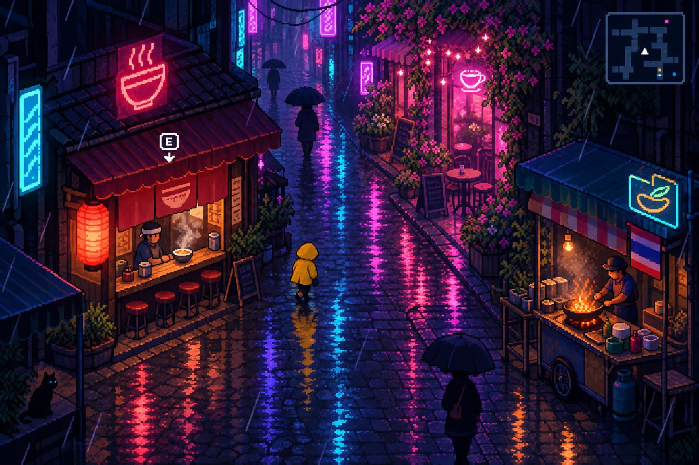

"Neon Rain Alley Market" was chosen by the creator before design began and is binding for the whole game. The game takes its identity from it:

- **Palette.** Night-ink and indigo darkness (#05071a, #1f2453, #2a1735), wet violet-blue cobbles (#2b2d5a with #5a5f9e glints), neon magenta #ff3fb4 and cyan #2ee6ff, lantern red #ff4a3a and warm amber #ffb347, and the yellow raincoat #f5c518 as the brightest warm point. The full palette is in `work/art-spec.md`, mirrored in the asset specs below.
- **Lighting.** Light comes from local sources only: lanterns, windows, neon. Every source has a coloured reflection streak on the wet ground. Steam glows magenta and cyan, and gentle diagonal rain falls everywhere.
- **Shapes and materials.** Low tiled roofs, red scalloped awnings and noren curtains (ramen); a rose-and-vine facade with fairy lights (café); a striped awning cart with lanterns and a wok flame (Thai); black umbrellas; chunky 1 px-outlined pixel art.
- **Proportions.** Each storefront is 7–8 tiles wide and 7–9 tall. Characters are about 1.5 tiles tall, cats under 1 tile.

**Departures.**
- **Camera.** The look uses a vanishing-point street perspective. The game uses an orthographic three-quarter top-down view (as the brief asks: "similar to Stardew Valley and classic Pokémon"), so storefronts face the camera and the street is seen from above. The palette, lighting, materials and props stay as close to the look as this view allows.
- **Reflections.** The look's reflections are faked with tinted additive streaks rather than true mirroring, for phone performance.
- **Sign lettering.** The signs in the game are icon-only, like the look's, and names are live text.
- **HUD.** The look's HUD (the "E" prompt and the corner minimap) is only a suggestion. The game's HUD is the UI designer's, shown over this image in `ui-hud-crowded-desktop`.

### Market layout (`market-map-schematic`, SCHEMATIC)

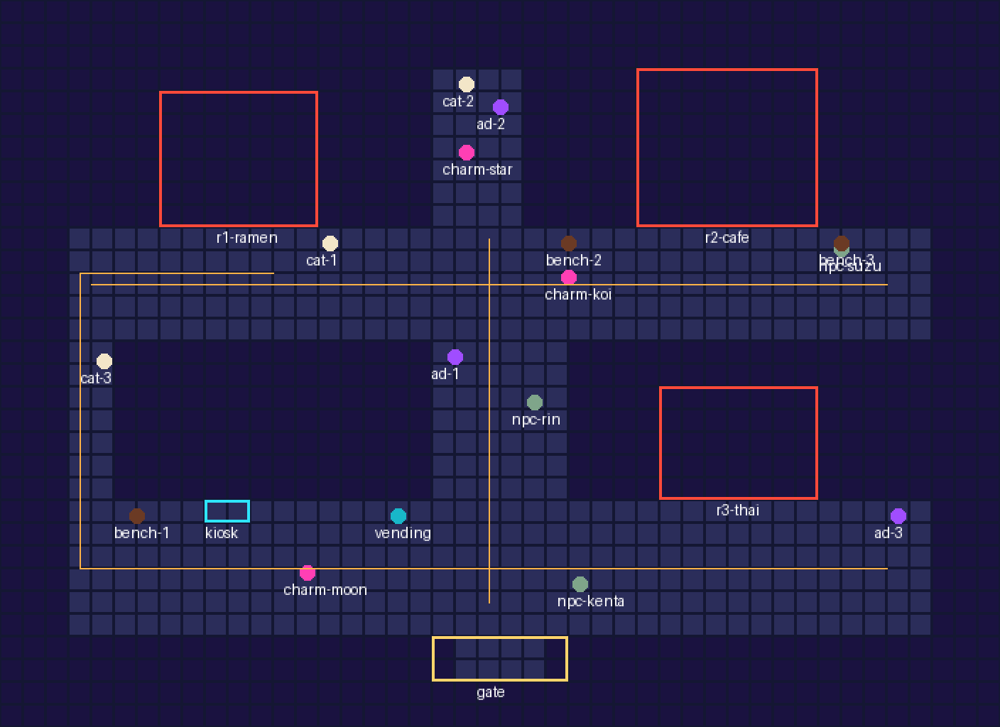

The schematic draws `fixtures/market-map.json` at 2 px per source pixel: dark is solid, blue is walkable, outlined boxes are building footprints, dots are finds and props, orange lines are walker paths. It defines structure only, not appearance.

The master target stays binding for every district's palette, lighting, rain, wet reflections and outline style.

### District targets: Lantern Steps (`look-lantern-steps`, TARGET) and Fogline Pier (`look-fogline-pier`, TARGET)

Each is composited by script from that district's delivered tiles, storefronts, props, effects and a stand-in player: a 480 × 270 in-game view at ×4, in the game's orthographic three-quarter camera, with no HUD. They are authoritative for those districts' world look and placement. Because they use the real assets, they show the actual view the builder makes. They show the delivered district chefs, cats and street people (frame 0); the umbrella walker is the slice's `npc-walker-1`. Every lamp, lantern, sign, lit window and holo panel has its glow, reflection streak and light pool, and puddles mirror the nearest light, as the master target requires. Lantern Steps: red lantern arches, granite steps, brick and tin, magenta/cyan neon. Fogline Pier: wet boardwalk, dark bay with neon reflections, fog bands, clapboard warehouses. Both targets were graded by script to the master's darkness (median brightness about 34–35, 58–62 % dark pixels).

### District schematics (`map-lantern-steps-schematic`, `map-fogline-pier-schematic`, SCHEMATIC)

They draw the district fixtures (solid, walkable, water, footprints, finds, walker paths, exits). They show structure only, not appearance.

### AR Portal 3D look (`ar-portal-dish-hero`, TARGET) and dish models sheet (`dish-models-sheet`, TARGET)

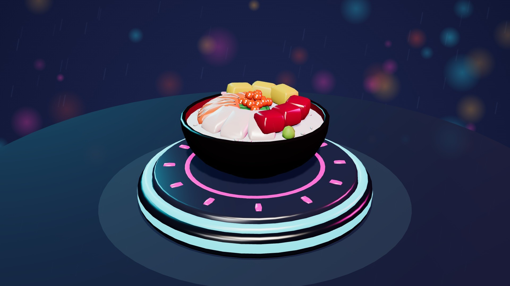

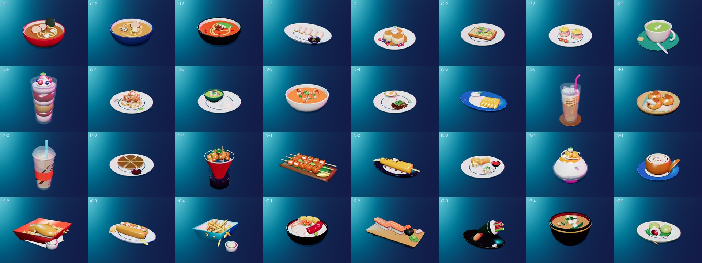

The hero is r7-1 (chirashi bowl) on the portal pedestal, rendered from the delivered OBJ files with the viewer camera and lights of the AR Portal rule (navy background, warm key, cyan and magenta rims). It is the 3D look the AR Portal and the order holograms follow. The sheet shows every dish model from the default 3/4 view. The creator's linked chirashi bowl is inspiration for the style only (appetising, rounded, glossy, generous toppings). It is not in the package.

### UI targets (`references/ui/`, TARGET)

The UI section lists every target and says which slice targets are superseded. The crowded states are `ui-hud-v2-crowded-desktop` (Lantern Steps) and `ui-hud-v2-crowded-phone` (Fogline Pier). The UI targets govern UI layout only; the world follows this section.

**Maximum occupancy in view** (every district): about 17 × 30 tiles at 16:9, at most 2 storefronts, 4 walkers, 3 street people or cats, 90 rain streaks, about 30 steam/smoke puffs, 3 fog bands, 3 order holograms and 2 toasts.

## Asset specifications

All world art is original code-drawn pixel art. **Precedence:** the asset specs below govern files: frame sizes, grids, pivots, colliders, anchors and import settings. For runtime behaviour (speeds, counts, timings, collision between characters, reduced motion) the Rules, Controls and Feedback sections govern wherever an asset spec suggests a different value, and the UI section governs UI layout, copy, focus and transition timings. Shared rules:
- PPU 16, Filter Mode Point, Compression None, no mipmaps.
- Sorting on one "World" layer by pivot Y. `gate-top`, overhead strings and floating lanterns go on an "Overhead" layer; glows and reflections go on additive "Light" and "Reflection" layers (Reflection draws above ground and below characters).
- Pack each family into an atlas with 2 px padding.
- Each family below was checked by its maker for alpha, stray pixels, frame alignment and silhouettes at 1× and ×3–4. What they could not check (motion in Unity, scene lighting) is listed in each family.

### Buildings and facade tiles

##### Buildings and structures (Nimble Fox, code-drawn pixel art)

Shared rules for every file in this section:
- Folder: `assets/world/buildings/`. PNG RGBA, real alpha (no semi-transparent pixels at all: every pixel is alpha 0 or 255).
- Import: Sprite (2D and UI), Pixels Per Unit 16, Filter Mode Point, Compression None, Mip Maps off, Wrap Clamp, sprite mode Single unless a frame grid is given (then Multiple, sliced by the grid).
- Coordinates below are pixels in the sprite's canvas, origin at the canvas BOTTOM-LEFT, x right, y up (divide by 16 for Unity units). Rects are written (x, y, w, h). Negative y means below the canvas, on the street.
- Pivot for every building sprite is bottom-centre of the canvas (Unity pivot 0.5, 0). Place the pivot on the street edge of the building's footprint tile row (the tile boundary between the shop's last row and the street).
- Sorting: one "World" sorting layer, sort by pivot Y (Transparency Sort Axis 0,1,0). `*-back` and the sign share the building's sorting order; `*-front` uses the same position with order +2, so a chef/barista/cook sprite at order +1 sits between them. `gate-top` goes on an "Overhead" layer above characters.
- No lettering anywhere in the art; shop names are live text. Lighting is painted in (stepped, dithered); runtime 2D lights are optional at the listed glow points.
- Steam: emitters listed per shop spawn the shared white-ish steam particle, tinted at runtime (steam-cyan #9ff6ff / steam-magenta #ff9be0).
- Signs: 2-frame neon flicker strips (96 x 32, two 48 x 32 frames, slice 48 x 32). Timing: frame 1 (bright) held for a random 2.5–4.0 s, then frame 2 (dim) 0.08 s, frame 1 0.06 s, frame 2 0.10 s, back to frame 1. With Reduced motion on, stay on frame 1.
- Provenance (all): provider Nimble Fox, tool `python-pillow script make_buildings.py` (helpers `pixlib.py`), source: original code-drawn pixel art.

###### Yuge Ramen (`bld-ramen`)
Use: restaurant R1 storefront on the north side of the upper street, map footprint x 7–13 (7 tiles wide, canvas 7 x 8 tiles). Dark kawara-tiled roof with eave, scalloped red awning edge, wooden facade, three red noren curtains (bowl motif on the centre one, wave crests on the sides), glowing amber interior with shelves and a stock pot, big red paper lantern at the left, menu tags and a small menu board (squiggles only), counter with 4 red stools, two potted plants.
- Files: `ramen-back.png` 112 x 128 (whole storefront including the counter); `ramen-front.png` 112 x 128 (only the counter top lip, counter front and the items standing on it; opaque bbox x 26–97, y 24–48; transparent elsewhere); `ramen-sign.png` 96 x 32 (2 frames 48 x 32: neon steaming bowl with chopsticks in lantern-red/pink on a dark red board; frame 2 is dim with two steam lines off).
- Pivot: (56, 0) on all three building layers; the sign uses its own bottom-centre pivot.
- Sign anchor: sign bottom-left at (32, 96) on the back canvas (sign bottom-centre (56, 96)); it covers the roof middle, mounting posts are painted on the roof below it.
- Collider (solid): (2, 0, 108, 96) — stools, plants, counter and facade; everything above is roof over the solid block.
- Interaction zone: (24, -20, 64, 20) — the street strip in front of the stools.
- Chef window: (36, 40, 56, 22). Chef sprite (24 × 24 frames, see `chefs`) bottom-centre default at (64, 38), may wander x 44–84; the counter front layer hides the chef below y 44, so head, shoulders and hands show over the counter, under the noren.
- Steam emitters: stock pot (84, 51); bowl on the counter (47, 47).
- Glow points (optional lights): lantern (17, 64) warm red r≈2 tiles; interior (61, 58) amber r≈3 tiles; sign (56, 112) magenta-red.
- Checked: 1x and x3 on dark cobble with a test chef and sign composited; x4 crop; over light grey (#d9d6e4) and navy (#0f1533); alpha binary, 0 isolated pixels, chef layering correct, no letters, silhouette reads at 1x.

###### Petal & Arbor Café (`bld-cafe`)
Use: restaurant R2 storefront on the north side of the upper street, map footprint x 28–35 (8 tiles wide, canvas 8 x 9 tiles). Scalloped lavender slate roof, cream cornice with fairy lights (gold, pink, cream, cyan, magenta bulbs) strung in three swags, dusky cream/lavender facade covered in vines, roses and pastel flowers, rose-covered arch doorway with glowing pink glass door, big glowing pink window (shelves, hanging plants, pendant lamp, espresso machine), wall lamps, garden seating: two round tables with teacups and 4 chairs, two flower planters, chalkboard A-frame (squiggles only).
- Files: `cafe-back.png` 128 x 144; `cafe-front.png` 128 x 144 (window sill and flower box with cups, opaque bbox x 55–119, y 40–55); `cafe-sign.png` 96 x 32 (neon teacup with steam swirls and a little heart, magenta/pink on a dark violet board; frame 2 dim, swirls off).
- Pivot: (64, 0).
- Sign anchor: sign bottom-left at (40, 112) (bottom-centre (64, 112)), over the roof.
- Collider: (0, 0, 128, 108) — garden furniture, planters and facade.
- Interaction zone: (56, -20, 64, 20) — in front of the window side of the garden.
- Barista window: (62, 48, 51, 26). Barista bottom-centre default (88, 48), may wander x 70–104; the sill/flower box hides everything below y 52.
- Steam emitters: espresso machine (103, 64); cup on the sill (71, 56); table teacups (30, 22) and (92, 20) (small, optional).
- Glow points: window (87, 74) pink r≈3.5 tiles; door (30, 64) pink; fairy lights row y ≈ 106–113 (static painted).
- Checked: as for ramen; facade darkened after the first review so it sits in the night palette instead of reading as daylight cream.

###### Lemongrass Lane (`bld-thai`)
Use: restaurant R3 street-food cart on the north side of the lower street, map footprint x 29–35 (7 tiles wide, canvas 7 x 7 tiles). Sloped teal-and-cream striped awning with scalloped valance, metal poles, woven straw back panels, jar shelf, hanging bulb, four coloured lanterns (red, gold, teal, pink), red/white/blue striped flag banner on the right pole, banana-leaf plant in a pot, cart with steel top, woven front panel and wheel, wok on a flaming burner, stacked bowls and sauce bottles, teal gas bottle, red and blue plastic stools.
- Files: `thai-back.png` 112 x 112; `thai-front.png` 112 x 112 (cart top/front, wheel, burner + flames, wok, bowls, bottles; opaque bbox x 14–92, y 11–55); `thai-sign.png` 96 x 32 (cyan neon frame, amber bowl, cyan leaf on a navy board; frame 2 dim).
- Pivot: (56, 0).
- Sign anchor: sign bottom-left at (58, 80) (bottom-centre (82, 80)), over the right half of the awning.
- Collider: (2, 0, 108, 80).
- Interaction zone: (28, -20, 56, 20).
- Cook window: (36, 36, 41, 30). Cook bottom-centre default (54, 38), may wander x 46–70; the cart layer hides everything below y 41 and the wok covers the cook's lower left.
- Steam / sizzle emitters: wok (35, 54) (steam + spark particles, ember-orange); flame base (35, 47) (optional flicker light); bowls (62, 49).
- Glow points: bulb (56, 71) amber; burner (35, 47) ember; sign (82, 96) cyan.
- Checked: as for ramen; lanterns moved off the flag after the first review; awning glints reduced.

###### Glimmer Plate Gate (`bld-gate`)
Use: market entrance at the bottom centre (map x 19–24, y 28–29; canvas 6 x 6 tiles, bottom on the map's south edge). Red-lacquered posts on stone bases with glowing amber paper lanterns (back layer); kasagi top beam with upturned ends, tie beam, two small red lanterns and a dark violet banner with a magenta hem and a glowing plate-and-sparkle emblem (top layer).
- Files: `gate-back.png` 96 x 96 (posts, bases, post lanterns); `gate-top.png` 96 x 96 (beams, post tops, banner, hanging lanterns; opaque rows y 44–92; transparent elsewhere).
- Pivot: (48, 0) for both; same position. `gate-top` on the Overhead layer so the player walks under it.
- Opening: 64 px clear between the stone bases (x 16–79), 68 px between the posts (x 14–81).
- Colliders: left base (2, 0, 14, 10); right base (80, 0, 14, 10).
- Interaction: none (title card shows over the gate).
- Glow points: post lanterns (9, 45) and (87, 45); hanging lanterns (21, 61) and (74, 61); emblem (47, 56) magenta/gold.
- Checked: opening widths measured by script; top/back registration checked with a 16 x 24 test player; alpha binary.

###### Glimmer Plate Kiosk (`bld-kiosk`)
Use: info kiosk on the north side of the lower street (map x 9–10). Small dark booth with a roof edged in neon teal, a glowing cyan screen showing an abstract map and a plate icon (no text), steel ledge, keypad dots, magenta antenna beacon.
- File: `kiosk.png` 64 x 48 = 2 frames of 32 x 48 (slice 32 x 48). Frame 1 idle; frame 2 screen shimmer (bright scan band, shifted map line, beacon off).
- Timing: frame 1 1.2 s, frame 2 0.15 s, loop. Reduced motion: frame 1 only.
- Pivot: (16, 0). Collider: (7, 0, 18, 6). Interaction zone: (4, -16, 24, 16).
- Glow point: screen (16, 26) cyan r≈1 tile.
- Checked: both frames registered (same booth pixels), alpha binary, reads at 1x.

###### Facade tileset (`tiles-facade`)
Use: background building walls and roofs for the solid blocks around the streets (Tilemap, 16 x 16 tiles, no colliders needed beyond the blocks' own).
- File: `tiles-facade.png` 128 x 64 = 8 columns x 4 rows of 16 x 16. Slice Grid by Cell Size 16 x 16, no padding, pivot centre. All tiles opaque.
- Index = row x 8 + col (row 0 at the top; matches Unity slice names `tiles-facade_N`):
  - Row 0: 0 (0,0) roof-edge-left, 1 (1,0) roof-edge-mid, 2 (2,0) roof-edge-right, 3 (3,0) roof-fill-dark, 4 (4,0) roof-fill-vent, 5 (5,0) roof-fill-skylight, 6 (6,0) roof-fill-chimney, 7 (7,0) drainpipe (wall).
  - Row 1: 8 (0,1) wall-plaster-dark, 9 (1,1) wall-plaster-stained (with blank poster scrap), 10 (2,1) wall-wood-dark, 11 (3,1) wall-wood-dark-rail, 12 (4,1) wall-window-lit-warm, 13 (5,1) wall-window-dark, 14 (6,1) wall-window-lit-curtain (pink curtains), 15 (7,1) wall-ac-unit.
  - Row 2: 16 (0,2) shutter-left, 17 (1,2) shutter-mid, 18 (2,2) shutter-right, 19 (3,2) wall-base-kerb, 20 (4,2) wall-base-kerb-left-end, 21 (5,2) wall-base-kerb-right-end, 22 (6,2) wall-base-kerb-puddle, 23 (7,2) wall-corner-left.
  - Row 3: 24 (0,3) wall-corner-right, 25 (1,3) wall-lantern-sconce, 26 (2,3) wall-cables, 27 (3,3) wall-neon-strip, 28 (4,3) wall-wood-window-lit, 29 (5,3) wall-wood-window-dark, 30 (6,3) roof-edge-mid-gutter, 31 (7,3) wall-plaster-dark-alt.
- Wall-front convention (three-quarter view, fronts face south): a block side that faces a street to its SOUTH shows a wall front 3 tiles tall above the street edge — bottom row (touching the street) = base/kerb tiles (19–22) or shutters (16–18); middle row = window / AC / sconce / neon-strip / cables tiles; top wall row = plain plaster or wood (8–11, 31), drainpipe (7) allowed in any wall row. Directly above the wall sits one roof-edge row (0/1/2 or gutter variant 30), then roof fill (3–6, mostly 3) for the rest of the block. A block's NORTH edge is roof fill to the edge. Wall rows start/end with wall-corner-left (23) / wall-corner-right (24), under roof-edge-left/right. Example, middle blocks y 15–21: rows 19–21 wall, row 18 roof edge, rows 15–17 roof fill.
- Checked: seams by tiling in the contact sheet, 1x and x3, all opaque, no letters (poster and graffiti are blank shapes).

### Ground tiles, props and effects

#### Environment props, ground tiles and effects (Nimble Fox)

All files: PNG RGBA, real alpha, original code-drawn pixel art (scripts in `design/work/env-props/`: `pix.py`, `make_tiles.py`, `make_props.py`, `make_fx.py`, `make_checks.py`).
Paths below are relative to `assets/world/`.

**Import settings (all):** Texture Type Sprite (2D and UI), Sprite Mode Multiple for strips/sheets (slice by Grid By Cell Size with the frame size given, no offset, no padding), Pixels Per Unit 16, Filter Mode Point, Compression None, Generate Mip Maps off, Wrap Mode Clamp, Alpha Is Transparency on. Some frames use the full frame width or height (signs, vending, holo panels), so when you pack them into a Sprite Atlas, use padding of 2 px or more.
**Coordinates:** pivots and colliders are in pixels. Colliders are `(x, y, w, h)` measured from the frame's bottom-left corner. "Bottom-centre" means pivot (0.5, 0).
**Blending:** "Alpha" means the normal sprite material. "Additive" means an additive sprite material (`Blend SrcAlpha One`): the sprite colour multiplied by alpha is added to the scene. Glow and reflection art is white, so the tint comes from the SpriteRenderer colour.
**Sorting:** use Y-sort by pivot for props. Ground decals (puddles, reflections, charms, ripples) go in a ground layer above the tiles and below the props.

###### Ground tiles (`tiles-ground`)
- File `tiles/tiles-ground.png`, 128×64: an 8 × 4 grid of 16×16 tiles. Index = row × 8 + column. Fully opaque, pivot centre, no collider (walls and buildings own collision).
- Base cobbles 0–3 tile seamlessly in any combination. The script checks this: tile edge columns 0 and 15 match pixel for pixel across all four variants, and stone rows end in a gap row at y = 15. Paint them with a random brush.

| idx | tile | idx | tile |
|---|---|---|---|
| 0–3 | wet cobble A–D (random brush) | 16 | drain grate |
| 4 | cobble, magenta neon glint (under magenta signs) | 17 | manhole cover |
| 5 | cobble, cyan neon glint (under cyan signs/holo) | 18 | stone step (top face + front riser; tiles horizontally) |
| 6–7 | darker cobble (first row along walls) | 19–20 | wet wooden planks A/B (tile horizontally; ramen/Thai stall floor) |
| 8 | kerb along top edge | 21–23 | puddle 9-slice: top-left, top, top-right |
| 9 | kerb along bottom edge | 24–26 | puddle 9-slice: left, centre (full water), right |
| 10 | kerb along left edge | 27–29 | puddle 9-slice: bottom-left, bottom, bottom-right |
| 11 | kerb along right edge | 30 | cobble with moss in the gaps (west alley, dead-end lane) |
| 12–15 | outer kerb corners TL, TR, BL, BR | 31 | cobble with pink petals (café frontage) |

- Tiles 4–7 and 30–31 share the base edge layout, so they sit next to tiles 0–3 without seams. The 9-slice puddle (21–29) stretches over any 3×N area. For small puddles, use the `prop-puddles` decals instead.

###### Lamp post (`prop-lamp`)
- `props/prop-lamp.png`: 32×48, 2 frames of 16×48 (0 = lit, 1 = dimmed flicker). Pivot bottom-centre. Collider (5, 1, 6, 4).
- Timing: hold frame 0 for a random 2000–4000 ms, show frame 1 for 80 ms, and sometimes repeat for a double flicker. Add `fx/glow-radial` additive, tinted lamp-amber #ffb347 (alpha 0.45, about 80×80 px), centred on the glass (8, 40 from the bottom-left). Add `fx/glow-reflection` additive, tinted amber, on the ground below. On frame 1, drop the glow alpha to 0.3.

###### Paper lantern string (`prop-lantern-string`)
- `props/prop-lantern-string.png`: 64×16, 1 frame, alpha. Hang it between façades with the pivot at top-centre. No collider. Optional runtime sway of ±1 px every 1.5 s. For extra warmth, add one small additive glow (lantern-red) per lantern, or skip it on phones.

###### Fairy lights (`prop-fairy-lights`)
- `props/prop-fairy-lights.png`: 128×8, 2 frames of 64×8 (alternate bulbs lit). Pivot top-centre. No collider. 500 ms per frame, looping. Used at the café.

###### Floating lantern (`prop-floating-lantern`)
- `props/prop-floating-lantern.png`: 16×12, 2 frames of 8×12 (bob and flame flicker). Pivot centre. No collider. 600 ms per frame, plus a runtime sine bob of ±2 px over 3 s. Place 3–5 near the gate; they also serve the finale celebration (spawn rising ones). Optional additive glow, tinted lamp-gold, 24 px.

###### Potted plants (`prop-plants`)
- `props/prop-plants.png`: 48×24, 3 frames of 16×24. Index 0 = round leafy bush in a wooden pot, 1 = tall bamboo/fern in a lavender ceramic pot (Thai/ramen), 2 = flowering pink/lavender bush in a plum pot (café). Pivot bottom-centre. Collider (3, 1, 10, 5). Static.

###### Crate (`prop-crates`)
- `props/prop-crates.png`: 16×16, 1 frame. Pivot bottom-centre. Collider (1, 1, 14, 7). Stack by placing a second crate 10 px higher.

###### Barrel (`prop-barrel`)
- `props/prop-barrel.png`: 16×20, 1 frame. Pivot bottom-centre. Collider (2, 1, 12, 7).

###### A-frame chalkboard (`prop-aframe`)
- `props/prop-aframe.png`: 16×20, 1 frame. The chalk marks are unreadable squiggles, never letters. Pivot bottom-centre. Collider (2, 1, 12, 4).

###### Bench (`prop-bench`)
- `props/prop-bench.png`: 32×16, 1 frame. It faces south, with the backrest at the back. Pivot bottom-centre. Collider (1, 2, 30, 5).
- **Sit point:** player pivot (feet) at (16, 5) px from the bench's bottom-left, which is (0, +5) px from the bench pivot (= 0, +0.3125 units). While seated, sort the player in front of the bench and use the player's sit pose. The interact trigger is a 32×12 px area in front of the bench (south side).

###### Vending machine (`prop-vending`)
- `props/prop-vending.png`: 32×32, 2 frames of 16×32 (front glass glow pulse and indicator lights). Pivot bottom-centre. Collider (1, 1, 14, 8). 900 ms per frame, looping.
- **Can-drop slot:** a dark recess at (3, 4, 8, 5) px from the bottom-left, with its centre at (7, 6), which is (−1, +6) px from the pivot. On interact, spawn `fx/soda-can` at the slot centre, drop it 2 px with a 300 ms ease-out, hold it 1.2 s, then fade. Play the clunk sound and show the toast.
- Optional additive glow, tinted neon-cyan, alpha 0.3, at the glass (centre (6, 19)).

###### Umbrella stand (`prop-umbrella-stand`)
- `props/prop-umbrella-stand.png`: 16×16, 1 frame (a metal bin with black and red closed umbrellas). Pivot bottom-centre. Collider (3, 1, 10, 4).

###### Vertical neon sign (`prop-neon-vertical`)
- `props/prop-neon-vertical.png`: 32×144, a grid of 2 columns (frames) × 3 rows (colours) of 16×48 frames. Row 0 = magenta, 1 = cyan, 2 = violet. The glyphs are abstract shapes (target ring, triangle, diamond, nested squares), never letters. Column 0 = lit, column 1 = flicker (one glyph dims, board glow dims).
- Wall-mounted: pivot bottom-centre, no collider, sorted with the façade it hangs on. Timing: hold frame 0 for a random 1500–3000 ms, then frame 1 for 100 ms. Pair each sign with additive `fx/glow-radial` (sign colour, alpha 0.35) and `fx/glow-reflection` (sign colour) on the ground below it, plus base tiles 4/5 under magenta/cyan signs.

###### Hologram ads (`prop-holo-ads`)
- `props/holo-ad-1.png` (floating noodle-cup robot mascot, cyan panel), `holo-ad-2.png` (glowing energy-drink can with a lightning bolt, violet panel), `holo-ad-3.png` (cyber-cat with sunglasses, magenta panel). Each is 160×48: 5 frames of 32×48. Icons only, no lettering. All products are made up.
- Frames: 0 = base, 1 = scanline shift, 2 = glitch (row slices shifted, white scan line), 3 = scanline shift (alternate), 4 = **scan glitch** (heavy slice split, accent-colour bleed, white scan bar) used for the E "scan" interaction.
- The panel and beam are semi-transparent (alpha 22–230). The projector base (bottom 4 rows) is opaque. Draw with Alpha blend, and optionally add a second copy with additive blend at alpha 0.25 for bloom. Pivot bottom-centre. Collider (10, 0, 12, 4) for the projector base only; the panel floats above.
- Timing: loop 0 → 1 → 0 → 3 at 120 ms. Every random 3–6 s, insert frame 2 for 80 ms. On scan: 4, 2, 4 at 80 ms each, then the joke slogan line (live text) and a return to the loop. Add additive `fx/glow-radial` in the panel colour (alpha 0.3) behind the panel.

###### Puddles (`prop-puddles`)
- `props/puddle-1.png` 32×16, `props/puddle-2.png` 48×16, `props/puddle-3.png` 32×24, 1 frame each: dark water with a lighter violet-blue rim (brighter on the top and left edges). The rim is opaque; the water interior is alpha 240.
- Ground decal, pivot centre, no collider. A secret puddle uses an elliptical trigger that is the frame size inset by 3 px.
- To mirror neon, draw `fx/glow-reflection` additive above the puddle, clipped to it (a SpriteMask using the puddle sprite) or simply placed over it.
- `fx/puddle-ripple.png`: 64×8, 4 frames of 16×8 (an expanding ring). Pivot centre, Alpha blend. Plays once at 100 ms per frame when the player steps in, or on random raindrops (at most 3 at once).

###### Puddle charms (`find-charms`)
- `fx/puddle-charms.png`: 32×48, a grid of 2 columns (shimmer frames) × 3 rows of 16×16. Row 0 = koi fish (magenta), 1 = crescent moon (cyan), 2 = star lantern (gold).
- Pivot centre, placed at the puddle centre. Draw additive (alpha 0.9) or with Alpha blend over the dark water; both work, and additive reads better. The outer glow ring is semi-transparent.
- Timing: fade in over 300 ms when the player stands in the puddle, loop 400 ms per frame, fade out over 500 ms on leaving. The passport icon can reuse frame 0.

###### Rain streak (`fx-rain-streak`)
- `fx/rain-streak.png`: 2×8, 1 frame, light blue-white with a stepped alpha fade from 40 at the top to 200 at the bottom. Use it for particles: fall speed about 220 px/s at a −10° slant, Alpha blend. Use at most 60 streaks on desktop and 30 on phones. Reduced motion: halve the count and speed.

###### Rain splash (`fx-rain-splash`)
- `fx/rain-splash.png`: 24×4, 3 frames of 8×4. Pivot bottom-centre. Plays once at 60 ms per frame at random ground points, or at a streak's end. Alpha blend.

###### Steam puff (`fx-steam-puff`)
- `fx/steam-puff.png`: 64×16, 4 frames of 16×16 (the puff grows and breaks up). It is near-white with dithered alpha, so tint it at runtime with steam-cyan #9ff6ff or steam-magenta #ff9be0.
- Pivot bottom-centre. 150 ms per frame, played once while rising 8–12 px, then fade. Scale ×1–×2 by an integer. Alpha blend; an additive copy at alpha 0.3 gives a glow. Emit from the ramen counter, the Thai wok and drains.

###### Radial glow (`fx-glow-radial`)
- `fx/glow-radial.png`: 64×64, white, with alpha falling off in 6 steps and ordered (Bayer) dither between the steps. **Additive**, tinted per light. Scale it by integer or half-integer steps (×0.5 to ×2.5). Use it for lamps, lanterns, neon, the vending glass, holo panels and the wok.

###### Wet-ground reflection (`fx-glow-reflection`)
- `fx/glow-reflection.png`: 16×48, a white vertical streak broken by ripple gaps, fading downward (alpha up to 230). **Additive**, tinted with the colour of the light above. Pivot top-centre, placed on the ground directly below a light source. Stretch the height up to ×2 for tall signs. A slow ±1 px horizontal wobble every 400 ms reads as wet.

###### Wok flame (`fx-wok-flame`)
- `fx/wok-flame.png`: 64×16, 4 frames of 16×16, opaque flame colours. Pivot bottom-centre, set on the Thai stall wok. 90 ms per frame, looping. Pair with an additive glow (ember-orange, alpha 0.5).

###### Sparkle (`fx-sparkle`)
- `fx/sparkle.png`: 32×8, 4 frames of 8×8, gold and white. Pivot centre. 80 ms per frame, played once. Spawn 3–5 around a completed find with ±8 px jitter.

###### Heart (`fx-heart`)
- `fx/heart.png`: 8×8, 1 frame. Pivot bottom-centre. Shows over a cat after "greet": rise 10 px over 800 ms while fading out (with reduced motion, fade only).

###### Soda can (`fx-soda-can`)
- `fx/soda-can.png`: 8×8, 1 frame. A yellow yuzu can with a green leaf band and no lettering. Pivot bottom-centre. Spawned at the vending can-drop slot (see `prop-vending`).

##### What was checked
- **Seamless tiles:** a scripted 12×8 random layout of base tiles 0–3 (`tiles-layout-check.jpg`) plus a mixed layout with glint, dark, kerb, puddle 9-slice, grate, manhole and plank tiles. A pixel test confirms edge columns 0 and 15 are identical across variants 0–3.
- **Alpha:** every file is RGBA. No transparent pixel carries colour (prevents halos under Point filtering), and semi-transparent pixels appear only in the glows, holo panels, charm halos, rain, steam, ripples and puddle water (`alpha-checks.json`).
- **Backgrounds:** every file was viewed over dark cobble and over a light #e8e6f0 background at ×3 (`contact-sheet.jpg`). No halos, crisp 1 px dark outlines on solid props.
- **Frame bounds:** measured per frame with no cross-frame bleed. Signs, vending and holo panels use the full frame width by design.
- **Scene test:** a 240×135 patch with puddles, a charm, a lamp, plants, a holo ad, neon signs, additive reflection streaks and glows, rain and steam, upscaled ×4 (`scene-test.png`).
- **Fix pass 1:** neon glyphs replaced with non-letter shapes (an earlier zigzag could read as a letter), grate and manhole brightened, cobble top highlights and glints strengthened, steam made denser.

##### Known limits
- The cobble rows read slightly brick-like, because stones sit in 3 staggered rows per tile. Mixing in tiles 4–7 and 30–31 breaks up the repetition.
- The holo ad 1 mascot reads as a cup with a face more than a robot. Its arms are small at 1×.
- Reflections are a stylised streak, not true mirroring of the sprite.

### District Lantern Steps art

District layout and finds: Rules → Map and placement → Lantern Steps layout. Shared props made here (`prop-order-portal`, `prop-signpost`) are used in every district.
#### Tilesets

###### Ground tiles (`tiles-ground-steps`)
- File `assets/world/tiles/tiles-ground-steps.png`, 128 × 64: an 8 × 4 grid of 16 × 16 tiles, index = row × 8 + column (`tiles-ground-steps_N`). Fully opaque, pivot centre, no collider. Same index conventions as `tiles-ground`:

| idx | tile | idx | tile |
|---|---|---|---|
| 0–3 | wet granite slabs A–D (two slab courses per tile, speckled, lit top edge; random brush) | 16 | drain grate |
| 4 | slab, magenta neon glint | 17 | round stone well cover (manhole slot) |
| 5 | slab, cyan neon glint | 18 | stone step: slab top face + bright lip + dark front riser (tiles horizontally; stack vertically for stairs) |
| 6–7 | darker slab (first row along walls) | 19–20 | worn red-painted stall floor A/B (tile horizontally) |
| 8 | kerb along top edge | 21–23 | puddle 9-slice: top-left, top, top-right |
| 9 | kerb along bottom edge | 24–26 | puddle 9-slice: left, centre, right |
| 10 | kerb along left edge | 27–29 | puddle 9-slice: bottom-left, bottom, bottom-right |
| 11 | kerb along right edge | 30 | slab with moss in the gaps |
| 12–15 | outer kerb corners TL, TR, BL, BR | 31 | slab with fallen red paper (wish tag scraps) |

- Seams: edge columns 0 and 15 are identical across 0–3 (and 4, 5, 30, 31), and every base tile ends in the gap row y = 15, so any combination tiles. 6–7 keep the same layout but are darker. Script-checked.

###### Facade tiles (`tiles-facade-steps`)
- File `assets/world/buildings/tiles-facade-steps.png` (next to the slice's `tiles-facade.png`), 128 × 64 = 8 × 4 of 16 × 16, all opaque, pivot centre. Same index layout and wall-front convention as `tiles-facade`; the materials are old brick, red shutters, plank, clay-tile roofs with tin patches and a red-lacquer eave beam under a tin gutter.
  - Row 0: 0 roof-edge-left, 1 roof-edge-mid, 2 roof-edge-right, 3 roof-fill (dark clay tiles), 4 roof-fill-tin-patch, 5 roof-fill-skylight (dim amber), 6 roof-fill-chimney, 7 drainpipe on brick.
  - Row 1: 8 brick, 9 brick-stained (blank poster scrap), 10 weathered plank, 11 plank-rail, 12 window-lit-warm, 13 window-dark, 14 window-lit-red-curtain, 15 AC unit.
  - Row 2: 16 red shutter left, 17 red shutter mid (gold padlock), 18 red shutter right, 19 wall-base-kerb, 20 kerb-left-end, 21 kerb-right-end, 22 kerb-puddle, 23 wall-corner-left.
  - Row 3: 24 wall-corner-right, 25 round red lantern sconce, 26 cables, 27 magenta neon strip, 28 plank-window-lit, 29 plank-window-dark, 30 roof-edge-mid-gutter, 31 brick-alt.
- Checked: contact sheet at ×3 with a sample wall (roof fill → edge → 3 wall rows → base) and a 12 × 8 random slab layout; all opaque; no letters. Roof fill was darkened after the first target review so roofs read clearly apart from the walkable slabs.

#### Buildings

###### Pearl & Pepper (`bld-pearl`)
Use: restaurant R4 tea-and-bun stall on the north side of the Upper Steps, footprint x 10–16 (7 tiles wide, canvas 7 × 8 tiles), pivot (13.5, 9.0). Low grey clay-tile roof with upturned eave tips on a red-lacquer eave beam; old brick side posts; red slatted shutters folded open at both sides; warm amber interior with a shelf of seven tea jars and a row of blank hanging menu cards; two gold round lanterns; clay bun oven with a glowing firebox at the left; red-lacquer counter with plain panels and a gold medallion (no glyph); a bamboo steamer stack, two pearl milk teas and a tray of buns on the counter; two red stools and a potted plant.
- Files: `pearl-back.png` 112 × 128 (whole storefront including the counter); `pearl-front.png` 112 × 128 (only the counter front, lip and items on it; opaque bbox x 24–97, y 12–55; transparent elsewhere); `pearl-sign.png` 96 × 32 (2 frames 48 × 32: amber neon tea cup with white pearls and a cyan straw, plus a bun glyph with cyan steam lines, on a dark red board; frame 2 dim, straw and steam off).
- Pivot: (56, 0) on all three building layers; the sign uses its own bottom-centre pivot. Sorting as the slice (back and sign at the building's order, chef +1, front +2).
- Sign anchor: sign bottom-left at (32, 96) on the back canvas (bottom-centre (56, 96)), over the roof; mounting posts painted at x 38 and x 72.
- Collider (solid): (0, 0, 112, 90): stools, plant, oven, counter and facade, up to the eave.
- Interaction zone: (24, −20, 64, 20).
- Chef window: (28, 45, 56, 24). Chef sprite (24 × 24 frames, `chef-pearl`) bottom-centre default at (60, 38), may wander x 40–80. The front layer hides the chef below y 45, so head, shoulders and hands show over the counter in front of the jar shelf (y 70–82).
- Steam emitters: bun oven top (17, 46); steamer stack (37, 53); tea cups (64, 52) (small, optional). Shared steam puff tinted steam-cyan / steam-magenta.
- Glow points: lanterns (22, 80) and (90, 80) gold r≈2 tiles; interior (56, 64) amber r≈3 tiles; oven firebox (17, 24) ember-orange r≈1 tile; sign (56, 112) amber/red. A tinted `fx/glow-reflection` goes on the street below each.
- Sign timing: as the slice signs (frame 1 for a random 2.5–4.0 s, then 2 / 1 / 2 at 0.08 / 0.06 / 0.10 s; Reduced motion: frame 1).

###### Ember Skewers (`bld-ember`)
Use: restaurant R5 grill cart on the north side of Lantern Row, footprint x 14–20 (7 tiles wide, canvas 7 × 7 tiles), pivot (17.5, 20.0). Orange-and-cream striped awning with a scalloped ember valance on steel poles; corrugated tin back panel; warm amber cook light; a row of blank black price tags with chalk smudges (no glyphs); a red round lantern; a sauce-bottle shelf; a wooden cart with a red panel, steel top, leg and spoked wheel; a charcoal grill with glowing coals and six skewers; a tray of corn and tofu; a cyan cooler box and a red stool.
- Files: `ember-back.png` 112 × 112; `ember-front.png` 112 × 112 (cart body, steel top, grill with coals and skewers, tray, leg and wheel; opaque bbox x 16–95, y 0–50); `ember-sign.png` 96 × 32 (2 frames 48 × 32: orange neon skewer with three magenta chunks and an orange/amber flame on a dark plum board; frame 2 dim, flame off).
- Pivot: (56, 0).
- Sign anchor: sign bottom-left at (32, 80) (bottom-centre (56, 80)), over the middle of the awning.
- Collider: (0, 0, 112, 76): stool, cart, cooler and poles, up to the awning valance.
- Interaction zone: (24, −20, 64, 20).
- Cook window: (34, 42, 44, 28). Cook (`chef-ember`, 24 × 24 frames) bottom-centre default (64, 40), may wander x 44–76. The cart layer hides everything below y 42; the grill (x 22–61, up to y 50) and tray (x 68–89, up to y 49) cover the cook's lower body.
- Smoke emitters (instead of steam): grill (32, 51) and (48, 51). Shared steam puff tinted smoke-grey #8a86a6 (scale ×1–×2, rising 10–14 px), plus occasional ember-orange #ff6a1f sparks (`fx/sparkle` tinted, or 1 px particles), at most 3 sparks at once.
- Glow points: charcoal (42, 46) ember-orange r≈1.5 tiles (optional 90 ms flicker); interior (56, 54) amber r≈2.5 tiles; lantern (20, 62) lantern-red r≈2 tiles; sign (56, 96) orange/magenta.
- Checked (both buildings): back + 24 × 24 dummy chef + front + both sign frames composited at ×3 over #2b2d5a and over #d9d6e4; alpha binary on all 6 files, 0 isolated pixels, no colour under transparent pixels; the chef's head and shoulders show above the counter; no letters or digits; silhouettes read at 1×. Fix pass: Ember's awning darkened into the night palette; Ember's cook raised to y 40 so the shoulders clear the grill.

#### Props

###### Order Portal (`prop-order-portal`, shared by all districts)
- File: `assets/world/props/prop-order-portal.png` 96 × 48 = 2 frames of 48 × 48. Frame 1 idle; frame 2 shimmer (ring segments swap cyan↔magenta, plinth dots and column strip swap colour, the plate glyph rises 1 px, a bright scan row in the beam, sparkles move).
- Art: dark steel plinth (y 0–8), steel column with a lit core strip, round table (side band y 18–22 with a dithered neon band, top face y 21–29) whose rim is a 10-segment cyan/magenta light ring, a semi-transparent cyan beam (alpha 40/70; frame 2 also 120 on one row) from y 29 to y 41, and an opaque floating plate glyph centred at (24, 35) (frame 2: (24, 36)). No letters.
- Alpha: steel, table and glyph are 0/255; only the beam is semi-transparent, like the holo ads.
- Pivot bottom-centre (24, 0). Collider (8, 0, 32, 10) (plinth spans x 9–38). Interaction zone (4, −16, 40, 16). Hologram anchor for served dishes (24, 30). Glow point (24, 26) cyan: additive `fx/glow-radial` #2ee6ff alpha 0.35 ×1.5, plus `fx/glow-reflection` cyan below.
- Timing: frame 1 for 1.2 s, frame 2 for 0.15 s, loop. Reduced motion: frame 1 only. Optional additive copy of the beam at alpha 0.25.
- Placement: D2 (25.0, 21.0), on the north side of Lantern Row between Ember Skewers and the east stair.

###### Signpost (`prop-signpost`, shared)
- File: `props/prop-signpost.png` 16 × 32, 1 frame: a wooden post on a stone foot, an arrow board pointing right (y 19–23) and one pointing left (y 12–16) with blank grooves and gold nails, and a small red lantern on a bracket at the top right. No letters.
- Alpha 0/255. Pivot bottom-centre (8, 0). Collider (5, 0, 6, 4). The name label (live text) shows the district the exit leads to. Glow: lantern (11, 23) lantern-red, `fx/glow-radial` ×0.5, alpha 0.4 (optional).
- Placement: D2 (38.0, 21.0), beside the east exit, outside the exit rect.

###### Wish board (`prop-wish-board`, find `wish-board`)
- File: `props/prop-wish-board.png` 64 × 32 = 2 frames of 32 × 32: a dark wooden board on two posts with stone feet, under a small red-lacquer tiled roof with gold end caps. A gold cord holds 5 red paper wish tags on paper strings, with 4 more on a lower row (blank paper marks, gold tassels). Frame 1 idle; frame 2: the newest lower tag swings right and a 4-pixel gold glint appears at (29, 14). The frames differ only inside x 13–30, y 5–15.
- Alpha 0/255. Pivot bottom-centre (16, 0). Collider (2, 0, 28, 4). Interaction zone (4, −16, 24, 16), prompt "Hang a wish".
- Timing: idle on frame 1. On "Hang a wish" play 2, 1, 2, 1 at 150 ms each, then rest on frame 1, with the find sparkles. Optional ambient: frame 2 for 150 ms every random 4–7 s. Reduced motion: frame 1 only.
- Placement: D2 (35.0, 10.0), Wish landing; lamp-2 and lantern-arch-4 give it warm light.

###### Lantern arch (`prop-steps-lantern-arch`)
- File: `props/prop-steps-lantern-arch.png` 96 × 32, 1 frame: a sagging dark cord between two small steel wall hooks (top corners) with 6 round red lanterns (gold caps, red ribs, glowing amber cores, red tassels), spanning 6 tiles.
- Alpha 0/255. Pivot top-centre (48, 32), so the map pivot y is the arch's top edge. "Overhead" layer, no collider.
- Glow points (from the bottom-left): (11.5, 15), (25.5, 11), (40.5, 9), (55.5, 9), (70.5, 11), (84.5, 15), lantern-red #ff4a3a, `fx/glow-radial` ×0.5, alpha 0.35. On phones, use 2 glows per arch (lanterns 2 and 5) and 1–2 reflection streaks on the ground about 2.5 tiles below.
- Optional sway ±1 px every 1.5 s; Reduced motion static.
- Placement: 4 arches in D2 (see layout); at most 3 arches can be in view at once.

###### Hologram ad 4 (`holo-ad-4`, manifest ID `holo-ad-4`, same rules as `prop-holo-ads`, find `ad-4` BOBA-BOT 3000)
- File: `props/holo-ad-4.png` 160 × 48 = 5 frames of 32 × 48, structure as the slice holo ads. Jade-green panel (#3ddc97) with magenta accents. The icon is a made-up bubble-tea-cup robot: pale-mint dome lid, magenta straw antenna with a pink ball, milk-tea body with dark pearls, a face band with eyes, blush and a smile, little waving arms, and a blank slogan bar (no text).
- Frames: 0 base; 1 scanline shift; 2 glitch (three row slices shifted ±1–2 px, white scan line); 3 scanline shift (alternate); 4 scan glitch (five slices shifted ±2–4 px, magenta bleed every 4th row, white scan bar).
- Alpha: border 230, interior lines 70/35, beam 22, glitch bars 120/230; the icon and the projector base (bottom 4 rows, x 10–21) are opaque. The base is identical across all 5 frames.
- Pivot bottom-centre (16, 0). Collider (10, 0, 12, 4).
- Timing: loop 0 → 1 → 0 → 3 at 120 ms; frame 2 for 80 ms every random 3–6 s; on scan play 4, 2, 4 at 80 ms, then the slogan line (live text). Additive `fx/glow-radial` jade #3ddc97, alpha 0.3, behind the panel.
- Placement: D2 (33.3, 17.0), east stair landing.

###### Puddle charms 2 (`find-charms-2`, rows 0–1 by D2)
- File: `fx/puddle-charms-2.png` 32 × 64 = 2 columns (shimmer frames) × 4 rows of 16 × 16. Row 0 jade coin (green disc, dark rim, square hole), row 1 peach blossom (5 pink petals, gold centre). Rows 2–3 (seashell, anchor) are by the Fogline Pier helper, in the same file.
- Alpha: cores 255; glow rings semi-transparent (110/70 in frame 1, 150/90 in frame 2). Frame 2 moves the coin highlight and rotates the petals slightly.
- Pivot centre, at the puddle centre. Additive at alpha 0.9 or Alpha blend; timing as `find-charms` (fade in 300 ms, 400 ms per frame, fade out 500 ms). The passport icon can reuse frame 0.
- Placement: charm-jade in puddle-1 at (5.0, 16.5); charm-blossom in puddle-1 at (23.5, 6.5). The trigger is the elliptical puddle frame inset by 3 px, as in the slice.

#### What was checked
- Every file by script (`check_d2.py` → `design/work/d2/checks-d2.json`): exact dimensions; tilesets fully opaque; all buildings, signpost, wish board and arch alpha 0/255 only; semi-transparency only in the portal beam, holo panel and charm glow rings; no colour under alpha-0 pixels in any file; isolated pixels: 0, except 3 intended sparkles on the portal; per-frame bounding boxes with no cross-frame bleed; holo base and portal steel registered across frames.
- Seams: ground edge columns 0/15 identical for 0–3, 4, 5, 30, 31; gap row y 15 in all base tiles; a 12 × 8 random layout and a sample facade wall viewed at ×3.
- Backgrounds and scale: every file over #2b2d5a / #0f1533 and over #d9d6e4 / #e8e6f0 at 1× and ×3 (contact sheets `check-buildings.jpg`, `check-props.jpg`, `check-tiles.jpg`); no letters or digits anywhere (all shapes are code-drawn; no font is used in any art script).
- Map: flood-fill reachability and collider clearance (see District layout); walker paths on free ground.
- Target: composited from the delivered files; compared with the master target's palette and lighting.

#### Known limits
- Slab tiles read slightly brick-like (two courses per tile), as the slice cobbles do; glint, moss and scrap tiles break up the repetition.
- Both stall interiors are large flat amber areas, as in the slice ramen; Ember's price tags read as small dark cards.
- The portal's plate glyph is small at 1× and reads as a glowing disc; the jade coin's square hole barely shows at 1×; BOBA-BOT's arms are 1 px lines.
- The look target shows the delivered chef-pearl, chef-ember, Mei, Jun and cat-4; Ember's smoke stays grey by design.
- Not checked: motion, sorting and lighting inside Unity; phone frame rate with 4 arches' glows (use the phone budget above).

### District Fogline Pier art

District layout and finds: Rules → Map and placement → Fogline Pier layout.
#### Tile placement rules (used by `make_target.py`)
- Boardwalk `=`: water above → ground 8; below → 9; left → 10; right → 11; two sides → corners 12 (TL), 13 (TR), 14 (BL), 15 (BR); the first row under a wall → 6/7; elsewhere 0–3 random brush with ~10 % tile 30; glint tiles 4/5 under magenta/cyan neon. Quay `.`: 19/20 random; 31 (painted edge stripe) where water is below.
- Water `~`: boardwalk above → water 8 (shadow + pilings); below → 9; left → 10; right → 11; two sides → 12–15; under a lamp or neon close to the rail (first 4 water rows) → reflection tiles 4 (magenta), 5 (cyan), 6 (amber); else 0–3 random (7 = deep, for open bay away from lights).
- Warehouse `#`: same wall-front convention as the slice's `tiles-facade` (three wall rows above the walkway, then roof edge, then roof fill; corners 23/24 at block ends; north edges roof fill).

#### Ground tiles (`tiles-ground-pier`)
- File `tiles/tiles-ground-pier.png`, 128 × 64: 8 × 4 grid of 16 × 16. Index = row × 8 + column. Fully opaque, pivot centre, no collider.
- Planks run north–south, 4 planks per tile (gap columns at x 3, 7, 11, 15), one butt joint per plank, sparse wet glints #4e5286. Tiles 0–7, 30 share the edge layout: column 15 is the plank gap in every one of them (checked by script), so any combination tiles without seams.

| idx | tile | idx | tile |
|---|---|---|---|
| 0–3 | wet planks A–D (random brush) | 16 | mooring cleat |
| 4 | planks, magenta neon glint | 17 | deck hatch (steel ring) |
| 5 | planks, cyan neon glint | 18 | step: boardwalk edge down onto quay (tiles horizontally) |
| 6–7 | darker planks (first row along walls) | 19–20 | wet concrete quay A/B |
| 8 | plank edge + rope rail along TOP (water above) | 21–23 | puddle 9-slice on planks: top-left, top, top-right |
| 9 | plank edge + rope rail along BOTTOM (water below) | 24–26 | puddle 9-slice: left, centre, right |
| 10 | edge along LEFT | 27–29 | puddle 9-slice: bottom-left, bottom, bottom-right |
| 11 | edge along RIGHT | 30 | planks with moss/weed in the gaps |
| 12–15 | outer corners TL, TR, BL, BR (with a rope post) | 31 | quay with dashed amber edge stripe (blank, no letters) |

- Edge tiles are walkable; the rope (period 16 px, 1 px sag) runs continuously along a row of edge tiles. The water tile beyond is the solid.

#### Bay water (`tiles-water`)
- File `tiles/tiles-water.png`, 128 × 64: 8 × 4 grid of 16 × 16, fully opaque. Rows 0–1 are animation frame A (tiles 0–15), rows 2–3 frame B (the same tile + 16). Use a Tilemap with an Animated Tile per index: frames N and N + 16, 600 ms each, looping. Reduced motion: frame A only. Collider: every water cell is solid (TilemapCollider2D + CompositeCollider2D on the water Tilemap).
- 0–3 open water (shared wave field, period 16 px, so all four tile together without seams; checked: mean colour step across tile borders 2.6 vs 5.1 inside tiles); 4 / 5 / 6 magenta / cyan / amber broken reflection streak (tiles vertically, period 8 px); 7 deep water (darker); 8 boardwalk above (deck shadow + two pilings with foam rings); 9 boardwalk below (lap foam); 10 left; 11 right; 12–15 two-sided inner corners TL, TR, BL, BR.
- Add `fx/glow-reflection` (additive) on the water under lamps and neon as on the street; reflection tiles 4–6 are the painted base under them.

#### Facade tiles (`tiles-facade-pier`)
- File `tiles/tiles-facade-pier.png`, 128 × 64, same layout and index meaning as `tiles-facade` so the same placement code works. Opaque, pivot centre.
  - Row 0: 0 roof-edge-left, 1 roof-edge-mid, 2 roof-edge-right (corrugated roof with a steel fascia), 3 roof-fill corrugated, 4 roof vent, 5 skylight (faint cyan), 6 stack pipe, 7 drainpipe (wall).
  - Row 1: 8 clapboard teal-grey, 9 clapboard with a blank faded poster, 10 clapboard barn-red, 11 barn-red with a coiled rope on a rail, 12 window lit amber, 13 window dark, 14 window lit cyan with curtains, 15 wall fan unit.
  - Row 2: 16 roll-up door left (with a blank magenta tag scrap), 17 roll-up door mid, 18 roll-up door right, 19 wall base (plank skirting), 20 base left end, 21 base right end, 22 base with puddle, 23 wall-corner-left.
  - Row 3: 24 wall-corner-right, 25 ship-lamp sconce (amber), 26 cables, 27 cyan neon strip, 28 barn-red window lit, 29 barn-red window dark, 30 roof-edge-mid with gutter drips, 31 clapboard blue-grey alt.
- Clapboard boards are 4 px (highlight, 2 base, shadow), so any wall tiles stack and sit side by side without seams.

#### Tideline Chowder (`bld-tide`)
Use: restaurant r6-tide on the north side of the main boardwalk, footprint x 6–13 (8 tiles wide, canvas 8 × 7 tiles). A painted teal-and-cream food truck parked against a clapboard warehouse: corrugated roof and warehouse wall behind (painted from `tiles-facade-pier` so it joins the tiles around it), roll-up door, truck roof vent, red-and-cream striped prop-out awning over a big lit serving hatch (shelf of jars and cups, steel warmer), cab with dark windscreen and amber headlight, two wheels, a blank menu card (squiggles only); on the steel ledge a steaming chowder pot, a bread-bowl of chowder and a basket of three bread loaves.
- Files: `tide-back.png` 128 × 112 (everything, fully opaque); `tide-front.png` 128 × 112 (ledge, pot, bread bowl, loaves and the truck body under the hatch; opaque bbox x 15–92, y 15–38; transparent elsewhere); `tide-sign.png` 96 × 32 (2 frames 48 × 32: cyan neon frame, amber bread bowl with three cyan steam lines over a cyan wave, on a dark teal board; frame 2 dim, steam off).
- Pivot: (64, 0) on both layers; sign uses its own bottom-centre pivot.
- Sign anchor: sign bottom-centre (64, 60) on the back canvas (bottom-left (40, 60)), standing on the truck roof against the warehouse.
- Collider: the footprint tiles are solid `#`; building collider (0, 0, 128, 64) (truck and wall).
- Interaction zone: (24, −20, 72, 20), the boardwalk in front of the hatch.
- Chef window: (24, 24, 62, 22) (the hatch). Chef sprite (`chef-tide`, 24 × 24 frames) bottom-centre default (56, 20), may wander x 40–72; the front layer hides the chef below y 26 (ledge top), so head, shoulders and hands show in the hatch.
- Steam emitters: chowder pot (34, 38); bread bowl (50, 31).
- Glow points: hatch interior (55, 36) amber r≈3 tiles; headlight (118, 25) amber r≈0.5 tile; sign (64, 76) cyan.
- Checked: 1× and ×3 over dark navy and light grey (#d9d6e4), composited with a stand-in chef and the sign in the target; alpha binary, 0 isolated pixels, no letters.

#### Kaigan Chirashi (`bld-kaigan`)
Use: restaurant r7-kaigan on the north side of the main boardwalk, footprint x 22–28 (7 tiles wide, canvas 7 × 7 tiles). A small sushi counter built into a barn-red clapboard warehouse: little dark-shingled gable roof, dark wood posts, four indigo noren panels with cream wave-crest dots, warm lit interior with a shelf of tea cups and bottles, a white-and-red paper lantern hanging at the left, light wood counter with slatted front, a glass fish case lit cyan (salmon, tuna and white-fish slices on ice), a soy dish and chopsticks, two indigo stools.
- Files: `kaigan-back.png` 112 × 112 (fully opaque); `kaigan-front.png` 112 × 112 (counter top, counter front and fish case; opaque bbox x 9–102, y 9–38); `kaigan-sign.png` 96 × 32 (magenta neon frame, cyan bowl with a magenta fish leaping over it, on a dark indigo board; frame 2 dim).
- Pivot: (56, 0).
- Sign anchor: bottom-centre (56, 64) (bottom-left (32, 64)), on the roof ridge.
- Collider: footprint tiles solid; building collider (2, 0, 108, 72).
- Interaction zone: (24, −20, 64, 20).
- Chef window: (18, 26, 76, 26). Chef (`chef-kaigan`) bottom-centre default (58, 24), may wander x 44–80; the counter hides the chef below y 26 and the fish case below y 38 in x 36–79. The chef's head overlaps the noren hem by up to 6 px (drawn over it, reads as standing in front of the curtain).
- Steam emitters: miso bowl (87, 28) (small); fish case cold mist (58, 40), optional, tint steam-cyan, 1 puff/s.
- Glow points: interior (56, 44) warm amber r≈3 tiles; paper lantern (6, 46) lantern-red/cream r≈1.5 tiles; fish case (58, 32) cyan r≈1 tile; sign (56, 80) magenta.
- Checked: as for Tideline Chowder.

Signs (both): timing exactly as the slice's signs (frame 1 for 2.5–4.0 s, then 2 / 1 / 2 at 0.08 / 0.06 / 0.10 s; reduced motion frame 1 only).

#### Pier props (`prop-pier-props`)
- `props/prop-pier-props.png`: 64 × 32, 4 frames of 16 × 32, 1 frame each (static), alpha binary. Pivot bottom-centre. Sprite Mode Multiple, Grid 16 × 32.
  - 0 bollard: iron mushroom bollard with a rope loop (opaque y 0–13). Collider (4, 1, 8, 5).
  - 1 rope rail post: wooden post with rope stubs reaching both frame edges (opaque y 0–21). Place posts every 16 px along a rail for a continuous rope. Collider (6, 0, 4, 3).
  - 2 crate of fish on ice: wooden crate, ice, three silver fish (y 0–15). Collider (1, 1, 14, 8).
  - 3 life ring on a post: red-and-cream ring on a post (y 0–27). Collider (6, 0, 5, 3).

#### Message in a bottle (`prop-message-bottle`, find `bottle`)
- `props/prop-message-bottle.png`: 32 × 16, 2 frames of 16 × 16: a green glass bottle lying against the rail, cork up-right, a rolled cream note inside. Frame 0 one white glint; frame 1 a 4-point white/cyan sparkle. Alpha binary. Pivot bottom-centre. No collider (it lies at the rail over the water edge).
- Timing: frame 0 for a random 1.6–2.4 s, frame 1 for 200 ms. Reduced motion: frame 0. Optional additive `fx/glow-radial` cyan alpha 0.25 ×0.25 at (8, 8).
- Interaction zone: (−8, 0, 32, 24) (around and north of the bottle, on the pier head). E: "Read the note".

#### Fog band (`fx-fog-band`)
- `fx/fog-band.png`: 128 × 32, 1 frame, pale blue-white (200, 210, 240) with alpha in 5 stepped levels (0, 24, 44, 64, 84) and 4 × 4 Bayer dither between them; densest along the middle rows and fading to 0 at the top and bottom. It tiles horizontally: its alpha field has period 128 px (the wrap step is one dither level, ≤ 24).
- Use: a SpriteRenderer with Draw Mode Tiled (Wrap Mode Repeat for this file only, Mesh Type Full Rect) the width of the map, Alpha blend, on the Overhead layer. Map objects `fog-1..3` give centre y, span, drift speed (px/s, ± direction) and alpha multiplier. Drift by scrolling the UV/offset; wrap every 128 px. Reduced motion: static.
- At most 3 bands per district (one full-screen quad each); no particles.

#### FOGWAVE RADIO hologram (`holo-ad-5`, manifest ID `holo-ad-5`, same rules as `prop-holo-ads`, find `ad-5`)
- `props/holo-ad-5.png`: 160 × 48, 5 frames of 32 × 48, built exactly like the slice holo ads: amber (#ffb347) panel and beam semi-transparent (alpha 22–230), opaque projector base (bottom 4 rows), icon: a magenta retro radio with an amber dotted grille, dial, knobs and antenna, cyan sound-wave arcs on both sides. No lettering; the product is made up.
- Frames 0 base, 1 scanline shift, 2 glitch (slices shifted, white scan line), 3 scanline shift alternate (+ faint white line), 4 scan glitch (heavy split, magenta bleed, white bars). Timing, pivot (bottom-centre), collider (10, 0, 12, 4) and scan sequence as the slice holo ads. Additive `fx/glow-radial` amber alpha 0.3 behind the panel.

#### Puddle charms rows 2–3 (`find-charms-2`)
- `fx/puddle-charms-2.png`: 32 × 64, 2 columns (shimmer frames) × 4 rows of 16 × 16. Rows 0–1 (jade coin, peach blossom) belong to the Lantern Steps family; this district added only row 2 = seashell (pale pink scallop with a cyan halo) and row 3 = anchor (gold with a gold halo). Same alpha scheme as `puddle-charms` (halo 70/110, shape 216/255), same pivot, blending and timing. Placed on `prop-puddles#0` at charm-shell (14.0, 24.0) and charm-anchor (36.5, 21.5).

#### Targets
- `references/look-fogline-pier.jpg` (TARGET, 1920 × 1080, JPEG q90): a 480 × 270 gameplay view (map x 3.0–33.0, y 2.25–19.1) composited by `make_target.py` from the delivered tiles, storefronts, signs, pier props, fog band and the slice's lamps, neon, bench, puddles, glows, reflections, steam and rain, plus the shared Order Portal and signpost, `player-yellow-hood` and `npc-walker-1`, scaled ×4 nearest. No HUD. It shows the delivered `chef-tide`, `chef-kaigan`, `npc-street-ola`, `npc-street-pip` and `cat-5` (Ola, Pip and the cat at illustrative spots inside the frame). Lights are additive glow-radial and glow-reflection streaks with light pools, puddles mirror the nearest light, rain is 70 streaks, steam is magenta/cyan tinted puffs with an additive copy.
- `references/map-fogline-pier-schematic.png` (SCHEMATIC, 1280 × 896): see District layout.
- Palette check against the master target (both reduced to 240 × 135): mean RGB (49, 43, 57) vs master (49, 27, 57); median luminance 42 vs 35; 44 % of pixels below luminance 40 vs 58 %; 1.1 % above 180 vs 0.6 %. The pier is a little lighter and less magenta than the alley because of the warm planks and the wide lit boardwalk; it stays night-dark with local-only light sources.

#### What was checked
- Dimensions of every file against this spec (`checks/checks.json`).
- Alpha: tiles and storefront layers, signs, pier props and bottle are binary (0/255) with no colour in transparent pixels and 0 isolated opaque pixels; semi-transparent pixels only in the holo panel/beam, charm halos and fog band; holo projector base rows opaque.
- Seams: plank tiles share gap column 15; water tiles share one periodic wave field (border step 2.6 vs interior 5.1); reflection streaks period 8; fog band wraps (step ≤ one dither level); clapboard and corrugated tiles tile in the target render.
- Backgrounds: contact sheets at ×3 over navy and over light grey (`checks/sheet-dark.jpg`, `checks/sheet-light.jpg`): no halos, 1 px ink outlines on solid art, no letters.
- Frame registration: sign, holo, bottle and charm frames share the same outline/base pixels; only the lit parts change.
- Layering: chefs between `-back` and `-front` in the target; front bboxes measured.
- Map: flood fill as above; schematic reviewed.
- `puddle-charms-2.png` was re-read just before writing; rows 0–1 were left untouched.

#### Known limits
- In the look target Ola, Pip and the ginger cat stand at illustrative spots; the fixture governs their places.
- The boardwalk is warmer and slightly lighter than the master target's cobbles; tiles 6–7 and the fog bands keep it moody.
- The rope rail is painted on the edge tiles plus optional posts; there is no separate rope sprite between posts on long straight edges.
- Water reflection tiles 4–6 are static paint; the moving reflection comes from the runtime `glow-reflection` wobble.
- The quay (x 1–5) uses the plank edge rule only where it meets boardwalk; where the quay meets water it uses tile 31's painted edge instead of a fascia.
- Motion (water animation, fog drift, sign flicker) was not seen in Unity; scene lighting is approximated in the target.

### Characters and cats

#### Characters and cats — sprite specification (Nimble Fox)

All files are in `assets/characters/`. They are original code-drawn pixel art made by Nimble Fox with Python + Pillow.
Scripts are in `work/chars/`. From the slice: `pixlib.py`, `make_player.py`, `make_npcs.py`, `make_cats.py`. New for the full game: `pixlib.py` (layer + auto-outline helpers), `make_outfits.py`, `make_cats2.py`, `make_street2.py`, `make_chefs2.py`, `check.py`, `ramps_check.py`, `preview.py`, `make_assets_json.py`.

**Import settings, every sheet:** Texture Type Sprite (2D and UI), Sprite Mode Multiple, Pixels Per Unit 16, Filter Mode Point (no filter),
Compression None, Generate Mip Maps off, Wrap Mode Clamp, Alpha Is Transparency on, sRGB on.
Slice with Grid By Cell Size, using each asset's frame size, offset 0, padding 0. Set the pivot to Bottom Center (0.5, 0) on every frame unless the asset says otherwise.
The bottom row of each frame is the 1 px outline under the soles, so a pivot at (0.5, 0) puts the feet on the ground point. Sort characters by Y (Transparency Sort Axis 0,1,0).
Colliders are in pixels at PPU 16. "w×h at the feet" means a BoxCollider2D of that size, centred on x, with its bottom edge on the pivot. For 10×6 that is size (0.625, 0.375) and offset (0, 0.1875). For 12×6 it is size (0.75, 0.375) and offset (0, 0.1875).
Lighting: every sheet has real 0/255 alpha with no semi-transparent pixels. Each character has a 1 px outline. The outline colour is the ink #0b0a1a with 20% of the neighbouring fill colour mixed in, so it shifts hue toward the dark violet ink. Cats use 40% fill colour.
**Left rows are exact mirrors of right rows.** On walker umbrellas this swaps the cyan and magenta rim sides, which is intended.

###### Player (`char-player`)
- Files (32): `player-<colour>-<hat>.png`, where colour is yellow, cherry, teal, lavender, mint, coral, midnight or peach, and hat is hood, buckethat, catbeanie or souwester. Each file is 128×96 px.
  - The 8 slice sheets (yellow/cherry/teal/lavender × hood/buckethat) are unchanged, byte for byte.
  - The 24 new sheets are palette swaps of the yellow sheets (coat ramp and the coat-tinted outline pixels are remapped), and the two new hats redraw only the head top in every frame of every direction.
- Grid: 16×24 px frames, 8 columns × 4 rows. Rows: 0 down, 1 up, 2 left, 3 right.
  - Columns 0–1: idle breathing. In frame 1 the head and shoulders drop 1 px.
  - Columns 2–5: walk. Frames alternate contact and passing poses. On passing frames the body bobs up 1 px. The feet lift and the arms swing; in side view the legs stride ±2 px.
  - Column 6: interact/reach. Down: the hand reaches forward toward the camera. Up: the arm is raised. Side: the arm is held straight out.
  - Column 7: sit. It exists in row 0 only. In rows 1–3, column 7 is transparent.
  - All headwear follows the head: it moves with the idle drop, the walk bob and the sit pose, and stays behind the raised hand in the up-interact frame.
- Figure: a small kid in a raincoat about 21 px tall, with dark rubber boots and dark hair peeking out.
- Headwear (all in the coat colour):
  - **Hood** (`hood`): the raincoat hood up, framing the face.
  - **Bucket hat** (`buckethat`): a round crown with a short all-round brim and a deep-colour band.
  - **Cat beanie** (`catbeanie`, new): a snug knit beanie with two pointed cat ears and a ribbed cuff (alternating shade/deep pixels). From the front and back the ears sit at both top corners; in side view one ear is at the front and one at the back. Hair shows under the cuff.
  - **Sou'wester** (`souwester`, new): the classic rain hat. A small round crown with a deep-colour band and a broad brim that droops at the sides. The brim is longer at the back: from behind it covers the back of the head and neck (2 rows below the hair line), and in side view it slopes down over the nape while the front brim reaches only 2 px past the face.
- Wardrobe labels: Yellow, Cherry, Teal, Lavender, Mint, Coral, Midnight, Peach; Hood, Bucket hat, Cat beanie, Sou'wester.
- Timings:
  - Idle: 2 frames, 500 ms each, looped.
  - Walk: 4 frames, 120 ms each, looped. This suits about 4 tiles/s; scale the frame time with move speed.
  - Interact: hold column 6 for 250 ms, then return to idle.
  - Sit: hold column 7 while seated. Any move stands the player up.
- Pivot: Bottom Center (0.5, 0). The lowest boot fill pixel is at y = 22 from the top; the outline is at y = 23.
- Collider: 10×6 px at the feet.
- Raincoat ramps (highlight / main / shade / deep) and grey value of the main colour (0.299 R + 0.587 G + 0.114 B):

  | Colour | Highlight | Main | Shade | Deep | Grey (main) |
  | --- | --- | --- | --- | --- | --- |
  | yellow | #ffe27a | #f5c518 | #c4900c | #7a5208 | 192 |
  | cherry | #ff8a8a | #e0414f | #a82645 | #5e1438 | 114 |
  | teal | #7ee8d6 | #1fb5a8 | #157f84 | #0d4654 | 135 |
  | lavender | #d4c4ff | #a98be6 | #7a5cbf | #45307a | 158 |
  | mint (new) | #c2f7d6 | #5fd49a | #2e9a7c | #155a5a | 170 |
  | coral (new) | #ffc2a8 | #ff8a66 | #e0584a | #8c2c44 | 169 |
  | midnight (new) | #5d74d6 | #2f3f8f | #1f2866 | #141842 | 67 |
  | peach (new) | #fff0dc | #ffbb8e | #e48a6c | #9c5258 | 202 |

  - **Midnight reflective trim**: a deep navy coat would vanish on the wet cobbles, so the midnight sheets add cyan #2ee6ff trim: the coat hem (the lowest coat pixel of every column), the buttons, the bucket-hat and sou'wester bands, and every other rib of the beanie cuff. The hood has hem and buttons only.
  - The hats use the same ramp as the coat. All 32 combinations ship as baked sheets, so the Wardrobe just swaps the sheet. A shader palette swap is not recommended because the outline pixels next to the coat take on its hue. If a shader swap is still wanted, also remap the outline colours, which are 80% #0b0a1a + 20% coat colour (the slice sheets round some of these 1 lower per channel).
- Fixed colours: skin #f2c4a0, hair #2b1b2e, eyes #1a1028, blush #ee8f8f, boots #3d3670 with rim #6a64b0 and sole #262048.

###### Umbrella walkers (`npc-walkers`)
- Unchanged from the slice: `npc-walker-1.png` (navy coat), `npc-walker-2.png` (plum coat with a shoulder bag), `npc-walker-3.png` (grey hoodie, jeans and white sneakers). Each is 96×128 px, 24×32 px frames, 4 columns × 4 rows (0 down, 1 up, 2 left, 3 right), 4-frame walk with a 1 px bob on frames 1 and 3, 160 ms per frame. Pivot Bottom Center, feet at y = 30, outline at 31. No collider needed (12×6 at the feet if wanted). The black umbrella (#15131f, panels #100e18, ribs #26233b) has a faint cyan (#1d8fa6) and magenta (#a3307a) rim.

###### Street people (`npc-street`)
- Files (7), each 96×32 px:
  - Slice: `npc-street-seller.png` (umbrella seller in a teal cap holding a bundle of clear umbrellas), `npc-street-elder.png` (elder in a moss cardigan, red scarf and glasses, seated; the bench is not included), `npc-street-busker.png` (pink beanie, small ukulele).
  - New (D2): `npc-street-mei.png` — **Auntie Mei**, an elderly woman with a grey bun and glasses, a plum quilted vest (stitch-dot pattern) over a cream blouse, a long dark skirt, holding a white tea cup with a jade band in both hands at her chest.
  - New (D2): `npc-street-jun.png` — **Jun**, a young lantern painter with messy black hair, a teal shirt and a canvas apron dabbed with lantern-red and amber paint, holding a brush with a red tip.
  - New (D3): `npc-street-ola.png` — **Captain Ola**, a fisher in a yellow-orange slicker (amber placket, toggles) and green rubber boots, a teal knit cap with a ribbed cuff, and a grey beard.
  - New (D3): `npc-street-pip.png` — **Pip**, a street-artist kid (shorter, 3 px lower head) with a striped red shirt, denim overalls splattered with magenta, cyan and amber paint, white sneakers, holding an open box of chalk (pink, cyan, yellow, mint sticks). No spray cans.
- Grid: 24×32 px frames, 4 columns × 1 row, all facing down. Columns 0–1 are idle and columns 2–3 are talk.
  - Seller, elder, Mei, Jun, Ola and Pip idle is breathing: in column 1 the head, torso and arms drop 1 px.
  - Busker idle is strumming: the hand moves down and up on the ukulele.
  - Talk frames open the mouth and raise a gesturing hand (column 3 repeats it with the 1 px breathing drop). The busker stops strumming to talk. Mei keeps the cup in one hand while she waves; Jun lifts the brush; Ola's mouth opens inside the beard; Pip waves a pink chalk stick.
- Timings:
  - Idle (seller, elder, Mei, Jun, Ola, Pip): 600 ms per frame.
  - Busker strum: 220 ms per frame.
  - Talk: 180 ms per frame, looped while their dialogue box is open.
- Pivot: Bottom Center (0.5, 0). Feet are at y = 30, outline at 31.
  - Elder: the lap and seat line is at y = 24–25 from the top, so put the bench seat's front edge about 6 px above the pivot. Draw the bench behind the elder by sorting order.
- Collider: solid 12×6 px at the feet.

###### Chefs (`chefs`)
- Files (7), each 96×24 px:
  - Slice: `chef-ramen.png` (white headband, indigo jacket, dark apron, lifting noodles in a strainer), `chef-cafe.png` (barista with a hair bun, cream shirt and lavender apron, whisking in a sage bowl), `chef-thai.png` (dark cap, blue shirt, cream apron, tossing a wok).
  - New: `chef-pearl.png` (Pearl & Pepper, tea-and-bun cook: red cap, cream shirt, red apron; lifts a bamboo steamer lid and shows a bun), `chef-ember.png` (Ember Skewers, grill cook: black spiky hair, red headband with fluttering tails, charcoal shirt, brown apron; fans the coals with a round amber paper fan, skewers in the other hand), `chef-tide.png` (Tideline Chowder, food-truck cook: white paper hat with a cyan stripe, blue shirt, white apron; ladles chowder), `chef-kaigan.png` (Kaigan Chirashi, sushi chef in a white jacket with an indigo collar and indigo headband; holds the fish and slices with a long knife).
- Grid: 24×24 px frames, 4-frame work loop in one row, facing down.
- Each full figure is drawn. A counter overlay should cover from about y = 17 (from the top) downward, so the head, shoulders and arms show.
- Timings:
  - ramen: 200 ms per frame. Hands go low (into the pot, below the counter), then lift, peak and shake.
  - cafe: 140 ms per frame. The whisk moves side to side.
  - thai: 130 ms per frame (rest, lift, peak, drop). Sync the separate wok and flame FX to it.
  - pearl: 180 ms per frame (lid closed, lifting, open with the bun showing, lowering). Spawn a steam puff on frame 2.
  - ember: 120 ms per frame (fan low, mid, high, mid); the headband tails flick on frames 1 and 3. Spawn smoke/sparks from the grill FX on frames 0 and 2.
  - tide: 180 ms per frame (dip below the counter, lift, pour, lift).
  - kaigan: 150 ms per frame (knife back, cut, draw through, cut).
- Tool anchors (px from the frame's top-left), for FX sync:
  - Thai hand anchor (wok handle): f0 (16,17), f1 (17,13), f2 (17,11), f3 (16,15).
  - Ramen strainer centre: f0 (11.5,17.5), f1 (11.5,14.5), f2 (11.5,10.5), f3 (11.5,13.5).
  - Pearl lid centre: f0 (11.5,16.5), f1 (11.5,14.5), f2 (11.5,12.5), f3 (11.5,14.5). Steam point above the bun: (11.5,15).
  - Ember fan centre: f0 (18.5,9.5), f1 (19.5,10.5), f2 (18.5,11.5), f3 (19.5,10.5). Skewers held at (3–7, 16).
  - Tide ladle bowl centre: f0 (12.5,18.5) (in the pot, hidden by the counter), f1 (12.5,15.5), f2 (12.5,12.5), f3 (12.5,15.5).
  - Kaigan knife tip: f0 (12,15), f1 (11,16), f2 (10,17), f3 (11,16).
- Pivot: Bottom Center (0.5, 0). No collider; the counter is solid.

###### Market cats (`cats`)
- Files (5), each 96×16 px:
  - `cat-1.png` (pure black, yellow-green eyes #d8ff3c), `cat-2.png` (black with white socks and chest, eyes #e9ff6a), `cat-3.png` (smoky grey-black, cyan eyes #2ee6ff).
  - New: `cat-4.png` — **calico**: white (#e8e4f0, rim #ffffff, shade #b8b0c8) with an orange patch (#f08a3c / #ffb066) over the right ear, tail and back, and a black patch (#2a2430 / #4a4358) over the left ear and brow and on the flank; amber eyes #ffd23c over glow #c8861c; pink nose and inner ears #f08aa6. Same shape as cat-2.
  - New: `cat-5.png` — **ginger tabby**: orange #e0823a (rim #ffb066, shade #a8552a) with darker stripes #b05a26 — a forehead "M", cheek marks, flank bands and tail rings, back stripes when curled; green eyes #a8ff5a over glow #3fa83a. Same shape as cat-1.
  - Use: D2 `cat-4` find → `cat-4.png`; D2 `cat-5` find (black with white socks) → `cat-2.png`; D3 `cat-6` (ginger) → `cat-5.png`; D3 `cat-7` (smoky) → `cat-3.png`.
- Grid: 16×16 px frames, 6 columns × 1 row.
  - Columns 0–1: sleeping curl. The back rises 1 px to show breathing.
  - Columns 2–3: awake sitting. Column 2 has glowing eyes; column 3 is a blink with a tail flick.
  - Columns 4–5: happy. Eyes are closed "^ ^", the cheeks blush, and the head bobs 1 px for the purr.
- The cats face the camera with the tail curled to their left (screen right). A bright 2-px eye row over a dimmer glow row keeps the eyes readable on dark cobbles. On the black cats a violet rim highlight (#3c3758) traces the head and back; the calico and ginger use a light rim of their own fur. On the light cats the outline is lighter (40% of a light fill), so they also separate on dark ground.
- Timings:
  - Sleep: 700 ms per frame.
  - Awake: column 2 for 1800 ms, then column 3 for 150 ms, looped.
  - Happy/purr: 160 ms per frame. Play it for about 2 s after a greet, then return to awake.
- Pivot: Bottom Center (0.5, 0). Paws are at y = 14, outline at 15.
- Collider: solid 12×6 px at the feet.

###### What was checked (all characters)
Checks were run by script on the package files (`check.py`, `ramps_check.py`, results in `work/chars/checks.json`); all 51 sheets pass:
- Every sheet has the exact size for its grid (player 128×96, cats 96×16, street people 96×32, chefs 96×24).
- Alpha values are only 0 or 255.
- No frame has an isolated stray pixel (0 found).
- Frame registration: within each sheet and across each family, every frame's lowest opaque row is the frame's bottom row, that row is outline only, and fill sits on the row above it (the pivot row: player y = 22, cats 14, street people 30, chefs 22).
- The only empty frames are the 3 intended player cells: column 7 of rows 1–3.
- No fill is clipped at the sides. Pixels in the top row are outline only (the slice's `chef-thai.png` has cap fill in the top row on its lift frame; it is unchanged).
- Player: left rows are exact mirrors of right rows in all 32 sheets. The 8 slice sheets are byte-identical (MD5 before/after). The palette-swap pipeline reproduces the slice cherry/teal/lavender sheets from the yellow ones (alpha identical, outline channels within ±1). The new hats change nothing more than 2 rows below the hair line.
- Ramps: grey values are listed above; the closest grey ramp profiles are mint/coral (sum of the 4 step differences 34), then lavender/coral (40) and lavender/mint (45). Swatch: `work/chars/ramps_gray_x3.png`.

Checks done by eye:
- ×3 contact sheets over dark cobble #2b2d5a and light #d9d6e4: `work/chars/contact_player_hood_x3.png`, `contact_player_buckethat_x3.png`, `contact_player_catbeanie_x3.png`, `contact_player_souwester_x3.png` (all 8 colours each), and `contact_cats_people_chefs_x3.png` (slice and new cats, street people and chefs side by side). No halos; the hats, the midnight trim, the calico patches and the tools read at small size.

Known limits and not verified: the look in Unity under scene lighting or tint; walk timing against the real move speed; the chef tool anchors against the steam, smoke and pot FX; alignment of the elder with the bench art. The cat-beanie ears are only 1–2 px, so from the side they read as small points. Mint and coral share almost the same grey main value (170/169) and rely on hue plus their different shade/deep steps. The new hats are drawn over the bucket-hat head, so with them the face sits 1 px lower than with the hood (as with the bucket hat). The new street people and chefs use an 8 px torso, a little slimmer than the slice's seller and busker.

### Dishes, emblems and stamps

###### Dish art (`dish-art`)

- Files: `assets/food/dish-r1-1.png` … `dish-r1-4.png`, `dish-r2-1.png` … `dish-r2-5.png`, `dish-r3-1.png` … `dish-r3-6.png`, `dish-r4-1.png` … `dish-r4-4.png`, `dish-r5-1.png` … `dish-r5-4.png`, `dish-r6-1.png` … `dish-r6-4.png`, `dish-r7-1.png` … `dish-r7-5.png` (32 files, one family; r4–r7 are new).
- 48 × 48 px PNG RGBA, real transparent background, alpha only 0 or 255 (no semi-transparent edges). Content stays inside a 1 px margin (no pixel touches the canvas edge). Pivot: centre. No letters or numbers.
- Style: 3/4 top-down view of each dish in its bowl, plate, cup, tray, board or paper; 1 px warm dark outline `#24101c`; top-left highlight and bottom-right shade edges, white gloss pixels; steam wisps (white core, pale lavender body, soft `#9a93c4` outline) on hot dishes. Reads on the cream menu panel (`#f3e6c8`) and on night navy (`#0f1533`).
- Per-place vessels so dishes group visually:
  - Yuge Ramen: deep bowls (red lacquer / white-with-indigo / charcoal) and an indigo oval plate.
  - Petal & Arbor Café: pastel lavender/sage plates, pink cup, footed glass.
  - Lemongrass Lane: cream plates with teal rim, terracotta pot, tall clear cup.
  - Pearl & Pepper: red-lacquer trays with a gold inner line (rectangular for buns, round for the pancake), a kraft paper cone with a red band, a tall clear cup with a domed lid, red straw, red sleeve and dark pearls.
  - Ember Skewers: dark slate plates with speckles (`#3a3a48`), bamboo skewers, a white paper boat, a footed slate stone bowl.
  - Tideline Chowder: red-and-white checked paper trays (sourdough bowl, crab roll), a red-white striped paper boat (fish and chips) and a striped paper cup (garlic fries).
  - Kaigan Chirashi: black lacquer bowls with a vermilion rim and band (chirashi, lidded miso bowl with the lid leaning behind), a black-and-vermilion lacquer plate (hand roll), a wooden geta board (nigiri), a cream square stoneware mochi plate with one vermilion dot.
- Dishes (generic types, labelled SAMPLE in game): r1-1 shoyu-style ramen, r1-2 miso-style ramen (corn, butter), r1-3 spicy tantan-style ramen (red broth, minced pork, bok choy), r1-4 pan-fried gyoza (row of 5 + dip), r2-1 berry soufflé pancakes, r2-2 avocado toast with edible flowers, r2-3 eggs benedict, r2-4 matcha latte (cup + saucer), r2-5 rose berry parfait (tall footed glass), r3-1 pad thai-style noodles (shrimp, lime), r3-2 green curry with rice, r3-3 tom yum-style soup (clay pot with handles), r3-4 holy-basil stir-fry with rice and fried egg, r3-5 mango sticky rice (on leaf), r3-6 Thai iced tea (tall cup, straw); r4-1 two black-pepper baked buns on a paper liner (steam), r4-2 brown-sugar pearl milk tea (striped tea, pearls, domed lid), r4-3 scallion pancake in wedges with a soy dip, r4-4 popcorn chicken spilling from a paper cone with basil and a pick; r5-1 three chicken skewers with scallion (steam), r5-2 glazed grilled corn cob on a skewer with a glaze brush (steam), r5-3 crispy tofu cubes with pickled cabbage and chili in a paper boat, r5-4 mango shaved ice mound with mango cubes, syrup, condensed-milk drizzle and mint; r6-1 clam chowder in a sourdough bread bowl with its lid leaning beside it (steam), r6-2 fish and chips with a lemon wedge and tartar cup (steam), r6-3 crab roll with lettuce and lemon, r6-4 garlic fries with parsley and a dip cup; r7-1 chirashi bowl (sushi rice under fanned salmon and tuna slices, tamago cubes, bright orange roe, cucumber, shiso leaf, pink pickled-ginger rosette), r7-2 salmon nigiri set (3 pieces, ginger, wasabi), r7-3 hand roll (nori cone with rice, tuna, salmon, cucumber, roe, shiso), r7-4 miso soup with tofu, wakame and scallion (steam), r7-5 three matcha mochi with a blossom petal.
- Display: ×2 (96 px) in menu lists, tasting list and Order Tray, ×4 (192 px) in the dish detail view. Integer scales only.
- Static images (no animation); the game may add a gentle 1 px bob or a runtime steam particle but the art already includes steam.

###### Restaurant emblems (`emblems`)

- Files: `assets/ui/emblems/emblem-ramen.png` (steaming red bowl, noodles, egg, chopsticks, red lantern top-right), `emblem-cafe.png` (pink teacup on lavender saucer wreathed in roses and leaves, one steam wisp), `emblem-thai.png` (teal bowl with two leaves rising and a red chili across it), `emblem-pearl.png` (tall pearl milk tea with red straw and sleeve, a pepper bun at its foot), `emblem-ember.png` (two crossed bamboo skewers of grilled chicken over five flame tongues), `emblem-tide.png` (sourdough bread bowl of chowder with two steam wisps and a pink clam shell), `emblem-kaigan.png` (black-and-vermilion lacquer bowl topped with salmon, tuna, roe and a shiso leaf).
- 32 × 32 px PNG RGBA, alpha 0/255, 1 px `#24101c` outline, icon only (no letters), inside a 1 px margin. Pivot centre.
- Used in the menu header (×2 or ×3), the minimap restaurant markers (×1 or ×2, add the "visited" check as a separate UI icon), the tasting-list and Order Tray group headers.

###### Passport stamps (`stamps`)

- Files (earned): `assets/ui/stamps/stamp-ramen.png` (vermilion `#d8402a`, round border), `stamp-cafe.png` (rose pink `#d84a7f`, 12-lobed scalloped border), `stamp-thai.png` (teal `#16858f`, soft octagon border), `stamp-pearl.png` (plum `#8a3f9e`, hexagon border), `stamp-ember.png` (burnt orange `#d0661a`, rounded-square border), `stamp-tide.png` (harbour blue `#2f5fb0`, wave-edged border: 9 breaking-wave curls), `stamp-kaigan.png` (shiso green `#3f7a3a`, ticket border with notched corners and side notches).
- Files (unearned slots): `stamp-empty-ramen.png`, `stamp-empty-cafe.png`, `stamp-empty-thai.png`, `stamp-empty-pearl.png`, `stamp-empty-ember.png`, `stamp-empty-tide.png`, `stamp-empty-kaigan.png`.
- 64 × 64 px PNG RGBA. Earned stamps: single ink colour, slightly irregular outer border (3 px) plus thin inner ring, the emblem motif inside as ink silhouette with negative-space details (the emblem's inner outline and highlight pixels become holes), worn texture = clumpy holes plus some pixels at alpha 150 (alpha levels 0/150/255; intended). No letters.
- Empty slots: 2 px dashed outline of the same border shape, warm grey `#8a7a6a` at alpha 170, otherwise transparent. Shapes: circle / scallop / octagon / hexagon / rounded square / wave / notched ticket; the four new shapes are clearly distinct at ×1. The restaurant name under each slot is live text.
- Display ×2 (128 px) in the passport overlay (7 slots); ×1 or ×2 in the "Stamp n/7" toast. Suggested stamp-in animation (builder): scale 1.3 → 1.0 over 0.15 s with a slight random rotation of up to ±6° (rotate the UI Image, keep Point filtering).

###### Restaurant data (`fixtures/restaurants.json`)

- Array of 7 records, in this order: `r1-ramen`, `r2-cafe`, `r3-thai`, `r4-pearl`, `r5-ember`, `r6-tide`, `r7-kaigan`. Fields: `id`, `name`, `cuisine` (short cuisine line), `palette` (4 hex colours), `emblem`, `stamp`, `stampEmpty` (package-relative paths), `storefront` (asset id `bld-ramen` / `bld-cafe` / `bld-thai` / `bld-pearl` / `bld-ember` / `bld-tide` / `bld-kaigan`), `district` (`d1-rain-alley` for r1–r3, `d2-lantern-steps` for r4–r5, `d3-fogline-pier` for r6–r7; the restaurant appears in that district's map), `xr` (restaurant level, `null`; reserved), `dishes[]`.
- Each dish: `id` (`r1-1` …), `name` (generic type), `sample: true`, `price: "Price TBA"`, `description` (≤ 110 chars, starts "Sample dish:", "Sample drink:" or "Sample dessert:"), `ingredients` (3–6 generic words, shown as chips), `allergens` (subset of wheat/gluten, egg, milk, soy, sesame, peanut, tree nuts, fish, shellfish; may be empty), `dietary {vegetarian, vegan, glutenFree, spicy 0–3}`, `image` (package-relative PNG path), `xr` = `{"model": "assets/models/dishes/<dishId>.obj", "previewScale": 1.0}` for all 32 dishes. When `xr` is non-null the dish detail shows "View in AR Portal" and the dish can appear as a hologram at the Order Portal; `model` is the OBJ (its MTL sits beside it with the same name), `previewScale` multiplies the model's fitted size on the pedestal and hologram anchor (1.0 = as authored). If `xr` is null, hide the AR button and use the 2D dish sprite as a billboard hologram.
- New 4 records: Pearl & Pepper ("Night-market tea and buns", palette `#b01f2a #e8b04a #8a4a1e #f6e3c0`), Ember Skewers ("Charcoal grill cart", `#ff7a1a #3a3a48 #c8964a #ffd23a`), Tideline Chowder ("Pier food truck seafood", `#2a4a7a #d8402a #f4ecd8 #c8803a`), Kaigan Chirashi ("Pier sushi counter", `#1f2453 #e0462a #141018 #f0864a`).
- This file is the one place real partner menus go: replace a record's `name`, `description`, `ingredients`, `allergens`, `dietary`, `price` and set `sample: false` only with supplied, rights-cleared data (external release gate).
- Adding a restaurant: append a record with a new `id` and `district`, draw a 32 × 32 emblem and 64 × 64 stamp + empty stamp in the same style (`work/food/make_badges.py`), add 48 × 48 dish PNGs named `dish-<restaurantNo>-<n>.png` (`work/food/make_dishes.py`), add each dish's model at `assets/models/dishes/<dishId>.obj`, then run `work/food/make_fixtures.py`-style validation (parses, allowed allergens, 3–6 ingredients, description rules, every image/emblem/stamp path exists). Dish order in the array is menu order.

###### Import settings (all three families)

Texture Type Sprite (2D and UI), Sprite Mode Single, Pixels Per Unit 16 (UI scale by integer multiples), Filter Mode Point, Compression None, Generate Mip Maps off, Alpha Is Transparency on, Wrap Clamp, sRGB on.

###### What was checked

- Script check of all 53 files (`work/food/check_all.py`, results in `work/food/checks.json`, all pass): exact dimensions, RGBA mode, four corners transparent, nothing touches the canvas edge, alpha levels (dishes and emblems 0/255 only; stamps 0/150/255 by design; empty stamps 0/170).
- Silhouette distinctness by alpha-mask overlap (IoU): every new dish against all 32 is at most 0.88 (closest: r4-2 milk tea vs r2-5 parfait, 0.88; told apart by domed lid vs footed glass and by colour). The slice's three ramen bowls share one silhouette by design (told apart by bowl colour).
- Contact sheet `work/food/contact_final.jpg`: all 32 dishes on cream at ×3 and on navy at ×2, all 7 emblems at ×3 on navy, all 14 stamps at ×2. Checked by eye: no halos, crisp edges, no letters or numbers (the scripts draw no text), each restaurant groups by vessel and colour.
- Fixture validation (`work/food/fixture_validation.json`): JSON parses, 7 restaurants / 32 dishes, allergens from the allowed list, 3–6 ingredients each, description rules, `xr.model` path pattern for every dish, every image/emblem/stamp path exists; a diff against the previous file confirmed r1–r3 values are unchanged apart from the added `district` and the dish `xr` objects.
- Unverified: appearance inside the real Unity menu, passport and Order Tray layouts; the 3D model files at the `xr.model` paths (made by the 3D helper); small motif detail inside the ember stamp at ×1 (skewers + flames read as a busy cluster).

### Dish models and AR Portal pedestal

Authored by Nimble Fox with a shared parametric Python kit (lathe vessels, superquadric slices/cubes/spheres, swept tubes for noodles, sprouts and straws, thin leaves). Style anchor: r7-1 chirashi bowl - appetising, softly rounded, glossy, saturated colours, generous toppings, chunky readable shapes. Target look: `references/ar-portal-dish-hero.jpg`; overview: `references/dish-models-sheet.jpg` (front 3/4 view of all 32).

#### Files

- `assets/models/dishes/<id>.obj` + `<id>.mtl` for all 32 dishes: r1-1..r1-4, r2-1..r2-5, r3-1..r3-6, r4-1..r4-4, r5-1..r5-4, r6-1..r6-4, r7-1..r7-5.
- `assets/models/portal-pedestal.obj` + `.mtl`.
- No texture files: every material is a flat colour (Kd, Ks, Ns, some with d), so nothing can go missing.

#### Units, orientation, pivot

- Units metres, Y up, the dish's front faces +Z, real-world size (bowls 0.12-0.20 m wide, plates 0.17-0.22 m, glasses/cups up to 0.21 m tall with straw).
- Pivot at the bottom centre of the vessel: lowest point y = 0 (on the table), x/z centred on the vessel axis.
- One OBJ object per file (`o <id>`), groups (`g`) per part, smooth vertex normals (`vn`) on every face (`f v//vn`).
- Pedestal: 0.30 m wide, top surface at y = 0.040; place a dish's pivot at (0, 0.040, 0) on it. Total height 0.042 m (the magenta tick marks stand 2 mm proud of the top).

#### Per-dish table (checked by script; bounds are width X x height Y x depth Z)

| id | dish | vessel | tris | materials | bounds (m) |
| --- | --- | --- | --- | --- | --- |
| r1-1 | Shoyu-style Ramen | deep bowl | 3096 | 11 | 0.200 x 0.105 x 0.200 |
| r1-2 | Miso-style Ramen | deep bowl | 3232 | 10 | 0.200 x 0.084 x 0.200 |
| r1-3 | Spicy Tantan-style Ramen | deep bowl | 3000 | 9 | 0.200 x 0.077 x 0.200 |
| r1-4 | Pan-fried Gyoza | oval plate + sauce dish | 1744 | 7 | 0.200 x 0.027 x 0.144 |
| r2-1 | Berry Souffle Pancakes | round plate | 2822 | 10 | 0.200 x 0.079 x 0.200 |
| r2-2 | Avocado Toast with Flowers | round plate | 2400 | 10 | 0.200 x 0.035 x 0.200 |
| r2-3 | Eggs Benedict | round plate | 2080 | 10 | 0.200 x 0.046 x 0.200 |
| r2-4 | Matcha Latte | cup + saucer | 1280 | 6 | 0.140 x 0.056 x 0.140 |
| r2-5 | Rose Berry Parfait | tall glass | 1784 | 9 | 0.072 x 0.148 x 0.072 |
| r3-1 | Pad Thai-style Noodles | round plate | 3824 | 11 | 0.210 x 0.058 x 0.210 |
| r3-2 | Green Curry with Rice | plate + small bowl | 2680 | 9 | 0.220 x 0.051 x 0.220 |
| r3-3 | Tom Yum-style Soup | deep bowl | 2500 | 11 | 0.190 x 0.082 x 0.190 |
| r3-4 | Holy Basil Stir-fry | round plate | 2620 | 11 | 0.220 x 0.052 x 0.220 |
| r3-5 | Mango Sticky Rice | oval plate | 1868 | 8 | 0.210 x 0.044 x 0.147 |
| r3-6 | Thai Iced Tea | tall glass + coaster | 1374 | 6 | 0.090 x 0.191 x 0.090 |
| r4-1 | Black-pepper Baked Bun | bamboo tray | 1744 | 9 | 0.176 x 0.044 x 0.176 |
| r4-2 | Brown-sugar Pearl Milk Tea | lidded cup | 2302 | 7 | 0.092 x 0.212 x 0.092 |
| r4-3 | Scallion Pancake | round plate + sauce dish | 1574 | 8 | 0.210 x 0.023 x 0.210 |
| r4-4 | Popcorn Chicken Cone | paper cone on stand | 1860 | 8 | 0.095 x 0.155 x 0.095 |
| r5-1 | Grilled Chicken Skewers | wooden board | 1982 | 9 | 0.200 x 0.038 x 0.090 |
| r5-2 | Glazed Grilled Corn | oval plate | 1960 | 9 | 0.221 x 0.055 x 0.120 |
| r5-3 | Crispy Tofu with Pickled Cabbage | round plate + sauce dish | 1966 | 10 | 0.210 x 0.045 x 0.210 |
| r5-4 | Mango Shaved Ice | footed glass bowl | 2352 | 9 | 0.160 x 0.164 x 0.160 |
| r6-1 | Clam Chowder Bread Bowl | plate + bread bowl | 1808 | 11 | 0.220 x 0.080 x 0.220 |
| r6-2 | Fish and Chips | paper-lined basket | 1244 | 11 | 0.140 x 0.048 x 0.138 |
| r6-3 | Crab Roll | oval plate | 2724 | 11 | 0.204 x 0.053 x 0.133 |
| r6-4 | Garlic Fries | paper boat | 1464 | 9 | 0.163 x 0.059 x 0.116 |
| r7-1 | Chirashi Bowl (style anchor) | lacquer bowl | 3864 | 12 | 0.184 x 0.099 x 0.184 |
| r7-2 | Salmon Nigiri Set | geta board | 2132 | 10 | 0.205 x 0.055 x 0.102 |
| r7-3 | Hand Roll | oval plate + stand | 1328 | 12 | 0.180 x 0.106 x 0.108 |
| r7-4 | Miso Soup | lacquer bowl | 2332 | 9 | 0.122 x 0.072 x 0.122 |
| r7-5 | Matcha Mochi | oval plate + leaf | 1651 | 10 | 0.174 x 0.036 x 0.150 |
| portal-pedestal | AR Portal holo pedestal | steel disc | 2016 | 4 | 0.303 x 0.042 x 0.303 |

Total 70591 triangles for all 32 dishes (max 3864 per dish, budget 4000). Max 12 materials per dish (budget 12).

#### Material naming

- Lowercase snake_case names that say what the surface is: vessels (`bowl_glaze`, `bowl_inside`, `plate`, `plate_rim`, `plate_top`, `lacquer_black`, `lacquer_red`, `glass`, `cup`, `board`, `paper*`), liquids (`broth_*`, `miso_broth`, `tom_yum_broth`, `milk_tea`, `thai_tea`, `matcha`, `chowder`, `*_sauce`), and the food itself (`salmon`, `salmon_fat`, `tuna`, `ikura`, `noodles`, `rice`, `chashu`, ...). Names repeat across dishes with the same colour, so a shared material library is possible but not required.
- Each MTL entry: `Kd` base colour (sRGB 0-1), `Ks` grey specular 0.15-0.95, `Ns` 20-250 (glossy fish, glazes, ikura, sauces are high), `d` < 1 only for see-through surfaces: `glass` / `cup` / `lid` / `glass_bowl` (d 0.30-0.50), `ice` (0.55), and lightly translucent liquids (`broth_shoyu` 0.90, `tom_yum_broth` 0.88, `miso_broth` 0.93, `thai_tea` 0.92, `milk_tea`/`brown_sugar` 0.95, `syrup` 0.90).
- Emissive (pedestal only): `holo_cyan` (#2ee6ff ring and band) and `holo_magenta` (#ff3fb4 inner ring and 12 tick marks). Others: `steel_dark`, `steel_trim`.

#### Unity import settings

- Import the OBJ files as they are (Unity's OBJ importer, or the builder's OBJ loader): Scale Factor 1 (units are metres), Convert Units off, Import Normals: Import, Generate Colliders off, Read/Write off, Import Materials on, Material creation from the MTL (embedded material by name), Mesh Compression off/low.
- URP: convert each material to URP Lit (or Unlit for the cheapest phone path) with Base Map colour = Kd. Smoothness from Ns: about 0.35 for Ns <= 40, 0.6 for Ns 60-120, 0.8 for Ns >= 150; Metallic 0. Materials with d < 1: Surface Type Transparent, Alpha = d, Render Face Front, Depth Write off; sort the dish's transparent parts after its opaque parts (the glass in front).
- Pedestal: `holo_cyan` and `holo_magenta` get Emission on with their Kd colour, intensity about 1.5-2 for bloom if the portal camera uses it; `steel_dark`/`steel_trim` Lit, Metallic 0.6, Smoothness 0.6.
- Axes: Unity's OBJ import mirrors X to convert to its left-handed space; Y up and the dish front at +Z are kept. So the viewer camera sits on the +Z side looking toward -Z (yaw 0 = straight at the front); if a dish's front reads backwards, rotate it 180 deg on Y rather than re-exporting.

#### AR Portal viewer camera (recommended)

- Perspective camera, FOV 30 deg vertical, rendering only the portal layer to the RenderTexture.
- Auto-fit: bounding sphere of (pedestal + dish placed at y = 0.04); distance = radius / sin(FOV / 2) x 1.0-1.05 (0.8 for the hero framing); target = sphere centre.
- Default view: 3/4 from the front, yaw 30 deg, pitch 30 deg (down); slow turntable 20 deg/s; orbit pitch clamp 10-75 deg; zoom 0.6x-1.6x of the fitted distance; Reset returns to yaw 30 / pitch 30 / fitted distance.
- Lighting (as in the hero): dark navy background #0f1533 (or the portal backdrop), warm-white key from front-right-above, cyan #2ee6ff rim from back-left, magenta #ff3fb4 rim from back-right, soft sky/ground ambient (indigo / plum), a weak front fill.

#### What was checked

- Script (`work/models/check.py`, report `check-report.json`): every file parses; triangle count <= 4000; materials <= 12; every `usemtl` is defined in the MTL and every MTL material is used; no texture maps; 0 degenerate (zero-area) faces; every face has a normal; no bad indices; lowest vertex y = 0 (pivot on the table); x/z centred on the vessel. All 33 files pass.
- Renders (three.js r160 OBJLoader/MTLLoader in headless Chromium with the lighting above): front 3/4 (yaw 30, pitch 30), top (pitch 88) and side (from +X, pitch 8) for every model, plus the pedestal, on #0f1533. Fixed after review: gyoza and scallion-pancake sauce dishes hanging over the plate edge, mango slices merged into one bar, fish-and-chips paper misaligned with the basket, zero-area faces at bowl feet and clamped mochi/bun bottoms.

#### Known limits

- Stylised low-poly food, flat colours only: no textures, so rice grains, sesame, chili flakes and char marks are small separate shapes, and two-tone foods (salmon fat lines, chashu rim, tamago) are made of separate parts.
- Liquids are flat or gently domed surfaces; transparent materials need correct sorting in URP (glass after contents).
- A few garnishes float a millimetre above or sink into their base by design (no physics fit), invisible at portal size.
- Vertex positions are not welded across parts (each part is its own smooth surface), which is fine for rendering.
- Side dishes (sauce cups, lime/lemon wedges) count inside the dish's bounds; r6-2 and r6-4 sauce cups sit just outside the basket.

### Audio

#### Glimmer Plate audio spec (Nimble Fox)

All files: `assets/audio/<id>.ogg`, OGG Vorbis, 44.1 kHz. Effects/UI are mono; music and ambience are stereo.
Each file is normalised to peak -3 to -8 dBFS (all ≤ -1 dBFS), so the volumes below set the in-game balance.
Suggested volume is the AudioSource volume in dB (linear = 10^(dB/20)). Audio starts only after the player's first input.
All files were inspected programmatically, not listened to (see `report.json`).
Total size ≈ 1.2 MB.

| Asset ID | file(s) | event / trigger | duration | loop | suggested volume (dB) | max concurrent |
|---|---|---|---|---|---|---|
| mus-market | mus-market.ogg (stereo) | Background music from the first input; keeps playing under overlays; Music on/off toggle in Pause. Duck -6 dB while the finale jingle plays | 45.71 s (16 bars, 84 BPM) | yes, seamless (whole file) | -12 | 1 |
| amb-rain | amb-rain.ogg (stereo) | Rain bed, always on in the world from the first input (Sound toggle) | 10.0 s | yes, seamless | -8 | 1 |
| amb-rain-awning | amb-rain-awning.ogg (stereo) | Optional: crossfade (1 s) in for rain on canvas when the player is under a stall awning or sits on the bench; fade amb-rain to -14 dB meanwhile | 10.0 s | yes, seamless | -9 | 1 |
| sfx-step-wet | sfx-step-wet-1.ogg, -2, -3 | Player footstep on each walk-cycle contact frame; pick a random variant not equal to the last; pitch ±5 % random | 0.32 s each | no | -16 | 2 |
| sfx-ui-move | sfx-ui-move.ogg | Cursor/focus moves between menu items, tabs, dishes (keyboard/pad focus or tap highlight) | 0.07 s | no | -12 | 1 (restart) |
| sfx-ui-select | sfx-ui-select.ogg | Confirm: press a button, open a dish detail, choose a wardrobe option | 0.32 s | no | -8 | 1 (restart) |
| sfx-ui-back | sfx-ui-back.ogg | Back from dish detail / cancel dialog / close a sub-panel | 0.28 s | no | -9 | 1 (restart) |
| sfx-menu-open | sfx-menu-open.ogg | Restaurant menu, kiosk, passport, tasting list, map or pause overlay opens | 0.75 s | no | -8 | 1 |
| sfx-menu-close | sfx-menu-close.ogg | Any of those overlays closes back to the world | 0.5 s | no | -9 | 1 |
| sfx-fav-on | sfx-fav-on.ogg | Dish saved to Tasting List (heart on) | 0.4 s | no | -8 | 1 |
| sfx-fav-off | sfx-fav-off.ogg | Dish removed from Tasting List (heart off) | 0.18 s | no | -10 | 1 |
| sfx-stamp | sfx-stamp.ogg | Passport stamp earned (first menu open per restaurant), with the stamp toast | 0.9 s | no | -5 | 1 |
| sfx-find | sfx-find.ogg | First completion of a hidden find, with sparkle + "Find n/28" toast | 1.5 s | no | -6 | 1 |
| sfx-finale | sfx-finale.ogg | "Passport complete!" overlay appears | 4.2 s | no | -4 | 1 |
| sfx-cat-purr | sfx-cat-purr.ogg | Greeting a cat (E / Action), positional at the cat | 1.5 s | no | -6 | 1 |
| sfx-cat-mrrp | sfx-cat-mrrp.ogg | Cat notices the player (enter its interact range), or just before the purr; pitch ±8 % per cat | 0.42 s | no | -8 | 2 |
| sfx-talk-blip | sfx-talk-blip-1.ogg, -2, -3 | Dialogue text reveal: one blip every 2–3 characters (skip spaces); each street person uses one variant as its voice | 0.06 s each | no | -14 | 1 (restart) |
| sfx-holo-glitch | sfx-holo-glitch.ogg | Scanning a hologram ad (glitch before the slogan line); also usable for the hologram's idle flicker at -24 dB, positional | 0.6 s | no | -9 | 2 |
| sfx-vending | sfx-vending.ogg | Vending machine use: clunk then can rattle; show the toast after ~0.8 s | 1.5 s | no | -6 | 1 |
| sfx-puddle-reveal | sfx-puddle-reveal.ogg | Stepping into a secret puddle reveals its neon charm in the reflection | 1.6 s | no | -7 | 1 |
| sfx-sizzle-loop | sfx-sizzle-loop.ogg | Wok stall ambience, positional 3D loop at the stall (min distance 2 tiles, max 8 tiles, linear rolloff) | 3.0 s | yes, seamless | -14 | 1 per stall (max 2 audible) |
| sfx-simmer-loop | sfx-simmer-loop.ogg | Broth/noodle stall ambience, positional 3D loop (same rolloff as sizzle) | 3.0 s | yes, seamless | -12 | 1 per stall (max 2 audible) |
| sfx-bump | sfx-bump.ogg | Rejected movement: walking into a wall, or tapping an unreachable spot (interact with nothing in range is silent) | 0.22 s | no | -10 | 1 (restart) |

Mixer suggestion: groups Music, Ambience, SFX, UI. Pause "Sound off" mutes Ambience+SFX+UI; "Music off" mutes Music.
On "Reduced motion" nothing changes in audio. When the player sits on the bench, raise amb-rain(-awning) by +3 dB and lower music by -4 dB for the rain-listening moment.

###### Audio (`audio-*`)

- Import every file as **Vorbis** (keep `.ogg`), sample rate preserved (44.1 kHz), Quality ≈ 70 %, Force To Mono **off** (only the 3 stereo files differ from mono). WebGL plays through the browser's audio, so all clips decode the same way.
- **Load type:** `mus-market` → *Streaming* (or Compressed In Memory), Preload Audio Data off is fine; `amb-rain`, `amb-rain-awning`, `sfx-sizzle-loop`, `sfx-simmer-loop` → *Compressed In Memory*; all short effects and UI → *Decompress On Load*.
- **Loops:** `mus-market`, `amb-rain`, `amb-rain-awning`, `sfx-sizzle-loop`, `sfx-simmer-loop` set `AudioSource.loop = true` and loop the whole file (no intro, no loop points; start at sample 0). Everything else is one-shot (`PlayOneShot`, with "max concurrent" enforced by a small per-ID voice limit; "restart" means stop the previous voice and play again).
- Variants (`sfx-step-wet-1..3`, `sfx-talk-blip-1..3`) are one asset family each; choose by random-no-repeat (steps) or per-speaker (blips).
- Spatial: stall loops, cat sounds and hologram glitch may use spatialBlend 1 with a 2D-friendly rolloff; UI, music, ambience and finale are 2D (spatialBlend 0).
- Provenance: Nimble Fox, Python numpy/scipy synthesis scripts in `work/audio/` (`synth_music.py`, `synth_ambience.py`, `synth_sfx.py`, helpers `synth_common.py`), encoded with soundfile; original synthesized sounds, rights cleared. Checks: `check_audio.py` → `report.json`; inspected programmatically, not listened to.

#### Full-game audio additions (Nimble Fox)

23 new files in `assets/audio/`, added to the slice's 27 (Audio spec above stays in force). Same format: OGG Vorbis, 44.1 kHz; effects, UI and kitchen loops mono; music and ambience stereo. Same levels: music peak −3.7 dBFS / RMS −16.4 dBFS (mus-market: −4.2 / −16.6), ambience peak −6 to −7 dBFS / RMS −22 dBFS (amb-rain: −7.1 / −21.1), effects peak −2.7 to −9 dBFS, none above −1 dBFS. Music uses the slice's tempo, 84 BPM (12 bars = 34.29 s), with the same lo-fi treatment: soft saturation, low-pass about 7 kHz, faint vinyl crackle.
All new files were **inspected programmatically, not listened to** (see `work/audio/checks.json`). New files total 1.73 MB, and the whole audio folder is 2.97 MB.
Suggested volume is the AudioSource volume in dB, on the same scale as the slice table (linear = 10^(dB/20)).

| Asset ID | file | event / trigger | duration | loop | volume (dB) | max concurrent | positional |
|---|---|---|---|---|---|---|---|
| mus-steps | mus-steps.ogg (stereo) | District music for Lantern Steps (D2): pentatonic zither-like plucks, plucked arpeggio, soft pad, woodblock/shaker/soft kick | 34.29 s (12 bars, 84 BPM) | yes, seamless (whole file) | −12 | 1 (music slot) | 2D |
| mus-pier | mus-pier.ogg (stereo) | District music for Fogline Pier (D3): mellow FM electric-piano ii–V–I–VI chords, walking bass, vibes melody, brushed beat | 34.29 s (12 bars, 84 BPM) | yes, seamless | −12 | 1 (music slot) | 2D |
| amb-steps-crowd | amb-steps-crowd.ogg (stereo) | D2 ambience layer under the shared `amb-rain`: distant murmuring crowd, paper lanterns creaking, paper flutter | 16.0 s | yes, seamless | −12 | 1 | 2D |
| amb-pier | amb-pier.ogg (stereo) | D3 ambience layer under `amb-rain`: water lapping on pilings, rope creaks, one distant low foghorn per loop (at 7.5 s) | 20.0 s | yes, seamless | −11 | 1 | 2D |
| sfx-grill-loop | sfx-grill-loop.ogg | Ember Skewers (r5-ember) charcoal grill crackle | 4.0 s | yes, seamless | −10 | 1 per stall (max 2 kitchen loops audible) | 3D, min 2 / max 8 tiles, linear |
| sfx-teapot-loop | sfx-teapot-loop.ogg | Pearl & Pepper (r4-pearl) bubbling kettle at the tea stall | 4.0 s | yes, seamless | −15 | 1 per stall (max 2 audible) | 3D, min 2 / max 8 tiles, linear |
| sfx-fryer-loop | sfx-fryer-loop.ogg | Tideline Chowder (r6-tide) deep fryer bubble at the food-truck hatch | 4.0 s | yes, seamless | −15 | 1 per stall (max 2 audible) | 3D, min 2 / max 8 tiles, linear |
| sfx-portal-open | sfx-portal-open.ogg | AR Portal overlay opens ("View in AR Portal"); also the Order Portal review panel opens | 0.9 s | no | −8 | 1 (restart) | 2D |
| sfx-portal-close | sfx-portal-close.ogg | AR Portal overlay or Order Portal review closes | 0.65 s | no | −9 | 1 (restart) | 2D |
| sfx-orbit-tick | sfx-orbit-tick.ogg | AR Portal: orbit snaps to a step or hits the zoom limit, and Reset. At most 1 per 80 ms | 0.04 s | no | −18 | 1 (restart) | 2D |
| sfx-order-add | sfx-order-add.ogg | Dish added to the Order Tray, or quantity + | 0.34 s | no | −9 | 1 (restart) | 2D |
| sfx-order-remove | sfx-order-remove.ogg | Line removed from the tray, or quantity − | 0.28 s | no | −10 | 1 (restart) | 2D |
| sfx-order-place | sfx-order-place.ogg | "Place demo order": counter-bell ding with a rising "order up" shimmer, as the XR order code appears | 1.8 s | no | −6 | 1 | 2D |
| sfx-order-ready | sfx-order-ready.ogg | After 8 s: the hologram dishes materialise over the portal table | 1.6 s | no | −6 | 1 | 3D at the portal (min 3 / max 12 tiles) or 2D if the player is in range |
| sfx-district-travel | sfx-district-travel.ogg | Player enters a district exit: plays at the start of travel (0.2 s fade out, 1.2 s district title card, 0.2 s fade in; whoosh with a rain swell) | 0.8 s | no | −9 | 1 | 2D |
| sfx-unlock | sfx-unlock.ogg | A new outfit item unlocks (finds 4, 8, 12, 16, 20, 24): play 0.5 s after `sfx-find`, with the unlock toast | 1.25 s | no | −5 | 1 | 2D |
| sfx-code-key | sfx-code-key.ogg | Market code entry: each character typed or deleted (title "Continue with code") | 0.06 s | no | −14 | 1 (restart) | 2D |
| sfx-code-ok | sfx-code-ok.ogg | Market code accepted and progress restored | 0.55 s | no | −8 | 1 | 2D |
| sfx-code-bad | sfx-code-bad.ogg | Market code invalid (gentle two-note fall, no buzz) | 0.42 s | no | −10 | 1 (restart) | 2D |
| sfx-wish-tag | sfx-wish-tag.ogg | D2 wish board, "Hang a wish": paper rustle and a small bell. The find's `sfx-find` follows after 0.6 s | 1.05 s | no | −7 | 1 | 3D at the board (min 2 / max 8 tiles) |
| sfx-bottle | sfx-bottle.ogg | D3 message in a bottle, "Read the note": glass clink and cork pop, before the note opens. `sfx-find` follows after 0.6 s | 0.9 s | no | −6 | 1 | 2D |
| sfx-gull | sfx-gull.ogg | D3 only, rare: a distant seagull every 25–60 s at random, pitch ±6 %, pan ±0.6 | 1.9 s | no | −14 | 1 | 2D, random pan |
| sfx-grand-finale | sfx-grand-finale.ogg | All 7 stamps: "Passport complete!" overlay. Seven rising chimes (one per stamp, 130 ms apart, in time with the stamps landing) then a chord bloom and sparkles. It **replaces** `sfx-finale` for this moment. Never play both | 4.0 s | no | −4 | 1 | 2D |

**Music and ambience by district** (2D; Music and Ambience mixer groups as in the slice):

| District | Music slot | Ambience layers | Kitchen loops (positional) | Extras |
|---|---|---|---|---|
| d1-rain-alley | `mus-market` −12 | `amb-rain` −8 (+ `amb-rain-awning` as in the slice) | `sfx-sizzle-loop` (r3-thai), `sfx-simmer-loop` (r1-ramen) | — |
| d2-lantern-steps | `mus-steps` −12 | `amb-rain` −8 + `amb-steps-crowd` −12 | `sfx-teapot-loop` (r4-pearl), `sfx-grill-loop` (r5-ember) | `sfx-wish-tag` at the wish board |
| d3-fogline-pier | `mus-pier` −12 | `amb-rain` −8 + `amb-pier` −11 | `sfx-fryer-loop` (r6-tide); optional `sfx-simmer-loop` at −16 for r7-kaigan's miso pot | `sfx-gull` timer, `sfx-bottle` |

State changes:
- **District travel:** play `sfx-district-travel` when the exit fade starts. Equal-power crossfade of **1.5 s** from the old district's music to the new one's, and of the district ambience layer; the new layer fades in from silence. `amb-rain` is shared and never restarts or fades. Each district music track starts from sample 0, or resumes at its last position (either is fine; resuming is nicer). Kitchen loops belong to their district's scene objects: fade out in 0.3 s on leaving, and start at a random offset on arrival so stalls do not sound in phase. Start or stop the D3 gull timer with the district.
- **AR Portal open:** `sfx-portal-open`; music ducks **−6 dB** (0.3 s ramp) and the ambience layers duck −3 dB, while the overlay is open. On close, `sfx-portal-close` plays and the levels restore over 0.5 s. Kitchen loops keep playing.
- **Order placed / ready:** music ducks **−6 dB** while `sfx-order-place` (1.8 s) plays, and again while `sfx-order-ready` (1.6 s) plays, then restores over 0.5 s. When the AR Portal duck is already on, do not add the two ducks together: the largest duck wins.
- **Grand finale:** music ducks −6 dB for the 4.0 s of `sfx-grand-finale` (same as the slice finale).
- **Bench sit:** the slice rule applies in every district: rain +3 dB, music −4 dB. The district ambience layer stays as it is.
- **Pause:** music −6 dB (slice rule); the new layers follow their mixer groups. "Sound off" mutes Ambience+SFX+UI, "Music off" mutes Music.

Import (as the slice): Vorbis, quality ≈ 70 %, Force To Mono off. `mus-steps` and `mus-pier` → Streaming (or Compressed In Memory). `amb-steps-crowd`, `amb-pier` and the three kitchen loops → Compressed In Memory, `loop = true`, whole file, no loop points. All one-shots → Decompress On Load, `PlayOneShot` with the per-ID voice limits above.

Provenance: Nimble Fox, Python numpy/scipy synthesis scripts in `work/audio/`: `synth_music.py` (mus-steps, mus-pier, sfx-grand-finale), `synth_ambience.py` (amb-steps-crowd, amb-pier, kitchen loops), `synth_sfx.py` (effects/UI), with the helper `synth_common.py`. Encoded with soundfile (libsndfile Vorbis). These are original synthesized sounds and their rights are cleared. Loops are rendered circularly: events wrap round the loop end, and filters and reverb are applied periodically, so the seams are sample-continuous.

What was checked (`check_audio.py` → `checks.json`): format, sample rate, channels, duration window, peak ≤ −1 dBFS, clipped samples (0 for all), DC offset (< 0.002), leading silence (≤ 15 ms), internal silent gaps, and the end sample of one-shots (faded to zero). For loops, the seam was checked three ways. The jump between the last and first sample is at most 0.6 of the file's 99.9th-percentile sample step. The RMS step across the seam is within the file's normal range; for music it was compared with the interior bar lines, because the seam falls on a downbeat. The log-spectrum correlation at the seam against mid-file is 0.81–0.92. All 23 files pass. Unverified: the subjective sound, how the mix balances in Unity, and how the three-layer music, rain and district bed sits on phone speakers.

All new sounds were inspected programmatically, not listened to.

## UI and exact copy

UI design by Nimble Fox. This section extends the built, accepted slice UI: every slice screen, part, token, motion and rule below stays as built unless a subsection says "changed"; the full game adds district tabs, the AR Portal, ordering, the Market code and the larger wardrobe. Every value is in **canvas units** (Canvas: Screen Space Overlay, Scale With Screen Size, reference 1920×1080, match height = 1; one unit = 1/1080 of screen height, so 3 units = 1 CSS px on a 360-px-tall phone). Mockup CSS px = canvas units. Source HTML/CSS: `docs/ui-source/`. The slice screens use one file per screen (`menu.html`, `hud.html`, …; their helper scripts stayed in the slice work folder). The full-game screens use `full-*.html` stubs + `full.js` (builder, one function per screen) + `full.css` (new tokens and components on top of `ui.css`) + `full-data.js` (generated from `fixtures/restaurants.json`). Query strings select states, e.g. `full-portal.html?st=confirm`, `full-code.html?phone=1&st=error`, `full-map.html?t=2`, `?w=1440` for 4:3. The rendered targets in `references/ui/` are the authority; when a value is missing here, measure the element box in the mockup HTML in Chromium.

### The game in three lines
- A rainy neon night market in three districts (Rain Alley, Lantern Steps, Fogline Pier): walk, open seven restaurants' menus, save dishes, stamp a passport, turn each dish in a holographic AR Portal.
- The player reads a cream cloth sign for a second, then goes back to the rain; orders are a demo that ends in a code for the XR table.
- Twenty-eight hidden finds unlock raincoats and hats; an 18-character Market code carries progress between visits.

### Direction contract (unchanged from the slice, one extension)
- **THESIS:** Every panel is a *noren*: a cream cloth curtain hung from a dark-wood rail, split into flaps, dyed per restaurant. The rain-world stays dark and neon; the UI is the warm cloth you duck under. It refuses the default cyberpunk HUD (cyan glow, hex grids, scanlines) that the neon scene invites.
- **OWN-WORLD:** Panels: cream cloth (#f3e6c8) with 4-unit ink-brown outline, 1-pixel inner highlight/shade and a hard deep-brown drop shadow (8 units down), rounded pixel corners. Overlays hang from a wood rail (#6b3a24) and their headers are split noren flaps (8-unit slits), dyed per restaurant (orange #f89537, file `flap_red` / plum / teal / lacquer / ember / harbour / indigo), cream for market screens. Buttons: small cloth tabs. Icons: 12×12 pixel glyphs on the ×4 grid. Fonts: Jersey 10 (display), Jersey 20 (body). Counters are live text on cloth tabs; stamps are ink rubber stamps.
- **Extension (full game):** the only cool-coloured UI is *holo tech that belongs to the world*: the holo-ad dialogue skin and the **AR Portal view window** (`panel_holo` frame around the 3D render). The cloth controls sitting on top of that window stay cream cloth; nothing in the UI glows. The tray count is live text on its cloth tab, not a red badge (the slice refused red badges).
- **REFUSED:** cyan holographic glow and scanlines in the UI itself (the AR render may shimmer; the UI frame does not); wood-plank/pastel bubble cozy UI; parchment + gold filigree; glossy candy buttons, ribbons, confetti, red badges; a pixel font next to smooth vector icons; small grey tracked caps; eyebrow labels; a coloured edge bar on cards.
- **One visual rule:** every overlay hangs from a rail and opens with a noren-flap header; nothing in the UI glows.

### Screens and their one job
| Screen / state | Job | Status |
| --- | --- | --- |
| Title card | Start a new market, or continue with a code | changed |
| Code entry (+ error) | Type or tap the 18-character Market code | new |
| First-time hints | Teach walk, then interact, once each | slice |
| HUD (explore) | Show the district map, stamps n/7, finds n/28, saved dishes and the tray, without covering the street | changed |
| District title card | Say where you arrived during the 0.2 s fade | new |
| Name label + interact prompt | Name the thing in reach and the one press that opens it | slice (+ new verbs) |
| Toasts | Confirm a stamp/find/save/unlock/order for 2.5 s | changed copy |
| Restaurant menu (list) | Browse a restaurant's sample dishes | slice (+ district line) |
| Dish detail | Read one dish, save it, add it to the tray, open the AR Portal | changed |
| AR Portal | Turn and zoom the dish in 3D; add or save it | new |
| Order Tray (+ empty) | See and adjust the dishes to order | new |
| Order Portal: Order tab (+ confirm) / Wardrobe tab | Place the demo order; change outfit in any district | new |
| Order ticket | Show the order number and the XR order code | new |
| Tasting List (+ empty) | See every saved dish, reopen one | slice |
| Passport (3 district pages) | See stamps, finds and totals; open the Market code | changed |
| Market code | Show the code to write down | new |
| Market Map (3 district tabs) | Find unvisited restaurants, the Order Portal and the exits | changed |
| Kiosk: Wardrobe / Market Guide / Passport | Change raincoat and hat (8 × 4, locked states); read controls | changed (wardrobe) |
| Dialogue (person / holo ad / cat) | Read 1–3 short lines, continue | slice |
| District finale card | Mark a district's restaurants all stamped | new |
| Grand finale | Celebrate all seven stamps | new (replaces the slice finale) |
| Pause (+ Controls, + Restart confirm) | Get back into the rain in one press; reach the Market code | changed |
| Rotate prompt (portrait phone) | Ask for landscape | slice |

### Fonts (OFL, rights cleared)
| Role | File | Use | Sizes (units) |
| --- | --- | --- | --- |
| Display | `assets/ui/fonts/jersey-10/Jersey10-Regular.ttf` (+ `OFL.txt`) | titles, restaurant names, dish name in detail, key-cap letters, stats | 224 title, 176 finale, 96 H1, 72 H2/name label, 64 key caps & passport names |
| Body | `assets/ui/fonts/jersey-20/Jersey20-Regular.ttf` (+ `OFL.txt`) | all other copy, buttons, chips, toasts, dialogue | 52 body/buttons (line 60), 48 minimum (chips, tags, small labels) |

- Both static single-weight families from google/fonts `ofl/jersey10`, `ofl/jersey20`; no Reserved Font Name; not modified. Glyph check (fontTools): all 80 distinct characters in every mockup's copy plus all of `fixtures/restaurants.json` and the toast/dialogue copy below are present in both fonts (incl. é & ’ – — … · /). **Arrow glyphs (← ↑ → ↓) are NOT in either font**: draw arrow key caps with `icon_chev_right` rotated 0/90/180/270°.
- Turn off ligatures/kerning features nothing else needs (Unity TMP has none by default). Minimum essential text 48 units (16 CSS px at 360 tall); SAMPLE tag is 48.
- TMP: font assets SDFAA 90/14, 1024², Dynamic; outline material (OUTLINE_ON, width 0.2, dilate 0.2, colour #1e1012) for text drawn directly on the scene (map labels "Kiosk", "Gate", "You"). Line spacing: set TMP `lineSpacing = (lineHeight/size − d)×100` from each font asset's d.

### Colours (named)
| Name | Hex | Use |
| --- | --- | --- |
| cloth-cream | #f3e6c8 | panel/button fill |
| cloth-hi | #fff8e4 | 1-px top/left highlight, hover fill |
| cloth-shade | #e2cfa6 | inner shade, chips, art plates, kiosk stage |
| ink | #3a1f18 | outlines, primary text, icons |
| ink-soft | #6b3f2c | secondary text ("Price TBA", "Not visited yet", values) |
| shadow-brown | #1e1012 | hard drop shadow, focus outer edge, text outline |
| rail-wood / wood-hi | #6b3a24 / #8f5534 | rails, minimap frame, scrollbar thumb |
| dye-red → **orange** (Yuge Ramen flaps, title/finale banners, primary buttons, touch Action button, hearts, chili, SAMPLE tag border) | #f89537 | changed (was #b01f2a); text and icons on it are **ink** #3a1f18 |
| orange-hi2 / orange-hi | #ffc285 / #ffac5c | primary-hover highlight / flap & button 1-px highlight, primary-hover fill |
| orange-press | #d9782a | primary and Action pressed fill |
| orange-shade | #b8621a | flap and primary-button bottom/edge shade |
| orange-deep (text on cream) | #8a420c | error message, "SAMPLE" tag text, "Restart market" text + icon, code-slot error baseline |
| dye-plum (Petal & Arbor Café) | #8e3a6e | |
| dye-teal (Lemongrass Lane) | #1f6f7a | |
| lamp-gold | #ffd56b | focus band, selected backing, title subtitle, finale lanterns |
| night-ink (scrims) | #05071a | |
| night-navy | #0f1533 | minimap ground, holo fill, joystick dither |
| holo-cyan / holo-magenta | #2ee6ff / #ff3fb4 | holo-ad dialogue only |
| raincoat-yellow | #f5c518 | player marker on maps |
| found-green | #1f6f3a | visited check on minimap |

Contrast (WCAG, scripted, `work/ui/contrast.json`): ink/cream 12.2; ink/cloth-shade 9.9; ink-soft/cream 7.2; ink-soft/cloth-shade 5.8; ink/orange 6.7 (cream/orange 1.8 fails, so text on orange is ink); orange-deep/cream 5.9; cream/plum 5.7; cream/teal 4.7; gold/orange 1.6 (not used for text any more: the title subtitle is ink); ink/gold 10.8; holo text #e9fbff/navy 16.8; cyan #9ff6ff/navy 14.6; disabled #6e5f50/#cbbfa8 3.4 (disabled, exempt); focus gold vs dark edge 13.2; empty find slot #6b3f2c/cream 7.2; check green/cream 5.0; joystick cream rim/navy 14.4. HUD panel edges against the master scene (min over a ring around each panel of the better of cream or ink): pause 3.75, minimap 7.1, counters 4.1, toast 3.6 — all ≥ 3. **Pass.**

Full-game additions to fonts: none (same two files). New copy uses only characters present in both fonts (Chromium fallback-width test over every character of `full.js` + `full-data.js`, 96 characters incl. × − — ’ ·: 0 missing; `work/ui/glyph-check.json`). Arrow key caps stay `icon_chev_right` rotated.

New colours (full game):
| Name | Hex | Use |
| --- | --- | --- |
| dye-lacquer (Pearl & Pepper) | #8a3a1e | header flaps `flap_lacquer` |
| dye-ember (Ember Skewers) | #a8460e | header flaps, name label `flap_ember` |
| dye-harbour (Tideline Chowder) | #2a4a7a | header flaps `flap_harbour` |
| dye-indigo (Kaigan Chirashi) | #1f2453 | header flaps `flap_indigo` |
| slot-error | #fcdcb8 (shade #d8bd9e) | code slot fill in the error state (with an orange-deep #8a420c 12-unit baseline); changed from #f2c9c0 / #b01f2a |
| card-dim | #c9b89a | non-current district names on the district title card; empty-tray icon uses #c9a98a (slice) |
| coat swatches | Mint #5fd49a, Coral #ff8a66, Midnight #2f3f8f, Peach #ffbb8e | main coat colour of the delivered `player-<colour>-*` sprites (Yellow #f5c518, Cherry #e0414f, Teal #1fb5a8, Lavender #a98be6 stay) |

Dye flaps are recolours of `flap_red` (main / dark ×0.68 / light ×1.25+24); text on them is cream, except on the orange `flap_red` (r1, banners, person nameplate), where text and icons are ink. Restaurant → dye: r1 orange (file name stays `flap_red`), r2 plum, r3 teal, r4 lacquer, r5 ember, r6 harbour, r7 indigo. Name labels in the world use the same dye flap.

New contrast pairs (scripted, `work/ui/contrast-parts.json`): cream/lacquer 6.3; cream/ember 4.8; cream/harbour 7.2; cream/indigo 11.8; error text orange-deep/cream 5.9; ink/code slot 9.9; ink/active slot (gold) 10.8; ink/error slot 11.6; ink/cream hint plate over the AR view 12.2; cream outlined map labels/navy 14.4; gold/night-ink 14.2 and #c9b89a/night-ink 10.3 (district card); ink-soft/cream 7.2; padlock ink on Peach 9.2, padlock **cream** on Midnight 7.6 (ink on Midnight was 1.6, so the Midnight padlock is cream); disabled #6e5f50/#cbbfa8 3.4 (disabled, exempt). **Pass.**

### Recolour — red UI → #F89537 (changed)
Red UI colours replaced with #F89537 at the creator's request ("replace all the red UI elements in #F89537"). Every UI part or token that was red (dye-red #b01f2a ramp #d63e3a/#ec6054/#7a141e, the code-slot error pink/red) now uses the orange ramp in the token table: orange-hi2 #ffc285, orange-hi #ffac5c, **orange #f89537**, orange-press #d9782a, orange-shade #b8621a, orange-deep #8a420c. Same light/dark order per part, exact palette swap, alpha untouched, file names, sizes, nine-slice borders and pivots unchanged (`flap_red`, `btn_primary*`, `tag_sample`, `touch/btn_action*`, `code_slot_error`). Script and swap log: `work/ui/recolour/`.
- **Copy/colour changes (contrast):** cream on #f89537 is 1.8:1, so all text and icons on orange are **ink #3a1f18** (6.7:1; hover 8.1, pressed 4.8): Yuge Ramen flaps and world name label, person dialogue nameplate, title banner ("Glimmer Plate" and "Neon Rain Market", was cream/gold), district/grand finale banner text, primary buttons (incl. the Pause "Resume" value text), touch Action icon. Orange text on cream is 1.8:1, so text that was red on cream uses **orange-deep #8a420c** (5.9:1): code error message, "SAMPLE" tag text, "Restart market". Hearts and chili icons stay #f89537 with a 4-unit (1 glyph pixel) ink outline, drawn at runtime by the three `Outline` components given in the parts table (the PNGs are plain white silhouettes): outline/cream 12.2, orange/outline 6.7 (≥ 3). Focus ring keeps its dark outer edge: 8.2 against orange.
- **Error vs focus:** the error slot fill (#fcdcb8) is close in hue to the gold next-slot (#ffd56b), so colour is not the cue: error = all 18 slots at once with a thick orange-deep 12-unit baseline (the gold active slot has an ink baseline and is never shown in the error state), a ±12 shake (reduced motion: none), `sfx-code-bad` and the error sentence "That code doesn't match. Check each character and try again." under the slots. Keyboard focus is the gold `focus_ring` around a key/button (shape: ring around, not a fill), so it never looks like a slot error.
- **Unchanged on purpose:** restaurant emblems, passport stamps, dish art, fonts, world art (out of scope); pink/magenta holo #ff3fb4 (not red); wood #6b3a24 (brown); dye-lacquer #8a3a1e (Pearl & Pepper, a brown-rust lacquer dye that keeps r4 distinct from the new orange r1 and ember r5); the Cherry #e0414f and Coral #ff8a66 raincoat swatches (they show the delivered player sprites' coat colours, which are world art).
- **Targets:** all 32 full-game targets (`render.js`) were re-rendered with the orange parts and are the authority. The 12 slice targets still marked KEPT (`ui-menu-list-desktop/-phone`, `ui-tasting-list`, `ui-tasting-empty`, `ui-controls-phone`, `ui-dialogue-person`, `ui-dialogue-holo`, `ui-dialogue-cat-phone`, `ui-pause-restart-confirm`, `ui-hints-desktop/-phone`, `ui-components`) could not be re-rendered from HTML (their slice helpers `common.js`, `data.js` and the slice render script are not in the package), so their red UI pixels were recoloured to the orange ramp (#ffac5c / #f89537 / #d9782a / #b8621a / #8a420c by brightness) by script (`work/ui/recolour/recolour_jpegs.py`; red world art in the gameplay backdrop was masked out and left unchanged), and cream text on solid orange flaps and buttons was turned to ink #3a1f18. They remain authoritative for layout and copy (except the Market Guide / Controls copy, which the Kiosk section supersedes). JPEG edge pixels may keep a faint red fringe; the colour table governs. Provenance: Nimble Fox, Python pixel recolour of the slice renders.
- Contrast results: `work/ui/recolour/contrast-recolour.json` (all used pairs pass); parts alpha/grid: `work/ui/recolour/check-alpha-parts.json`; layout: `work/ui/recolour/check-results.json`.

### Spacing and layout grid
- Pixel grid: 4 units (one UI art pixel = 4 units, same as the world's ×4). All part sizes and offsets are multiples of 4.
- Spacing steps: 8, 12, 16, 24, 32, 48, 64. Screen margin: 48 (desktop) / safe inset + 24 (phone). Gaps between adjacent touch targets ≥ 24.
- Safe areas: phones landscape, notch inset 132 units (44 CSS px) on the notch side, home bar 63 units (21 CSS px) at the bottom. Effective margins: `safeL = 48` or `132+24`, `safeR` likewise, `safeT = 48`, `safeB = 63+24` on phones, 48 on desktop. Read `Screen.safeArea` and convert to units; never less than 48.
- Overlay panel width = min(1680, W − safeL − safeR), centred in the safe region; panel top 56 (rail at 40), height 968 (pause 860). **Narrow mode** when that width < 1600 (4:3 desktops, tablets): rules below.
- Layering (back to front): world → world-space name label/prompt → HUD → toasts → overlay scrim → overlay → modal confirm → rotate prompt.

### Parts (all PNG RGBA, alpha only 0 or 255, 1 PNG px = 1 unit, Sprite Single, Point filter, no mipmaps, Uncompressed, Clamp, `pixelsPerUnitMultiplier` 1, Max Size 4096). Nine-slice borders in PNG px, Unity order L, B, R, T. Shadow is inside the PNG (body = whole PNG).
| Asset ID | File (under `assets/ui/`) | Size | Border L,B,R,T | Notes |
| --- | --- | --- | --- | --- |
| ui-panel-cloth | panels/panel_cloth.png | 96×104 | 24,32,24,24 | all cream panels, toasts, list rows, prompt plate, dialogue box |
| ui-flap-cream / -red / -plum / -teal | panels/flap_*.png | 96×104 | 24,32,24,16 | square top; header flaps, name labels, dialogue nameplates |
| ui-rail-wood | panels/rail_wood.png | 96×32 | 24,0,24,0 | height fixed 32; extends 40 past the panel each side |
| ui-panel-holo | panels/panel_holo.png | 100×104 | 20,24,20,20 | holo-ad dialogue only, opaque navy, cyan line, magenta offset |
| ui-btn (normal/hover/pressed/disabled) | buttons/btn_normal, btn_hover, btn_pressed, btn_disabled.png | 64×60 (disabled 64×56) | 20,24,20,20 (disabled 20,20,20,20) | |
| ui-btn-primary (normal/hover/pressed) | buttons/btn_primary*.png | 64×60 | 20,24,20,20 | orange #f89537, **ink** text and icons |
| ui-focus-ring | buttons/focus_ring.png | 64×64 | 20,20,20,20 | gold 8-unit band + 4-unit dark edge; placed 28 outside the control (32 at the bottom) |
| ui-chip | buttons/chip.png | 40×40 | 16,16,16,16 | ingredient/allergen/diet chips, height 72 (64 narrow) |
| ui-tag-sample | buttons/tag_sample.png | 40×40 | 16,16,16,16 | displayed with 12/16 border widths, height 72 |
| ui-selected-mark | buttons/tab_selected_mark.png | 40×44 | 16,20,16,16 | selected tab / swatch backing (gold) |
| ui-keycap | prompts/keycap.png | 48×56 | 16,24,16,16 | min 72×80, letter live (Jersey 10, 64) |
| ui-minimap-frame | minimap/minimap_frame.png | 112×116 | 28,32,28,28 | transparent centre; map RawImage inset 24 |
| ui-touch-joystick | touch/joystick_base.png, joystick_knob.png | 244×244, 92×96 | — | base is a 50% pixel dither (no partial alpha) |
| ui-touch-action | touch/btn_action.png, btn_action_pressed.png | 156×164, 156×156 | — | icon live on top (icon_tap ×2 at 30,30) |
| ui-touch-halo | touch/press_halo.png | 156×156 | — | shown at 204×204 around the pressed control/finger, and as the "can interact" ring on Action |
| ui-icons | icons/icon_*.png (38) | 48×48 | — | white silhouettes; tint with Image.color (ink #3a1f18 on cream, cream on dye, ink on orange, orange #f89537 with an ink outline for hearts/chili: the PNG is a white silhouette with no outline baked in, so the outline is drawn at runtime with three Unity UI `Outline` components on the icon Image, all effectColor ink #3a1f18, useGraphicAlpha on, effectDistance (4, 4), (4, 0) and (0, 4) (together the 8 neighbour offsets of one 4-unit glyph pixel)). 96 for large use (×2 only) |

Icons: heart, heart_outline, passport, map, pause, close, back, chev_left, chev_right, check, sound, music, motion, restart, cat, charm, person, holo, wheat, egg, milk, peanut, nut, soy, fish, shrimp, sesame, leaf, sprout, chili, nowheat, hanger, book, hood, buckethat, tap, cube, lantern.
Allergen → icon: wheat/gluten→wheat "Gluten"; egg→egg "Egg"; milk→milk "Milk"; peanut→peanut "Peanut"; tree nuts→nut "Tree nuts"; soy→soy "Soy"; fish→fish "Fish"; shellfish→shrimp "Shellfish"; sesame→sesame "Sesame". Diet: vegan→sprout "Vegan" (replaces Vegetarian); vegetarian→leaf "Vegetarian"; glutenFree→nowheat "Gluten-free"; spicy n>0 → n orange chili icons (ink outline) + "Spicy n/3".
Dish art (48×48) ×3 = 144 in lists (96 = ×2 in narrow lists and Tasting List), ×6 = 288 in detail (×4 = 192 narrow). Emblems 32×32 at 64 (×2) in pins/legends, 96 (×3) in headers. Stamps 64×64 at 256 (×4) in passport, 192 (×3) finale, 128 narrow finale, 64 in toasts. Always integer scales, Point filter.

Full-game parts (new files only; every slice part above is unchanged). Same import rules (PNG RGBA, alpha 0/255, 1 PNG px = 1 unit, Point, no mipmaps, Uncompressed, Clamp).
| Asset ID | File (under `assets/ui/`) | Size | Border L,B,R,T | Notes |
| --- | --- | --- | --- | --- |
| ui-flap-dyes-2 | panels/flap_lacquer.png, flap_ember.png, flap_harbour.png, flap_indigo.png | 96×104 | 24,32,24,16 | same shape as `flap_red` |
| ui-code-slot | prompts/code_slot.png, code_slot_active.png, code_slot_error.png | 48×64 | 4,12,4,4 | character well: cloth-shade (empty/filled), gold (next slot), pale orange #fcdcb8 + orange-deep baseline (error). Shown 72×96 (narrow 56×80); character live, Jersey 10 72 (narrow 64) |
| ui-icons-2 | icons/icon_tray, portal, padlock, reset, zoom_in, zoom_out, plus, minus, ticket, code, delete, signpost, orbit, bell, catbeanie, souwester (.png) | 48×48 | — | white silhouettes on the 12×12 ×4 grid, tinted like the slice icons |

Reused for new screens (no new file): keypad keys = `ui-btn` 132×132 with the character live in Jersey 10 64; tabs = `ui-btn` with `ui-selected-mark` when selected; AR view window = `ui-panel-holo` (nine-slice 20,24,20,20) around the RenderTexture; tray/portal/ticket rows = `ui-panel-cloth`; swatch lock = `btn_disabled` + `icon_padlock`.
New icon uses: tray (HUD tray, Add to order, Order tab, Orders stat), portal (View in AR Portal, AR Portal header, Order Portal header, map pin), padlock (locked swatches), reset (Reset view), zoom_in/zoom_out, plus/minus (qty), ticket (ticket header), code (Market code, Continue with code), delete (keypad Delete), signpost (district tabs, district card), orbit (drag hint in the AR view), bell (Place demo order / Place order), catbeanie/souwester (headwear).
Emblems/stamps for r4–r7 are the delivered `emblems/emblem-{pearl,ember,tide,kaigan}.png` and `stamps/stamp-*.png`, `stamp-empty-*.png` (dish helper), used at the slice's integer scales.

### Component states and motion
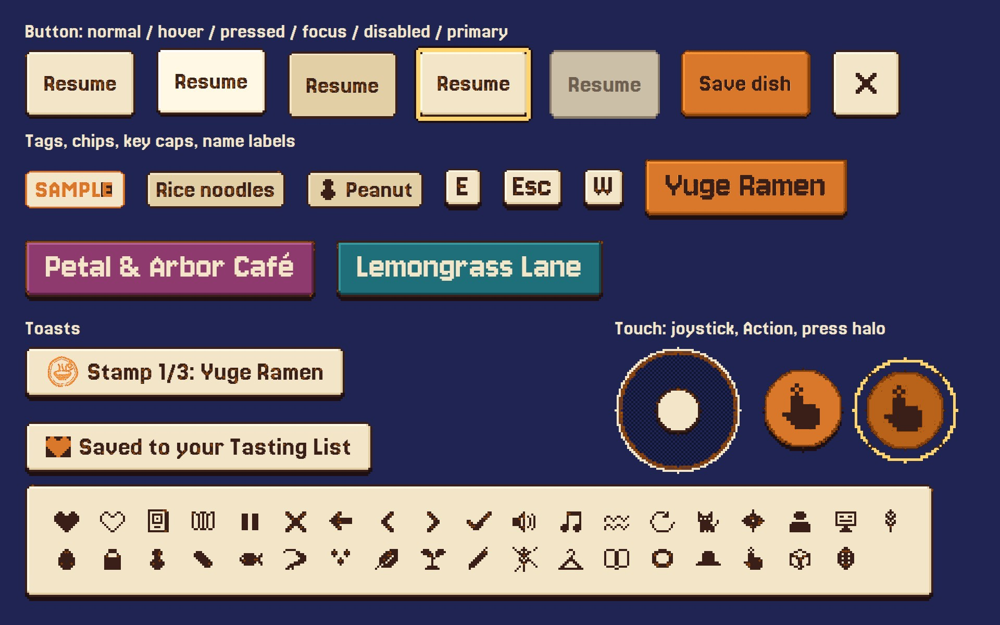
| Component | Normal | Hover (desktop only, delight only) | Pressed | Focus (keyboard) | Disabled | Selected |
| --- | --- | --- | --- | --- | --- | --- |
| Button | btn_normal | btn_hover + body lifts 4 (moves −4 y) + flap sway: rotate −1.5°→+1°→0 about top-centre over 360 ms | btn_pressed, body +4 y, 60 ms | focus_ring around, gold | btn_disabled, text #6e5f50, no input | — |
| Primary | btn_primary | btn_primary_hover + same lift/sway | btn_primary_pressed | focus_ring | n/a | — |
| Dish row | panel_cloth | lift −8 and rotate −0.6° (a curtain flutter), 160 ms ease-out | +4 y | focus_ring around row | — | heart icon at right if saved |
| Swatch / tab | btn_normal | as button | as button | focus_ring | — | tab_selected_mark backing + ink check tile (56×56, at −28,−28 from top-right) |
| Toggle (Sound/Music/Reduced motion) | button with live value "On"/"Off" right-aligned in ink-soft | | press flips value | focus_ring | — | |

Motion (all on unscaled time; nothing blocks input):
- Overlay open: rail drops from y−48 to 40 and panel unrolls (scale-y 0.9→1 from the top, alpha 0→1) 180 ms ease-out; scrim fades 120 ms. Close: reverse 140 ms. Input goes to the overlay from frame 1.
- Header flaps sway once on open (±1°, 400 ms) — delight only.
- Toast: slide down 24 + fade in 160 ms, hold 2.5 s, fade 200 ms. Max 2 visible; a 3rd queues; a new one pushes the oldest out early (min 0.8 s shown).
- Name label/prompt: fade + rise 8 over 120 ms when in reach; out 100 ms. Action ring (press_halo) pulses scale 1.0↔1.06 at 1.2 s while an interaction is available.
- Stamp earned: stamp scales 1.4→1 with a 2-frame shake (−3°/+3°) 220 ms, then toast.
- Finale: title flaps drop 300 ms, stamps land one by one 150 ms apart, lanterns (icon_lantern, gold) drift up 40 units/s, 6 max.
- Hold-to-hover never carries information: everything shown on hover is also in normal state.
- **Reduced motion (Pause toggle):** no sway, flutter, shake, drift or pulse; overlays and toasts cross-fade 120 ms; Action ring is a static ring; lanterns static.

UI sounds (cues for the audio set; IDs requested): `sfx-ui-open` (cloth swish, overlay open), `sfx-ui-close` (soft swish), `sfx-ui-move` (wooden tick, focus move), `sfx-ui-press` (soft knock), `sfx-ui-save` (small bell), `sfx-ui-unsave` (muted tick), `sfx-ui-stamp` (rubber stamp thunk), `sfx-ui-find` (sparkle chime), `sfx-ui-toast` (none; toasts use the event's own sound), `sfx-ui-finale` (lantern chime phrase). The first press on the title card is the first sound (start ambience + `sfx-ui-press`).

### HUD (explore) — changed — targets `ui-hud-v2-crowded-desktop`, `ui-hud-v2-crowded-phone`, `ui-hud-v2-4x3`, `ui-hud-v2-21x9`
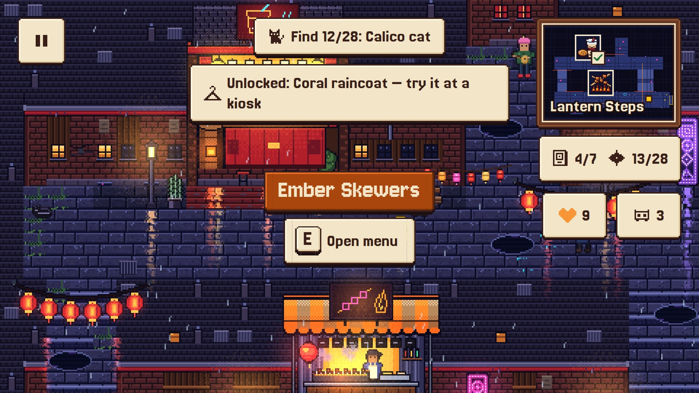
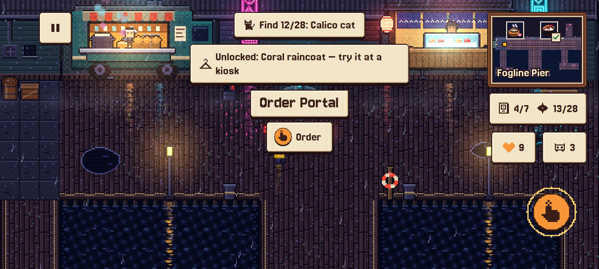
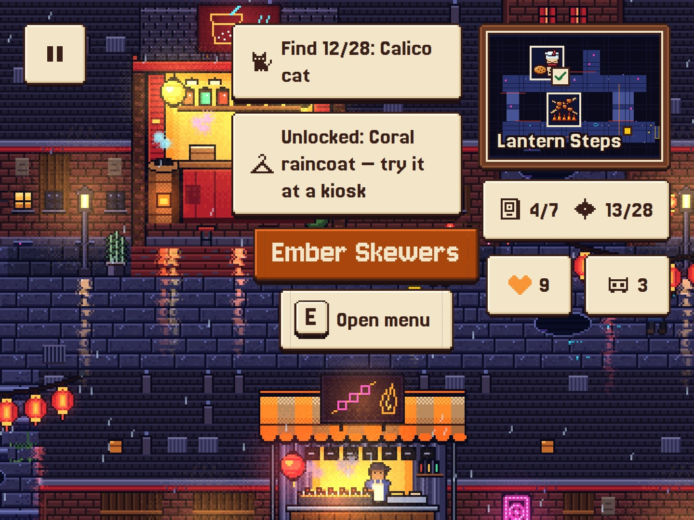 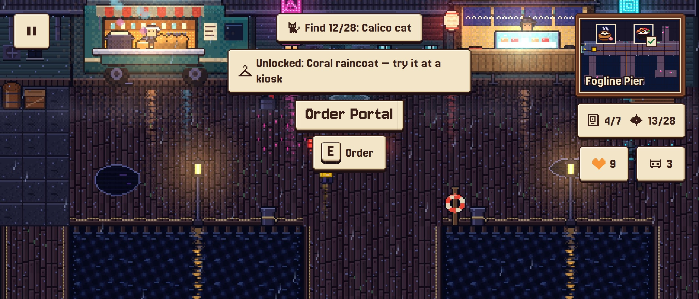

Anchors are to the safe region. Play focus = the middle ~60% of the screen, clear of all HUD.
| Element | Anchor | Position / size | Content |
| --- | --- | --- | --- |
| Pause button | top-left | (safeL, safeT), 132×132 | icon_pause. Esc / P also pause |
| Minimap | top-right | right safeR, top safeT, 400×308 frame, map 352×256 inset 24 | the **current district's** tilemap at 8.8 units/tile (40×28 → 352×246; D1 keeps the slice scale), that district's restaurant pins (72, emblem 64, visited check 40), player 20×20 yellow; district name bottom-left inside the map (left 40, top 220), Jersey 20 48 cream with the TMP outline material. Click/tap or M opens the Market Map on the current district's tab |
| Passport counter | top-right | right safeR, top safeT+324, auto width (≈380), 132 tall | icon_passport + live "4/7" (stamps) + 16 gap + icon_charm + live "13/28" (finds). One target: opens the Passport on the current district's page. Tab also opens it |
| Tasting List button | top-right | right safeR−204, top safeT+480, 180×132 | orange icon_heart (ink outline) + live count "9" |
| Tray button | top-right | right safeR, top safeT+480, 180×132 | icon_tray + live line count "3" (the badge). Hidden while the tray is empty (the heart button then moves right to safeR). O opens the tray |
| Toasts | top-centre | top safeT, stack gap 16, width ≤ min(880, 2×(minimapLeft − 32 − W/2)) | panel_cloth, 104 min, icon 48 + text 48, wraps (3 lines at 4:3) |
| Name label + prompt (world) | world | slice rules (clamped below the toast stack) | flap in the restaurant's dye; cream for everything else |
| Joystick / Action (touch) | slice | unchanged | |

New interact verbs (exact): Order Portal "Order"; signpost "Look" (label = district it leads to: "To Lantern Steps", "To Fogline Pier", "To Rain Alley"); wish board "Hang a wish"; message bottle "Read the note"; bench "Sit". New name labels: "Pearl & Pepper", "Ember Skewers", "Tideline Chowder", "Kaigan Chirashi", "Order Portal", "Calico cat", "Black cat", "Ginger cat", "Smoky cat", "Auntie Mei", "Jun", "Captain Ola", "Pip", "Holo ad", "Wish board", "Message in a bottle", "Puddle", "Bench". The minimap and HUD hide while an overlay is open (as in the slice); during district travel the whole HUD fades with the scene.

### District title card — new — target `ui-district-card`
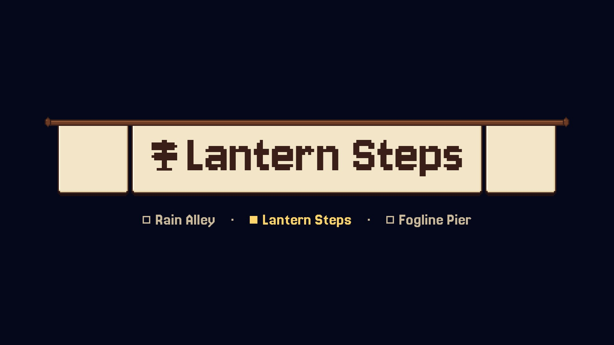
Shown 1.2 s over the night-ink fade during travel (input locked). Centred: wood rail + 3 cream flaps (1:6:1, width 1560, height 240): icon_signpost ×2 (96) + district name (Jersey 10 176, ink, single line). 48 below: the position row "Rain Alley · Lantern Steps · Fogline Pier" (Jersey 20 52); current district gold #ffd56b with a filled 24 square, others #c9b89a with an outline square. Motion: flaps drop 24 → 0 and fade in 160 ms, hold, fade out 160 ms (reduced motion: fade only). First visit to D2/D3 then toasts "New district: Lantern Steps" / "New district: Fogline Pier" (icon_signpost) after the fade-in.

### Toasts (exact copy, 2.5 s)
- "Stamp 1/7: Yuge Ramen" (stamp art 64 instead of icon; n/7 and restaurant name live)
- "Find 4/28: Black cat" (icon_cat) / "Find 5/28: Koi charm" / "Find 5/28: Crescent moon charm" / "Find 5/28: Star lantern charm" (icon_charm) / "Find 6/28: Chat with Grandma Suzu" (icon_person) / "Find 7/28: Holo ad scanned" (icon_holo); n/28 is live
- "Saved to your Tasting List" (orange heart) / "Removed from your Tasting List" (heart outline)
- "A fizzy yuzu soda. Refreshing!" (icon_charm)
- "New look: Teal raincoat" / "New look: Bucket hat"
- Bench: no toast; a cream panel line at bottom-centre "Listening to the rain…" with "Move to stand up" (desktop) / "Touch the joystick to stand up" (touch).

Full-game toast copy (exact; n and names live; same 2.5 s, max 2 visible rule):
- "Stamp 4/7: Pearl & Pepper" (stamp art 64). Totals are now /7.
- "Find 12/28: Calico cat" (icon_cat) — labels per find: cats "Black cat" / "Calico cat" / "Ginger cat" / "Smoky cat"; charms "Koi charm", "Crescent moon charm", "Star lantern charm", "Jade coin charm", "Peach blossom charm", "Seashell charm", "Anchor charm" (icon_charm); people "Chat with Grandma Suzu" / "Chat with Auntie Mei" / "Chat with Jun" / "Chat with Captain Ola" / "Chat with Pip" (icon_person); "Holo ad scanned" (icon_holo); "Wish hung on the lantern board" (icon_lantern); "Note from the bottle read" (icon_charm).
- "Unlocked: Mint raincoat — try it at a kiosk" / "Unlocked: Cat beanie — try it at a kiosk" / Coral raincoat / Sou'wester / Midnight raincoat / Peach raincoat (icon_hanger; queued right after the find toast; `sfx-unlock`).
- "New look: Mint raincoat" / "New look: Cat beanie" (choice applied).
- "Find 20 to unlock Midnight" (icon_padlock) when a locked swatch is pressed (with `sfx-code-bad`; nothing changes).
- "Added to your order" (icon_tray) / "Your tray is full (6 dishes)" (icon_tray, `sfx-code-bad`) / "Removed from your order" (icon_tray).
- "Your order is ready at the portal table" (icon_bell) 8 s after placing.
- "Welcome back!" (icon_code) after a good code; "New district: Lantern Steps" / "New district: Fogline Pier" (icon_signpost).

### Restaurant menu — targets `ui-menu-list-desktop`, `ui-menu-list-phone`
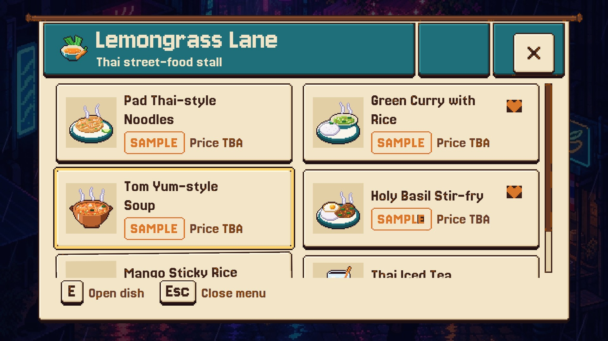 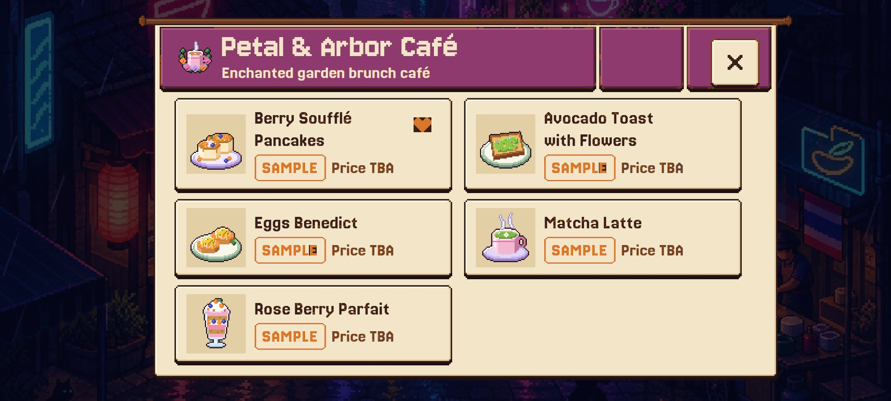
Scrim night-ink 72% (Unity Image alpha 0.94, see Unity note). Panel per layout rules. Header: 3 flaps in the restaurant dye (6:1:1 widths, 8 gaps, height 176, overlapping the panel top by 8): emblem 96 + H1 restaurant name (Jersey 10 96, cream) + cuisine line from data (Jersey 20 48, cream). Close button 132×132 top-right inside the header (right 24, top 24).
- List: 2 columns, gap 16×32, rows min 208 tall and grow to fit (art and text centred vertically): art plate 160×160 cloth-shade with dish ×3 (144); text column (name + meta) keeps 96 right padding reserved for the heart, so names never run under it; name (52, ink, wraps to 2 lines max); meta row: tag "SAMPLE" + "Price TBA" (ink-soft); orange heart 48 at top-right (right 32, top 24) when saved. The list is a scroll region (RectMask2D, top 184 visible, bottom above the footer on desktop / 8 above the panel edge on touch, 32 inner padding so focus rings and hover lift are not clipped; right 72): when rows overflow, a 24-wide scrollbar (track cloth-shade with 4 ink border at right 32, thumb rail-wood) appears and focus scrolls the row into view. Narrow: art plate 112 with ×2 art, name 48.
- Footer (desktop only), bottom 24, ink-soft: [E] "Open dish"   [Esc] "Close menu". Touch: none (rows are tapped).
- Copy from `fixtures/restaurants.json`: name, cuisine, dish name, `price` ("Price TBA"), SAMPLE tag when `sample` true.
- Focus order: dish rows in reading order (left→right, top→bottom), then Close. Arrows/WASD move focus in the grid; E/Space/Enter opens; Esc closes the menu. Default focus: first dish. Back/Esc on the list closes to the world. First open of a restaurant awards the stamp: toast + `sfx-ui-stamp` play when the menu opens.

Full-game change: the header's second line is "<cuisine> · <district>" (e.g. "Night-market tea and buns · Lantern Steps"), Jersey 20 48, single line; the main flap is wide enough at every size (checked). Flaps use the restaurant's dye (table above). Everything else in the list is the slice's.

### Dish detail — changed — targets `ui-dish-detail-v2-desktop`, `ui-dish-detail-v2-phone`, `ui-dish-detail-v2-4x3`
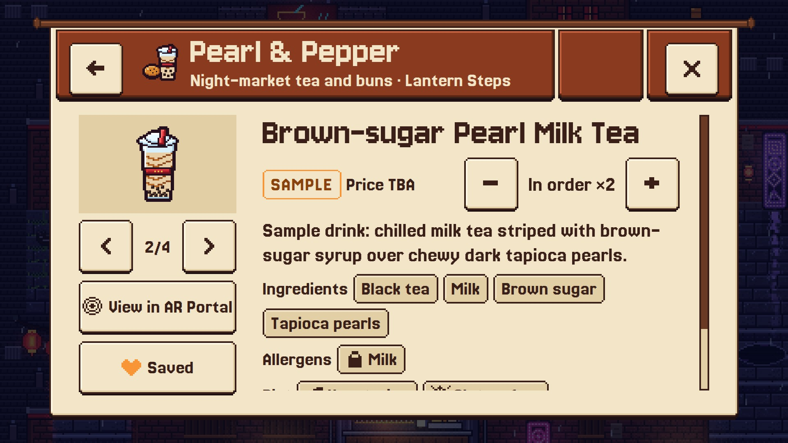
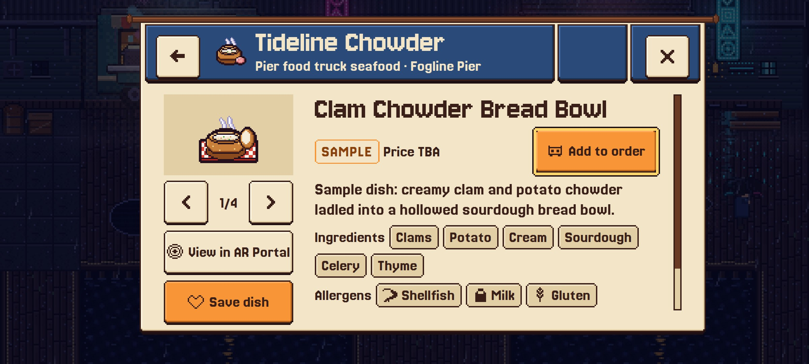
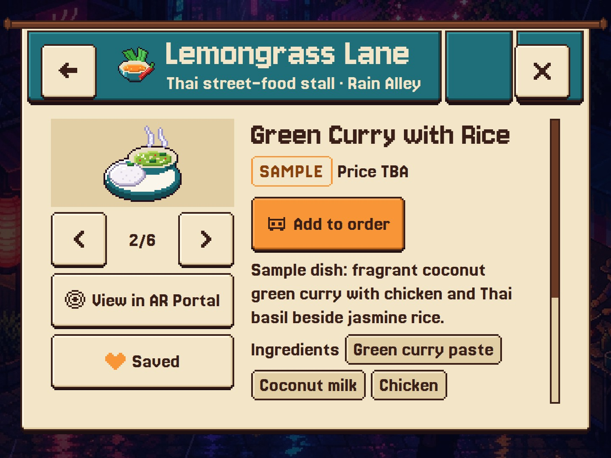

Same panel and header as the slice (Back 132 at 24,24; header text from 184; header line 2 "<cuisine> · <district>"). Body (48, 200) → (W−48, panel bottom −40): left column 384 (narrow **432**, changed from 320 so "View in AR Portal" fits), gap 64 (narrow 40).
- Left (top to bottom, gap 16, narrow 12): art plate 384×240 (narrow 432×208) cloth-shade with dish ×4 (192); Prev / live "2/4" / Next row (132 buttons at the column ends, counter centred, 48); **"View in AR Portal"** (cream button, icon_portal, full column width, 132) — replaces the slice's "3D / XR view: not linked yet" note, which is removed; Save as in the slice (unsaved primary orange "Save dish" + heart_outline; saved cream "Saved" + orange heart).
- Right (gap 16, narrow 12): dish name (Jersey 10 96, narrow 80); **meta row**: "SAMPLE" tag + "Price TBA" (single line) + the order control right-aligned on the same row (narrow: the control wraps to its own row under the tag): **"Add to order"** (primary orange, icon_tray) when the dish is not in the tray; when it is: [−] "In order ×2" [+] (two 132 buttons, live text Jersey 20 52 between, gap 24; + disabled at ×3; − at ×1 removes the line and returns to "Add to order"). Then description, Ingredients, Allergens, Diet as in the slice. The right column is a scroll region (RectMask2D, 24-wide scrollbar at its right edge, 28 inner padding so focus rings aren't clipped) whenever its content is taller than the body — with the order row added this happens for most dishes at 1920 (target shows it).
- Add when the tray already has 6 different dishes: toast "Your tray is full (6 dishes)", `sfx-code-bad`, nothing changes.
- Keys: V opens the AR Portal; ←/→ step dishes; Esc/Back returns to the list with that dish focused.
- Focus order: Save → View in AR Portal → Add to order (or − / +) → Next → Previous → Back → Close. Default focus: Add to order (or + when in the tray). Up/down move within the left column; right moves to the order control.

### AR Portal — new — targets `ui-ar-portal-desktop`, `ui-ar-portal-phone`
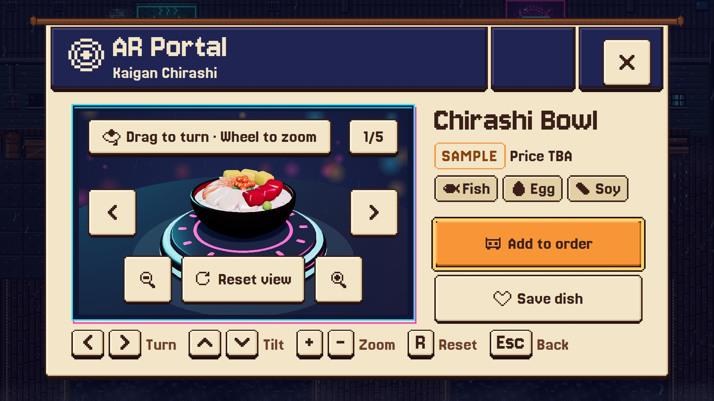
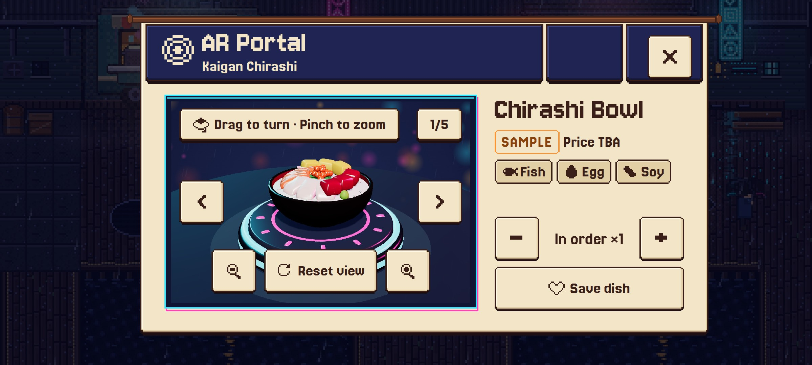

Overlay `ArPortal`, opened from dish detail (button or V) on top of it (the detail stays underneath; the scrim is the menu's). The 3D view in the targets is the stand-in render `references/ar-portal-dish-hero.jpg`; the build shows the RenderTexture.
- Panel: standard rail-hung panel (width per layout rule, 968 tall; phones 937). Header in the restaurant's dye: icon_portal ×2 (96, cream) + "AR Portal" (H1) + restaurant name (line 2, 48). Close 132 top-right (Esc/Backspace = back to dish detail; there is no separate Back).
- **View window** (left): left 48, top 200, right edge = panel right − 48 − infoW − 48, bottom = panel bottom − 120 (desktop, leaves the key footer) / − 40 (touch). Frame: `panel_holo` nine-slice (20,24,20,20). Inside, the RawImage fills the frame's inner rect (RenderTexture sized to that rect × the screen scale, max 1600×1000). On the view:
  - Hint plate top-left (24, 20): panel_cloth, min height 96, icon_orbit + "Drag to turn · Wheel to zoom" (desktop) / "Drag to turn · Pinch to zoom" (touch), ink 48. Fades out 4 s after the first drag; returns when the portal reopens.
  - Counter plate top-right (right 24, top 20): live "1/5" (dish index in the restaurant), ink 48.
  - Prev / Next: 132 buttons (icon_chev_left/right) at the window's left/right edges (24 inset), vertically centred. Wrap within the restaurant.
  - Zoom row bottom-centre (bottom 28): [icon_zoom_out 132] ["Reset view" + icon_reset] [icon_zoom_in 132], gap 24.
  - Drag anywhere on the view that is not a button orbits; the drag threshold is 6 px; a press under 6 px on a button is a click.
- **Info column** (right): width infoW = 560 (narrow 480), gap 16: dish name (Jersey 10 96, narrow 80, wraps to 2 lines); "SAMPLE" tag + "Price TBA"; allergen chips (icon + label, as detail; "None listed" when empty) — no "Allergens" label here; flexible space; "Add to order" (primary, icon_tray, full width) or [−] "In order ×n" [+]; "Save dish" / "Saved" (full width, same states as detail).
- Footer (desktop only, bottom 24, left 48, right infoW + 96, gap 32, ink-soft 48): [◀][▶] "Turn"  [▲][▼] "Tilt"  [+][−] "Zoom"  [R] "Reset"  [Esc] "Back" (arrow caps are icon_chev_right rotated).
- Motion: open = portal ring scale 0.6→1 + alpha 0→1 over 350 ms (ease-out) on the view; panel unrolls as any overlay; `sfx-portal-open`. Reduced motion: 150 ms fade, no auto-turn, no shimmer. Model auto-turns at 20°/s; stops on drag, resumes 3 s after release.
- Focus order: Add to order (default) → Save → Reset view → Zoom out → Zoom in → Previous → Next → Close. Keys work regardless of focus: ←/→ yaw 45° (0.25 s ease), ↑/↓ pitch 10°, +/− zoom, R reset, Esc back.

### Order Tray — new — targets `ui-order-tray`, `ui-order-tray-empty`
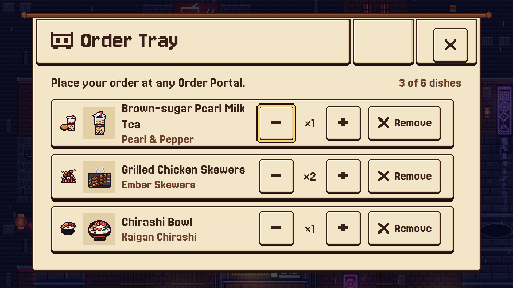 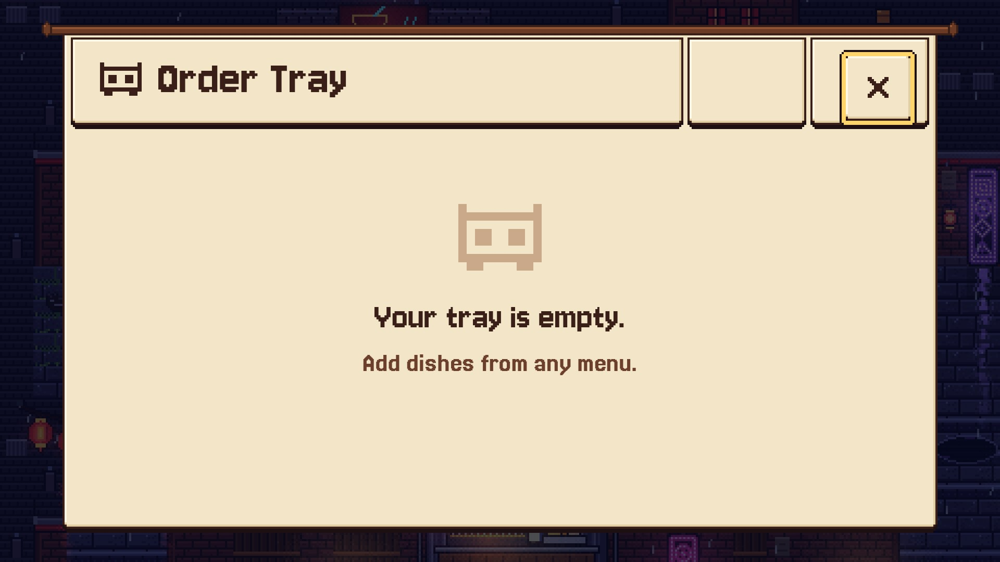
Overlay `OrderTray` from the HUD tray button or O (works in every district; not from inside another overlay). Header cream: icon_tray ×2 + "Order Tray"; Close.
- Body top row: "Place your order at any Order Portal." (52) left; live "3 of 6 dishes" (ink-soft 48) right.
- List (scroll region from body top + 92 to body bottom, RectMask2D, 28 inner padding, 24-wide scrollbar when > 3–4 rows): one panel_cloth row per line, min height 180, gap 16: emblem 64; art plate 120 with dish ×2 (96); text column: dish name (52, wraps to 2) + restaurant name (ink-soft 48); qty control [− 132] live "×2" (52, min width 72) [+ 132] (gap 24; + disabled at ×3; − at ×1 removes the line); "Remove" button (icon_close + "Remove", 132 tall).
- Lines keep the order they were added. Max 6 lines.
- Empty (exact): icon_tray 192 (#c9a98a, decorative), "Your tray is empty." (H2), "Add dishes from any menu." (ink-soft). Focus → Close.
- Focus order: first line's − (default) → + → Remove → next line … → Close. Up/down move between lines keeping the column. Esc/O closes.

### Order Portal — new — targets `ui-order-portal-order`, `ui-order-portal-confirm`, `ui-order-portal-wardrobe`
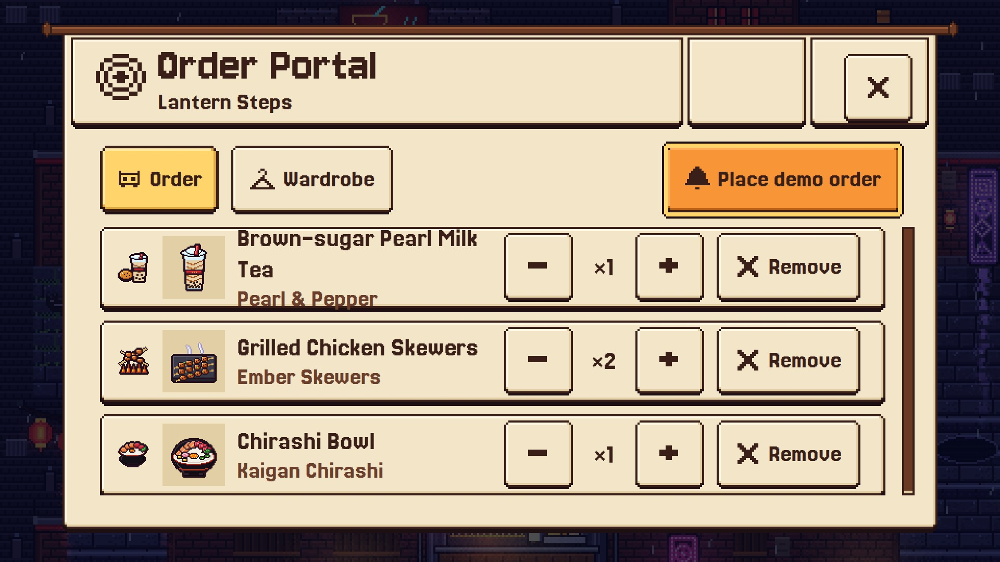
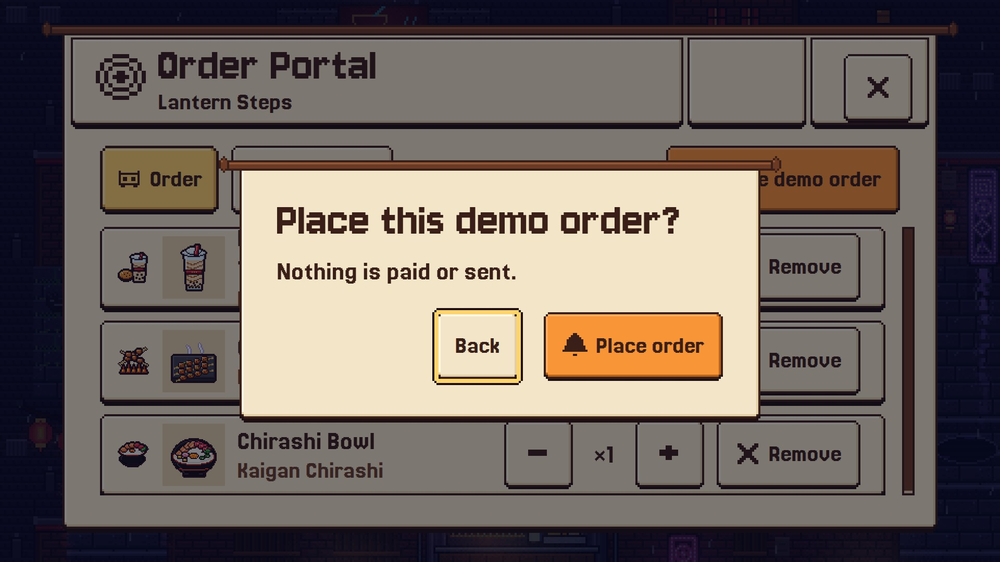
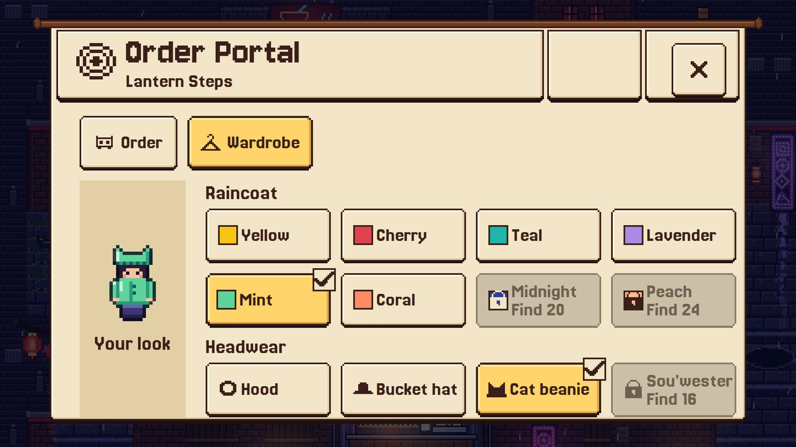
Overlay `OrderPortal` from the world object (verb "Order"). Header cream: icon_portal ×2 + "Order Portal" + district name (line 2); Close.
- Row at body top: tabs "Order" (icon_tray) and "Wardrobe" (icon_hanger), gap 24, selected = gold backing; right-aligned on the same row: primary **"Place demo order"** (icon_bell); disabled (btn_disabled) when the tray is empty, and the list then shows the tray's empty state.
- Order tab list: the Order Tray rows (min height 164 here), scroll region from body top + 128 to body bottom. Q/E or ←/→ on the tab row switches tabs.
- Confirm (modal, scrim 50% over the portal, panel width min(1000, W−96), top 300, height fits content, padding 40/48): "Place this demo order?" (H1) / "Nothing is paid or sent." (52) / buttons right-aligned, gap 48: "Back" (default focus) and primary "Place order" (icon_bell). Esc = Back.
- Wardrobe tab: identical to the kiosk wardrobe below (same grid, locks, toasts), so outfits can change in every district.
- Focus order: Order tab → Wardrobe tab → Place demo order (default when the tray has lines) → list (as the tray) → Close.

### Order ticket — new — target `ui-order-ticket`
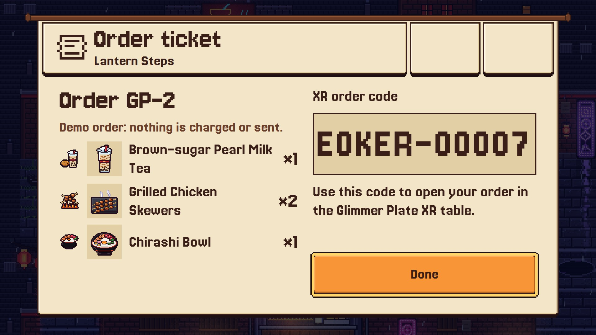
Replaces the portal panel content after "Place order" (`sfx-order-place`, chef bell). Header cream: icon_ticket ×2 + "Order ticket" + district line; no Close (Done closes; Esc = Done).
- Left column (flex): "Order GP-2" (H1; n = orders placed this save, from 1; the number keeps counting, only the passport shows "9+" and the code caps at 15); "Demo order: nothing is charged or sent." (ink-soft 48); the lines: emblem 64 + plate 112 (×2 art) + dish name (52, narrow 48) + "×n" (H2) right.
- Right column 720 (narrow 560): "XR order code" (52); code plate (cloth-shade, 4 ink border, 200 tall) with the code "XXXXX-XXXXX" in Jersey 10 144 (narrow 104), letter-spacing 8, ink; "Use this code to open your order in the Glimmer Plate XR table." (52); primary "Done" (full column width, default focus).
- The code in the target is the real encoding of the shown tray (r4-2 ×1, r5-1 ×2, r7-1 ×1 → "E0KER-00007"; trailing zeros are the padding, the last character the checksum), computed by `xrCode()` in `full.js`, which follows the binding rule.
- After Done: back to the world; 8 s later the portal table shows the holograms, toast "Your order is ready at the portal table".

### Market code — new — target `ui-market-code`
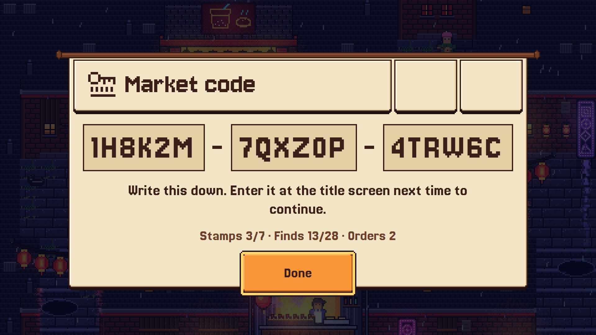
Overlay `MarketCode` from Passport, Pause or the Grand finale. Panel width min(1480, safe width), height 760, top 160 (rail 144). Header cream: icon_code ×2 + "Market code"; no Close (Done; Esc = Done).
- The code in 3 groups: each a cloth-shade plate with a 4 ink border, padding 24, text Jersey 10 120 (narrow 96), letter-spacing 8; "-" (H1) between plates, gap 24. Characters are the Crockford alphabet only, so no O/I/L/U appear.
- "Write this down. Enter it at the title screen next time to continue." (52, centred, max width 1100); live summary "Stamps 3/7 · Finds 13/28 · Orders 2" (ink-soft 48); primary "Done" (width 360, default focus).
- The code is recomputed whenever the overlay opens (always the current progress). The code in the target is illustrative.

### Tasting List — targets `ui-tasting-list`, `ui-tasting-empty`
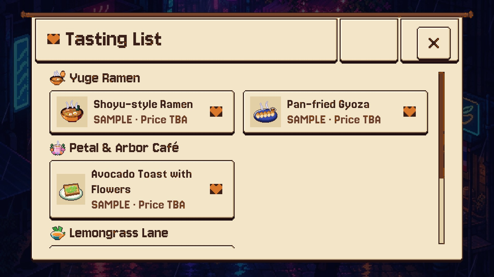 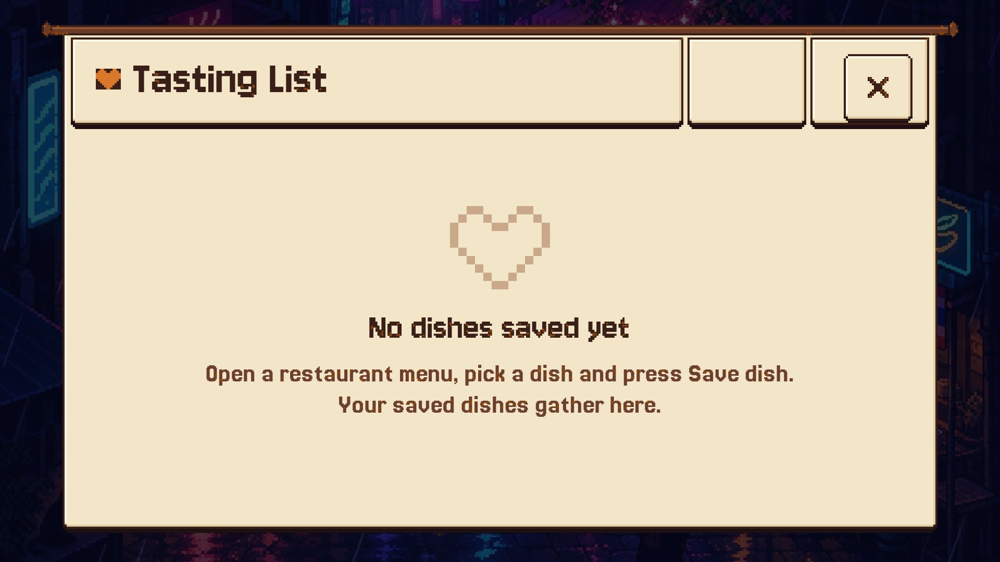
Header cream flaps: orange heart + "Tasting List"; Close. Body (top 192, scroll region with RectMask2D, right edge 112) groups by restaurant in market order: group head = emblem 64 + restaurant name (Jersey 10 64); rows 2 columns, min height 160: art plate 120 (×2 art), dish name (52, wraps), "SAMPLE · Price TBA" (ink-soft), orange heart. Scrollbar: 24-wide track cloth-shade with 4 ink border at right 48, thumb rail-wood; mouse wheel, drag, arrow focus scroll it. Selecting a row opens Dish detail (Back returns here).
Empty state (exact): icon heart_outline 192 (#c9a98a, decorative); "No dishes saved yet" (H2); "Open a restaurant menu, pick a dish and press Save dish." / "Your saved dishes gather here." Focus: rows in order, then Close; empty → Close.

### Passport — changed — targets `ui-passport-districts`, `ui-passport-districts-d2`
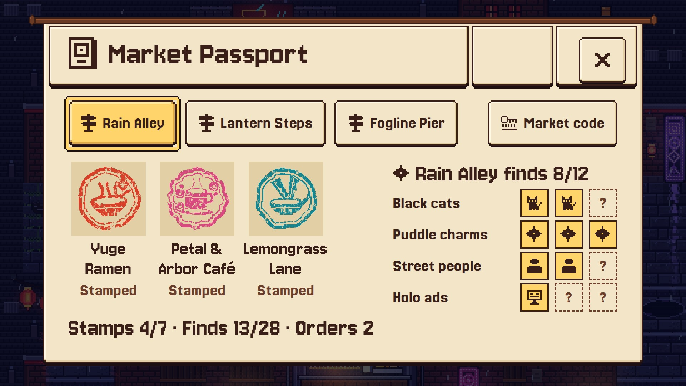 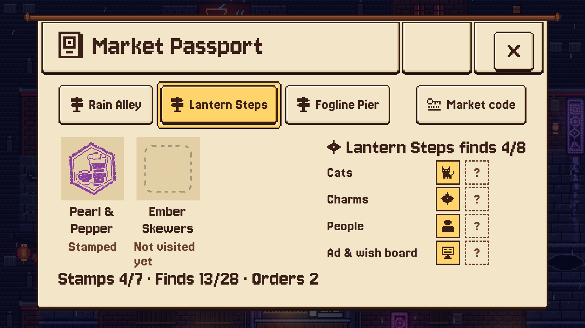
Header cream: icon_passport + "Market Passport"; Close. Esc/Tab closes.
- Row at body top: district tabs "Rain Alley", "Lantern Steps", "Fogline Pier" (icon_signpost, gap 24; selected = gold backing; opens on the current district) and, right-aligned, "Market code" (icon_code; opens the Market code overlay, Done returns here). Narrow: "Market code" moves to the bottom row's right end.
- Page, left (top 172): the district's restaurant stamps in a row, gap 24: pad 208×208 cloth-shade with the stamp ×3 (192; stamped rotate −3°, 2°, −1°) or `stamp-empty-*`; name (Jersey 10 56, wraps to 2, width 224); "Stamped" / "Not visited yet" (ink-soft 48).
- Page, right (top 172, right-aligned, gap 8): icon_charm + "<District> finds n/m" (H2), then 4 rows: label (48, width 340, narrow 300) + slots 80×80 (found = gold fill, 4 ink border, category icon; not found = 4 dashed ink-soft border + "?"). Rows: Rain Alley "Black cats" 3, "Puddle charms" 3, "Street people" 3, "Holo ads" 3; Lantern Steps "Cats" 2, "Charms" 2, "People" 2, "Ad & wish board" 2 (holo icon, lantern icon); Fogline Pier "Cats" 2, "Charms" 2, "People" 2, "Ad & bottle" 2 (holo icon, charm icon).
- Bottom row (68 tall; narrow 132 with the button): live totals "Stamps n/7 · Finds n/28 · Orders n" (H2; narrow 52); orders show "9+" above 9.
- Focus: tabs (default = current district) → Market code → Close; Q/E or ←/→ on the tab row switch pages.

### Market Map — changed — targets `ui-map-districts`, `ui-map-districts-d1`
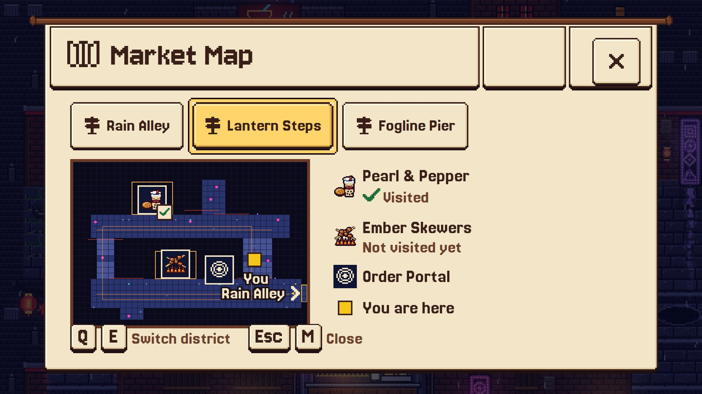 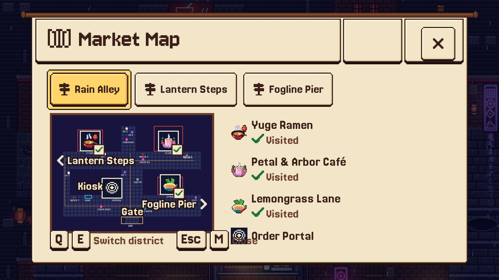
Header cream: icon_map + "Market Map"; Close. Esc/M closes.
- Tabs at body top: "Rain Alley", "Lantern Steps", "Fogline Pier" (icon_signpost), current district selected and focused on open.
- Map box at body (0, 156) with an 8 wood border: the tab's tilemap at 16 units/tile for D2/D3 (40×28 → 640×448) and 14 for D1 (44×32 → 616×448); narrow 12/tile. Pins 80 (navy, 4 cream border, emblem 64) at storefront pivots (bottom-centre at the pivot), visited = cream 44 check tile at the pin's bottom-right; Order Portal pin = same pin with icon_portal (cream); exit labels at the map edge where the exit is: "‹ Lantern Steps", "Fogline Pier ›", "Rain Alley ›"/"‹ Rain Alley" (Jersey 20 48 cream, TMP outline, chevron icons); D1 keeps "Kiosk" and "Gate" labels; player marker 40 yellow + "You" only on the current district's tab.
- Legend right of the map (left = map width + 80, top 172, gap 24): each of the district's restaurants: emblem 64 + name (52) + "Visited" (green check) / "Not visited yet"; "Order Portal" (portal pin glyph); "You are here" (current tab only).
- Footer (desktop): [Q][E] "Switch district"   [Esc][M] "Close".
- Focus: tab row (←/→ or Q/E switch) → Close.

### Kiosk — targets `ui-market-guide` (slice; its Wardrobe paragraph is superseded by "Wardrobe" below)
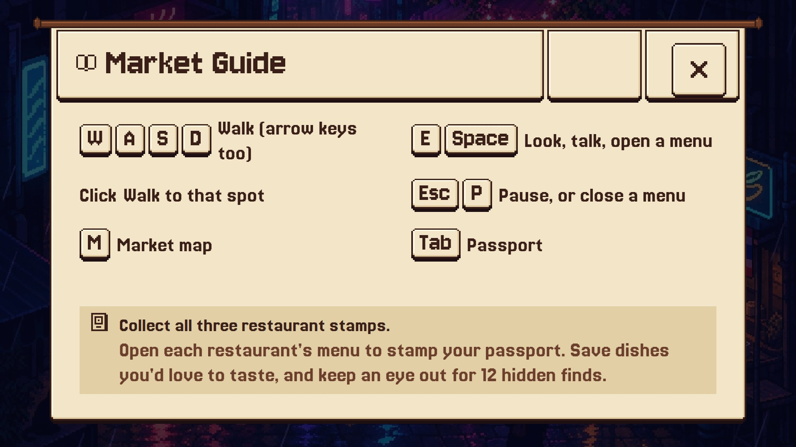 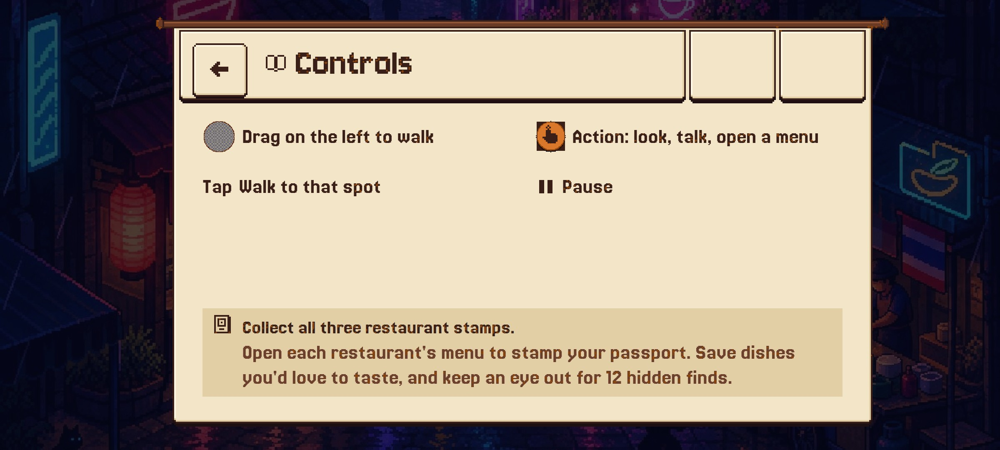
Header cream: icon_lantern + "Glimmer Plate Kiosk"; Close. Tabs (top 184, gap 24): "Wardrobe" (icon_hanger), "Market Guide" (icon_book), "Passport" (icon_passport; opens the Passport overlay, Back returns to the kiosk). Selected tab uses the gold backing.
Wardrobe: stage 320×540 at (48,340), player sprite frame 0 ×8 (scaled 1.5 on top of ×8 in the mockup = ×12, 192×288 bottom-centred) + "Your look". Options at left 416: "Raincoat" then 2×2 swatches 340×132 (64 colour square with 4 ink border + name): "Yellow" #f5c518, "Cherry" #e0414f, "Teal" #1fb5a8, "Lavender" #a98be6 (each the main coat colour of the delivered player sprites); "Headwear" then "Hood", "Bucket hat" (icons). Selected = gold backing + check tile. A choice applies immediately (preview + world), toast "New look: …". Focus: tabs → swatches (grid) → headwear → Close. Default: the current raincoat.
Market Guide (same as Pause → Controls, which has Back instead of Close). **Full-game copy; it governs.** `ui-market-guide` and `ui-controls-phone` are layout authority only (2-column rows, keycaps left, goal box at the bottom); their slice copy is superseded by this list. The rows scroll inside the panel (scroll region with the slice scrollbar) when they exceed it. Keyboard rows: [W][A][S][D] "Walk (arrow keys too)"; [E][Space] "Look, talk, open a menu"; "Click" "Walk to that spot"; [Esc][P] "Pause, or close a menu"; [M] "Market map"; [Tab] "Passport"; [O] "Order tray"; [V] "View a dish in the AR Portal"; "Drag" + [←][→][↑][↓] "Turn the dish in the AR Portal"; "Wheel" + [+][−] "Zoom the dish"; [R] "Reset the dish view"; [Q][E] "Switch tabs (when the tabs are selected)". Touch rows: joystick "Drag on the left to walk"; Action "Action: look, talk, open a menu"; "Tap" "Walk to that spot"; pause icon "Pause"; icon_tray "Order tray"; icon_orbit "Drag to turn the dish, pinch to zoom". Goal box (cloth-shade, bottom 40): "Stamp all 7 restaurants across 3 districts." / "Open each menu to stamp your passport and save dishes you'd love to taste. View them in the AR Portal and place a demo order at an Order Portal. 28 hidden finds unlock new outfits. Your Market code in the Passport brings your progress back next visit."

### Wardrobe (kiosk tab and Order Portal tab) — changed — targets `ui-kiosk-wardrobe-v2`, `ui-kiosk-wardrobe-v2-4x3`, `ui-order-portal-wardrobe`
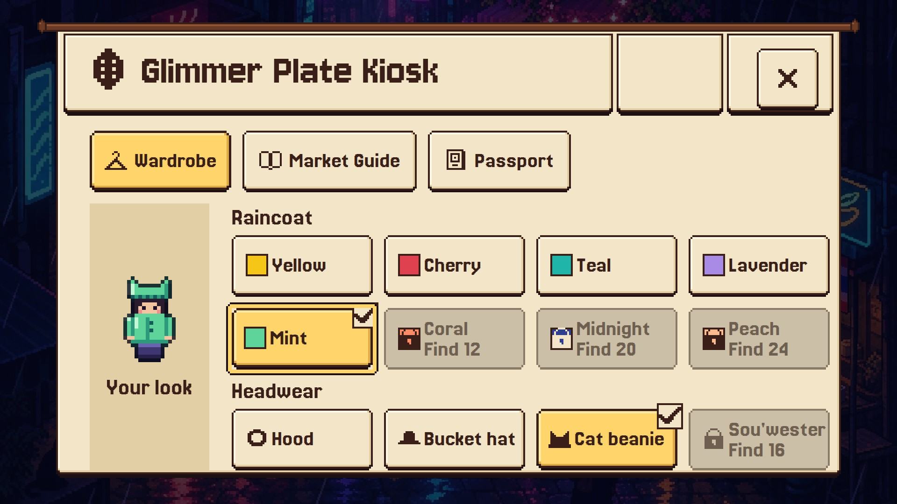 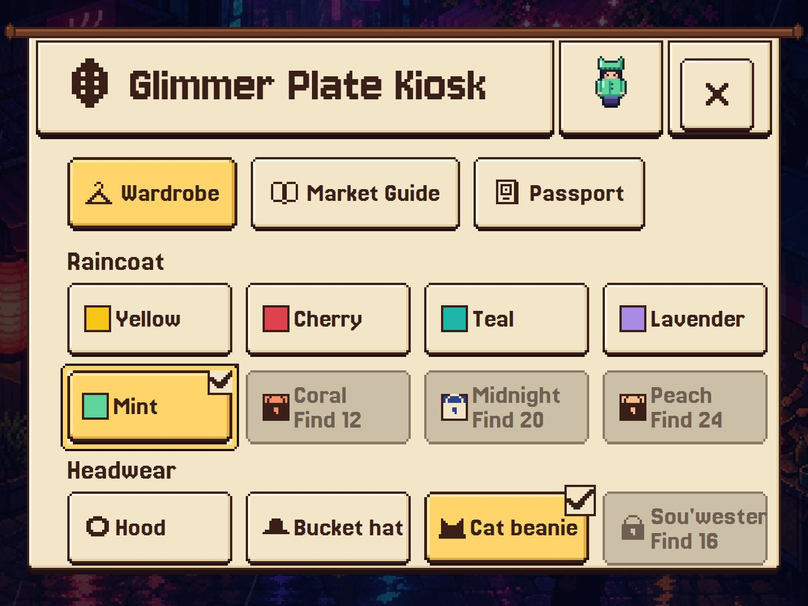
Kiosk header and tabs as the slice. Wardrobe body (below the tab row, top 156):
- Stage 256×572 cloth-shade at the left: player sprite frame 0 of `player-<colour>-<hat>.png` at ×8 (128×192), "Your look" (52). Narrow: no stage; the preview (×4, 64×96) sits in the header's second flap.
- Options from left 304 (narrow 0): "Raincoat" (52) then a 4-column grid of swatches (302 wide, narrow 294; 132 tall; gap 24): colour square 48 with 4 ink border + name. Order: Yellow, Cherry, Teal, Lavender / Mint, Coral, Midnight, Peach. "Headwear" then one row of 4: Hood, Bucket hat, Cat beanie, Sou'wester (icons hood, buckethat, catbeanie, souwester).
- Locked (finds below the threshold): `btn_disabled` skin, icon_padlock in place of (headwear) or on top of (colour square; cream padlock on Midnight, ink on the others) the swatch, two lines: name / "Find n" (#6e5f50, 48, line 44). Thresholds: Mint 4, Cat beanie 8, Coral 12, Sou'wester 16, Midnight 20, Peach 24. Pressing a locked swatch: `sfx-code-bad`, toast "Find 20 to unlock Midnight", nothing changes. (The full "Find 4 to unlock" wording does not fit a 302-wide swatch at 48; the toast carries it.)
- Selected = gold backing + check tile. Choice applies immediately; toast "New look: Mint raincoat".
- Focus: tabs → raincoat grid → headwear row → Close; default = the current raincoat. Locked swatches are focusable (so the player can learn the threshold).

### Dialogue — targets `ui-dialogue-person`, `ui-dialogue-holo`, `ui-dialogue-cat-phone`
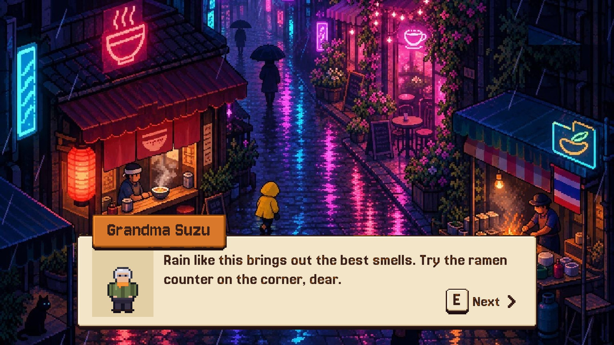 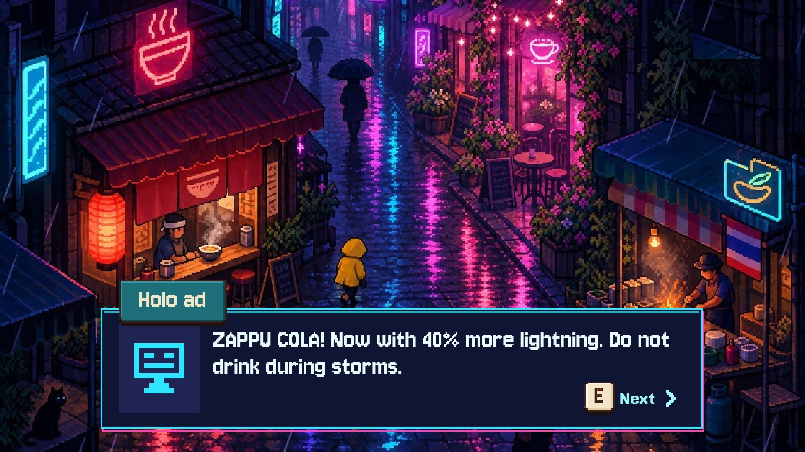 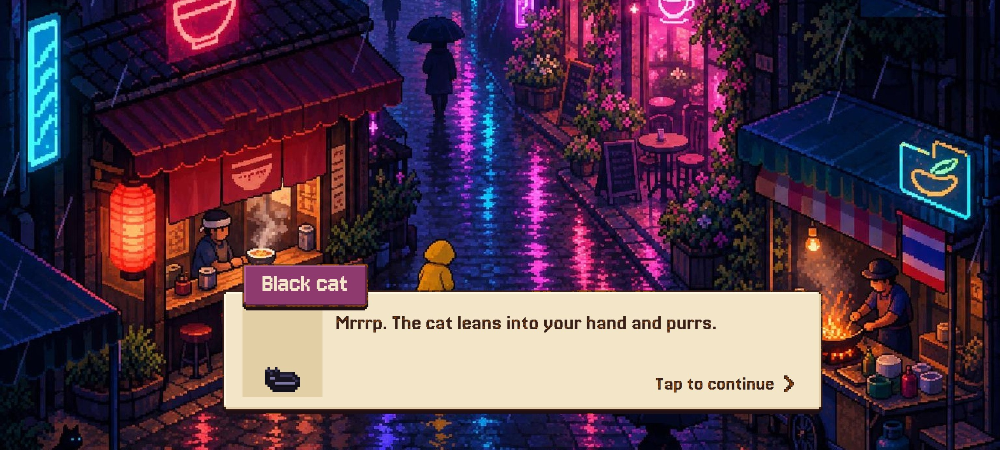
Box bottom-centre: bottom safeB, width min(1440, safe width) (phones: minus 480 so it clears the Action button), height 296, panel_cloth (holo: panel_holo). Nameplate flap at (24, −88) in a dye (person orange `flap_red` with ink text, cat plum, holo teal), Jersey 10 64. Portrait plate 192×216 (cloth-shade; holo #1f2453) with the sprite frame 0 ×6. Text 52/60 (holo: Jersey 10 64, #e9fbff), max 3 lines; typewriter 40 chars/s, a press completes the line first. Continue cue bottom-right: [E] "Next" + chevron (desktop), "Tap to continue" (touch; tap anywhere). Touch controls hide while dialogue is open. Esc closes.
Copy: Grandma Suzu: "Rain like this brings out the best smells. Try the ramen counter on the corner, dear." / "I've walked this lane for fifty years. The cats know me better than the shopkeepers." / "Save a dish or two for later. Your passport will thank you." Kenta: "Umbrellas! Umbrellas! …Oh, you've got a raincoat. Never mind." / "The puddles here show more than your face. Look closer." Rin: "This song is about soup. Every song is about soup, really." / "If you find all three stamps, the lanterns go up. Worth seeing." Holo ads: "ZAPPU COLA! Now with 40% more lightning. Do not drink during storms." / "NEKO-NET: Fast internet for cats. Humans, please wait." / "HYPER NOODLE 9000: Slurp the future. Results may vary." Cats (one line, then a heart pops over the cat): "Mrrrp. The cat leans into your hand and purrs." Puddle (no box; toast only). Brands are invented.

### District finale card — new — target `ui-district-finale`
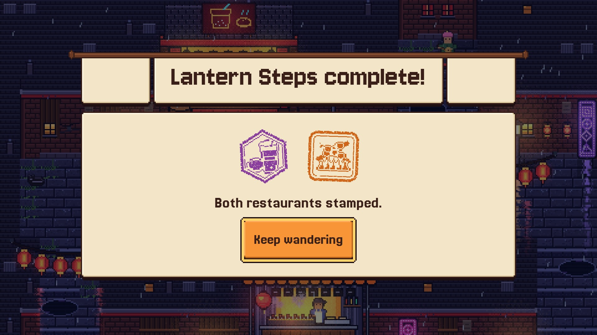
Once per district, when its last restaurant is stamped (after the stamp toast; not when that stamp also completes all 7 — then only the Grand finale shows). Scrim 50%. Rail + 3 cream flaps (1:5:1, width min(1400, W−96), top 160, 176 tall): "<District> complete!" (H1, single line) — "Rain Alley complete!", "Lantern Steps complete!", "Fogline Pier complete!". Card (panel_cloth, padding 24/48): the district's stamps ×3 (192, rotated −3°/2°/−1°), "All three restaurants stamped." (d1) / "Both restaurants stamped." (d2, d3) (52), primary "Keep wandering" (default; Esc). `sfx-ui-finale`.

### Grand finale — new (replaces the slice finale) — target `ui-grand-finale`
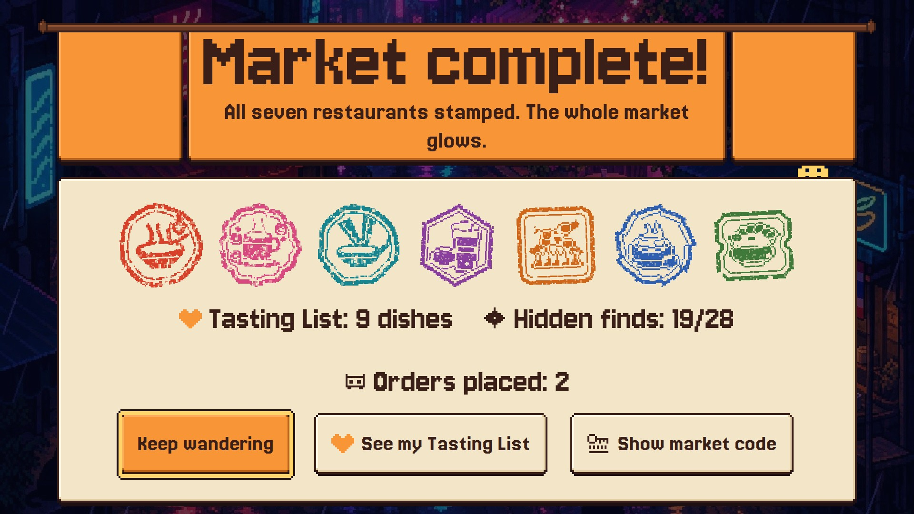
All 7 stamps, once. Scrim 60%; gold icon_lantern ×2 drifting up 40 units/s (max 6; static with reduced motion); `sfx-grand-finale`. Banner: rail + 3 orange `flap_red` flaps (1:5:1, 300 tall, width min(1680, safe width), top 40): "Market complete!" (Jersey 10 176, narrow 144, cream, one line) and "All seven restaurants stamped. The whole market glows." (52, ink). Card (top 24 below, padding 24/48, gap 24): the 7 stamps ×3 (192; narrow ×2, 128), rotated −3°…3°, gap 16; stats (Jersey 10 72): orange heart "Tasting List: 9 dishes" (singular "1 dish", zero "0 dishes"), charm "Hidden finds: 19/28", tray "Orders placed: 2"; buttons, gap 48: primary "Keep wandering" (default; Esc), "See my Tasting List" (heart), "Show market code" (icon_code). The slice's XR statement line is removed (ordering exists now).

### Pause — changed — target `ui-pause-v2`
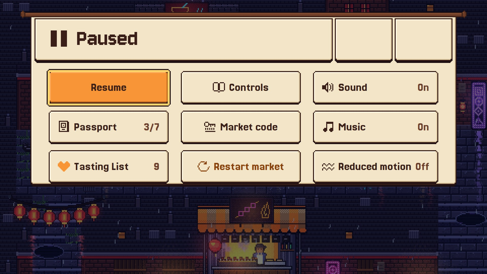
Scrim 55%. Panel width 1680 (per layout rule), height 680; header cream: icon_pause + "Paused". Three columns of 132-tall buttons (gap 48 × 24): 1 — primary "Resume" (default), "Passport" (value "3/7"), "Tasting List" (value count); 2 — "Controls", **"Market code"** (icon_code), "Restart market" (orange-deep #8a420c text and icon_restart); 3 — "Sound" On/Off, "Music" On/Off, "Reduced motion" Off/On. Narrow (4:3): 2 columns, gap 48 × 16, panel 968: left Resume, Passport, Tasting List, Controls, Market code; right Sound, Music, Reduced motion, Restart market. Focus: down each column, then the next. Restart confirm as the slice; its body line becomes "Your stamps, hidden finds, saved dishes, outfit and order tray will be cleared. Your old Market code still works."
Restart confirm (modal, scrim 50% over pause, panel width min(1000, W−96) at top 300): "Restart the market?" (H1) / "Your stamps, hidden finds, saved dishes, outfit and order tray will be cleared. Your old Market code still works." Buttons: "Keep playing" (default focus) and primary "Restart" (icon_restart). Esc = Keep playing. Restart returns to the title card. (target `ui-pause-restart-confirm` shows the slice copy; the copy here wins)

### Title card — changed — targets `ui-title-v2-desktop`, `ui-title-v2-phone`
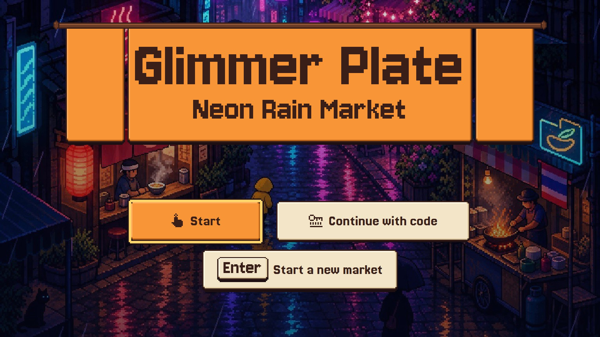 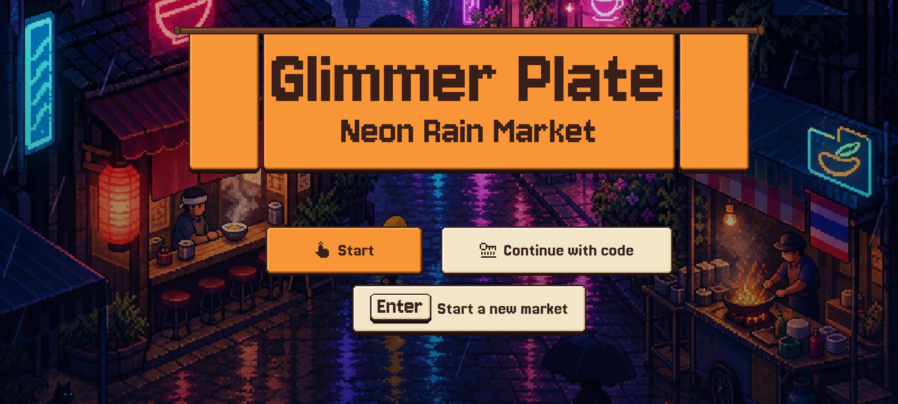
Banner, scene and scrim exactly as the slice (rail + 3 orange `flap_red` flaps 1:2.2:1, 392 tall, width min(1500, safe width), top 64; "Glimmer Plate" Jersey 10 224 ink; "Neon Rain Market" Jersey 10 112 ink — changed from cream/gold, which fail on orange). The single "Press any key" plate is replaced by two buttons, bottom-centre of the safe region (bottom safeB+96 + hint height + 24), gap 48: primary **"Start"** (icon_tap, width 420) and **"Continue with code"** (icon_code, width 620). Desktop only, below them: a panel_cloth hint plate [Enter] "Start a new market" (48). The first press of either button starts the audio. Start = the slice's enter-the-market flow (fresh progress). Continue opens Code entry. Focus: Start (default) → Continue with code; ←/→ move; Enter/E/Space press. Mouse/touch press either button directly (no "press any key" any more, so a stray key cannot skip the code choice).

### Code entry — new — targets `ui-code-entry-desktop`, `ui-code-entry-phone`, `ui-code-entry-error`, `ui-code-entry-4x3`
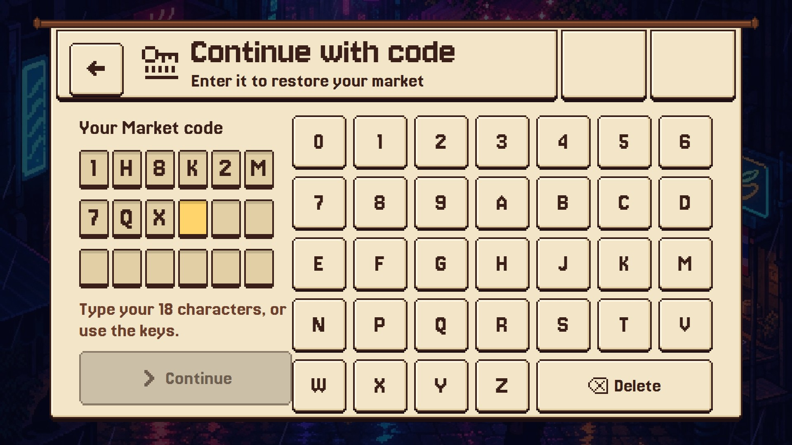
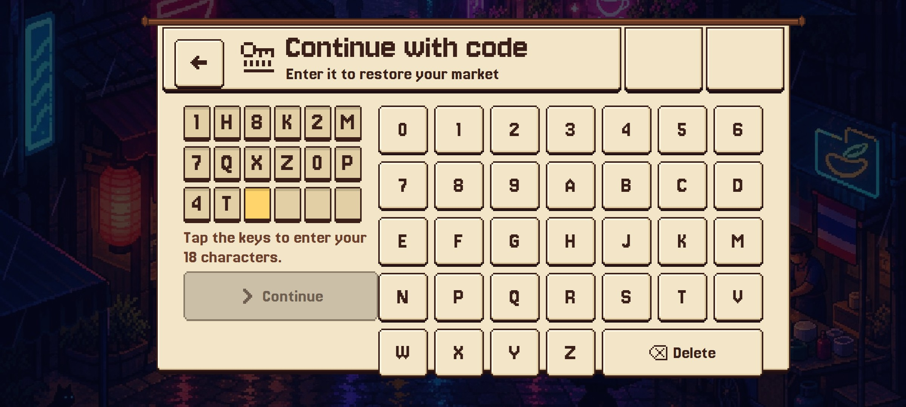
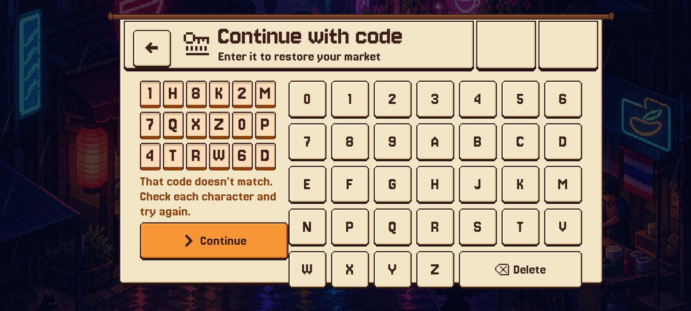
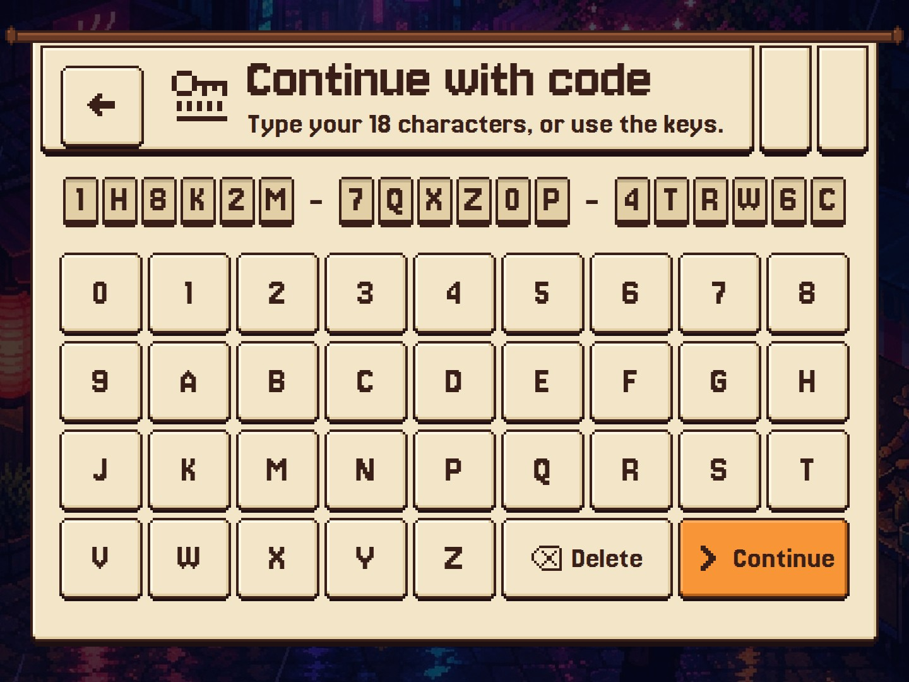
Overlay `CodeEntry` over the title scene (scrim 72%). Header cream: Back (132, top-left; returns to the title) + icon_code ×2 + "Continue with code" + line 2 "Enter it to restore your market"; no Close.
- **Wide layout** (panel ≥ 1600): left column 516 wide: "Your Market code" (52; hidden on phones) then 3 rows of 6 slots (72×96, gap 8; rows gap 24, phones 12), then the message (48/52): hint "Type your 18 characters, or use the keys." (desktop) / "Tap the keys to enter your 18 characters." (touch), ink-soft; error "That code doesn't match. Check each character and try again." in orange-deep #8a420c; then "Continue" (icon_chev_right, full column width; disabled until 18 characters, then primary). Right: keypad, 7 columns × 5 rows of 132×132 keys, gap 16, right-aligned at body top: 0–9 then A B C D E F G H J K M N P Q R S T V W X Y Z (Jersey 10 64), then "Delete" (icon_delete, spans 3 columns).
- **Narrow layout** (4:3, panel < 1600): one row of 18 slots 56×80 (gap 6, groups separated by "-" with gap 24), centred at body top; error message centred under it; the header line 2 shows the hint; keypad 9 columns × 4 rows (132 keys, gap 8), bottom of the body: the 32 characters, "Delete" (2 columns) and "Continue" (2 columns).
- Slot states: filled (cloth-shade), next (gold `code_slot_active`), error (all 18 `code_slot_error`). Typing: letters/digits; lowercase accepted; I/L → 1, O → 0, U → V; dashes/spaces ignored; Backspace deletes; Enter submits; 19th character ignored. Each key `sfx-code-key`.
- Submit: < 18 → nothing (Continue disabled). Bad checksum/version → slots shake ±12 units 0.3 s (reduced motion: no shake), error slots + message, `sfx-code-bad`; the next key press clears the error state (characters stay). Good → `sfx-code-ok`, the overlay closes, toast "Welcome back!", the player starts at the D1 gate with the saved outfit.
- Focus: wide = Back → slots row (not focusable; typing always goes to the slots) → Continue → keypad grid (default focus on "0" for gamepad/keyboard-only users; with a physical keyboard, typing works whatever has focus). Narrow = Back → keypad grid incl. Continue. Esc = Back.

### First-time hints — targets `ui-hints-desktop`, `ui-hints-phone`
 
1) After the gate walk-in: hint plate bottom-centre (bottom safeB+32; touch narrow: safeB+440) with WASD key caps "or" arrow key caps and "Walk. Or click the street to stroll there." Touch: "Drag on the left to walk, or tap the street." + joystick ghost with a "Drag here" plate above it (bottom safeB+300). Clears after 1.5 s of movement. 2) First time something is in reach: the normal prompt plus a hint plate "Press E to look inside" (desktop) / "Tap Action to look inside" (touch), cleared on first interaction or after 6 s. Pause → Controls shows them again.

### Rotate prompt — target `ui-rotate-portrait`

Portrait phones: full-screen night-ink, cream panel centred: phone outline turned sideways, "Turn your phone sideways" (H1), "The market opens in landscape." The game pauses beneath it.

### Responsive rules
- Desktop 4:3 → 21:9 (1440–2520 units wide): HUD anchors to corners; panels centred, width capped 1680; extra width is scene. Narrow mode (< 1600 panel width) switches: list art ×2 with 112 plates, detail left column 320 / art ×4, map 14 units/tile, finale stamps ×2, toast width rule above.
- Phones landscape only (16:9–20:9 → 1920–2400 units wide at 1080 tall): same layouts, safe insets applied, touch controls shown, key caps replaced by the Action disc/tap copy, desktop footers hidden. Tablets (4:3 touch) use narrow mode + touch.
- Live resize: re-layout on size change; re-dirty TMP two frames later.

Full-game additions to the responsive rules:
- Phones: overlay panel height = min(968, 1080 − 56 − safeB) = 937 so nothing sits under the home bar (checked); every new screen keeps 132 targets.
- Narrow mode (panel < 1600) additionally switches: dish detail left column 432 and the order control onto its own row; AR info column 480 and dish name 80; ticket code column 560 / code 104; Market code 96; code entry one-row slots + 9×4 keypad; wardrobe without stage (preview in the header flap) and 294 swatches; passport "Market code" button to the bottom row; pause 2 columns; map 12 units/tile; grand finale stamps ×2 and title 144.
- 21:9: panels stay capped at 1680 and centred; HUD at the corners (target `ui-hud-v2-21x9`).

### Focus and back (global)
Keyboard focus always visible (focus_ring). Arrow keys/WASD move focus spatially; E/Space/Enter activate; Esc = back one level (detail → list → world; sub-panel → parent; modal → cancel). Mouse hover never moves focus. Opening an overlay sets its default focus; closing returns focus to the world (no stray focus). Touch: tapping outside an overlay panel does nothing (no accidental close); every overlay has a 132 Close or Back button. The world receives no movement input while an overlay is open.

Full-game additions to focus and back: Esc chains — AR Portal → dish detail → list → world; confirm → Order tab; Market code → whatever opened it (Passport, Pause, Grand finale); Code entry → title. Tabs (Map, Passport, Portal, Kiosk) switch with Q/E or ←/→ while focus is on the tab row. Opening any overlay from the HUD (map, passport, tray) never happens during district travel. Keys: O tray, M map, Tab passport, V AR Portal (from detail), R reset (in the AR Portal).

### Unity notes
Scrims are solid #05071a Images: browser alpha 0.72 / 0.60 / 0.55 / 0.50 → set Image alpha 0.94 / 0.87 / 0.83 / 0.78 (raised as `1−(1−a)^2.2` for Linear blending; untested for colour alpha). All exported art is alpha 0/255 only (translucent joystick fill is a pixel dither), so no PNG alpha correction is needed. Map labels on the scene use the TMP outline material.

### Targets (references/ui/, JPEG q90, authority TARGET)
Kept from the slice (still valid, unchanged): ui-menu-list-desktop, ui-menu-list-phone, ui-tasting-list, ui-tasting-empty, ui-market-guide, ui-controls-phone, ui-dialogue-person, ui-dialogue-holo, ui-dialogue-cat-phone, ui-pause-restart-confirm (body copy changed, see Pause), ui-hints-desktop, ui-hints-phone, ui-rotate-portrait, ui-components.
Superseded by full-game targets (kept for history, not authority): ui-hud-crowded-desktop/-phone, ui-hud-4x3, ui-hud-21x9 → ui-hud-v2-*; ui-dish-detail-desktop/-phone/-4x3 → ui-dish-detail-v2-*; ui-passport → ui-passport-districts*; ui-map → ui-map-districts*; ui-kiosk-wardrobe → ui-kiosk-wardrobe-v2*; ui-finale → ui-grand-finale + ui-district-finale; ui-pause → ui-pause-v2; ui-title-desktop/-phone → ui-title-v2-*.
New (32): ui-ar-portal-desktop, ui-ar-portal-phone, ui-dish-detail-v2-desktop, ui-dish-detail-v2-phone, ui-dish-detail-v2-4x3, ui-order-tray, ui-order-tray-empty, ui-order-portal-order, ui-order-portal-confirm, ui-order-ticket, ui-order-portal-wardrobe, ui-market-code, ui-title-v2-desktop, ui-title-v2-phone, ui-code-entry-desktop, ui-code-entry-phone, ui-code-entry-error, ui-code-entry-4x3, ui-district-card, ui-map-districts, ui-map-districts-d1, ui-passport-districts, ui-passport-districts-d2, ui-kiosk-wardrobe-v2, ui-kiosk-wardrobe-v2-4x3, ui-grand-finale, ui-district-finale, ui-pause-v2, ui-hud-v2-crowded-desktop, ui-hud-v2-crowded-phone (2400×1080, notch left), ui-hud-v2-4x3 (1440×1080), ui-hud-v2-21x9 (2520×1080). Desktop targets 1920×1080 unless noted; phone targets 2400×1080, notch left. Backgrounds: `look-lantern-steps`, `look-fogline-pier` and the slice gameplay stand-in; the AR view is `ar-portal-dish-hero`; minimap/map imagery is the district schematics as a stand-in for the tilemap render. Dish art, emblems and stamps are the delivered assets; copy comes from the fixture.

### Usability-check results (scripts in `work/ui/scripts/`, results in `work/ui/`)
- **Layout / text fit / targets / safe areas / overlaps** (`check.js` → `check-results.json`): 31 full-game screen states × 6 sizes = 186 runs (desktop 4:3 1440, 16:9 1920, 21:9 2520; phone 20:9 2400 and 16:9 1920 with notch left (inset 132) and home bar (63); the phone at 360 CSS px tall via deviceScaleFactor 1/3). Checks: live text < 48 units, clipped text, text outside its button/chip/panel, anything outside the panel or screen, any button < 132×132 (44 CSS px), text or targets inside the notch/home-bar insets, overlapping buttons (elements under a modal's scrim and rows clipped by a scroll region excluded). **Result: 186 pass, 0 fail** (after fixes: AR info overflow, detail order row, 4:3 detail/ticket/passport/pause/wardrobe/code-entry overflow, phone code-entry under the home bar, tray/portal list overflow → scroll regions, 21:9/4:3 HUD).
- **Contrast** (`contrast_parts.py` → `contrast-parts.json`): all new pairs pass (values in Colours); the one failure found (ink padlock on Midnight 1.6) was fixed with a cream padlock (7.6).
- **Glyphs** (`glyphs.js` → `glyph-check.json`): 0 missing characters in Jersey 10 and Jersey 20.
- **Parts** (`contrast_parts.py`): all 107 PNGs under `assets/ui/` checked; every UI part (panels, buttons, prompts, minimap, touch, icons — 54 icons now) is alpha 0/255 and on the 4-unit grid. The 14 stamp PNGs (slice and new, owned by the dish/emblem helper) contain partial alpha — flagged to that helper, not changed here.
- **Focus order**: each state's button DOM order and default focus are recorded in `check-results.json` (`buttons`); the orders written in each screen above were checked against them. Default focus exists on every overlay.
- **Touch spacing**: 24-unit gaps hold everywhere except: dish-detail left column and AR info column (16, as in the slice detail), code keypad (16; narrow 8), pause narrow rows (16). Each target is still the full 132.
- **Colour independence**: locked (padlock + disabled skin + "Find n"), in-tray (qty control text), current district (filled square + gold), visited/found/saved/selected as the slice.

### Assumptions and known shortfalls
- Kept from the slice: Street-people names and lines are Nimble Fox inventions; minimap/map imagery is a stand-in; UI sounds are cue requests; hover/motion specified, not rendered.
- New UI sound cues requested from the audio set: `sfx-portal-open`, `sfx-order-place`, `sfx-order-ready`, `sfx-code-key`, `sfx-code-ok`, `sfx-code-bad`, `sfx-unlock`, `sfx-district-travel`, `sfx-grand-finale` (all named in the binding rules).
- The Market code in the targets is illustrative (the checksum rule is defined in the GDD's save section); the XR order code is computed by the binding rule.
- Locked swatches say "Find n" on the swatch; the full "Find n to unlock …" sentence is the toast on press (space).
- Dialogue lines for Auntie Mei, Jun, Captain Ola, Pip and the new holo ads/wish board/bottle are not part of this UI pass (they use the slice dialogue box unchanged).
- The dish detail right column scrolls for most dishes at 1920 because the order row was added; the description, ingredients, allergens and diet stay reachable by scroll/focus.
- The AR view's 3D look is the hero render stand-in; scan-line shimmer and rim lights are render effects, not UI parts.
- Keypad and some column gaps are 16 (narrow keypad 8), below the slice's 24 house rule; accepted to keep 132 keys within one panel.
- Gold lanterns in the Grand finale target sit partly behind the banner (motion is specified, not rendered).

## Feedback, motion and audio

The audio set lives in `assets/audio/` (the Audio spec above). The UI section's requested cue names map to the delivered files:

| UI section cue | Delivered file |
| --- | --- |
| `sfx-ui-open` | `sfx-menu-open` |
| `sfx-ui-close` | `sfx-menu-close` |
| `sfx-ui-move` | `sfx-ui-move` |
| `sfx-ui-press` | `sfx-ui-select` |
| `sfx-ui-save` | `sfx-fav-on` |
| `sfx-ui-unsave` | `sfx-fav-off` |
| `sfx-ui-stamp` | `sfx-stamp` |
| `sfx-ui-find` | `sfx-find` |
| `sfx-ui-finale` | `sfx-finale` |

Back buttons inside an overlay (detail → list) use `sfx-ui-back`.

| Event | Visible response and motion | Timing/interruption | Sound asset and concurrency |
| --- | --- | --- | --- |
| First input on title | Title card fades out, gate auto-walk | 300 ms fade, then 0.6 s walk | `amb-rain` + `mus-market` fade in over 2 s; `sfx-ui-select` |
| Footstep | Walk frames | Frames 2 and 4 | `sfx-step-wet-1..3`, max 1 at a time |
| Bump | None (the player stops) | Once per 0.5 s of free movement | `sfx-bump`, max 1 |
| Focus gained/lost | Name label and prompt rise 8 units and fade in; the Action ring pulses | 120 ms in, 100 ms out | None |
| Menu opens | Scrim and noren panel drop | 160 ms | `sfx-menu-open`, max 1 |
| Stamp earned | Stamp scales 1.4 → 1 with a shake, then toast | 220 ms, starting with the menu open | `sfx-stamp` |
| Save / unsave dish | Heart fills or empties with a 1.2× pop, toast | 120 ms | `sfx-fav-on` / `sfx-fav-off` |
| Find recorded | Sparkle over the object, toast "Find n/28" | 4 × 80 ms sparkle; toast when the overlay closes | `sfx-find`, max 1 |
| Cat greeted | Happy frames, heart rises | 2.0 s | `sfx-cat-mrrp` then `sfx-cat-purr`, max 1 cat sound |
| Talking | Talk frames while text types at 40 chars/s | Until the line completes | `sfx-talk-blip-1..3` every 3 characters, max 1 |
| Holo scan | Glitch frame, then the holo dialogue | 400 ms glitch | `sfx-holo-glitch` |
| Puddle charm reveal | Charm fades in with shimmer and glow | 300 ms in/out | `sfx-puddle-reveal`, once per entry |
| Vending | Can drops and fades | 300 ms drop, 1.2 s hold | `sfx-vending`; 1.5 s cooldown |
| Wardrobe change | Sprite swaps, toast | Immediate | `sfx-ui-select` |
| Finale | Banner flaps drop, stamps land 150 ms apart, 6 lanterns rise in the world and the overlay | 300 ms drop, 6 s lanterns | `sfx-finale` (4.2 s); music ducks −6 dB while it plays |
| Ambience | Rain streaks and splashes | Continuous | `amb-rain` loop always on (Sound toggle); `amb-rain-awning` optional, near the shop awnings |
| Kitchens | Steam, chef loops, wok flame | Continuous | `sfx-sizzle-loop` (Thai) and `sfx-simmer-loop` (ramen), positional |
| Music | — | Continuous; −6 dB in Pause | `mus-market` loop (Music toggle) |

**Full-game events** (audio levels and concurrency: Audio spec, "Full-game audio additions"):

| Event | Visible response and motion | Timing/interruption | Sound asset and concurrency |
| --- | --- | --- | --- |
| District travel | Fade to night-ink, district card, fade in; camera snaps at arrival | 0.2 + 1.2 + 0.2 s; uninterruptible; input ignored | `sfx-district-travel` ×1; music/ambience crossfade 1.5 s |
| New district | Toast "New district: …" | 2.5 s after the fade in | — |
| AR Portal open / close | Portal ring scales 0.9 → 1 with alpha, scan-line shimmer; reverse on close | 0.35 s (Reduced motion 0.15 s fade); a close during opening reverses from the current value | `sfx-portal-open` / `sfx-portal-close`, restart; music −6 dB while open |
| Orbit / zoom / reset | Model turns/zooms; reset eases | Drag live; keys 0.25 s; reset 0.3 s | `sfx-orbit-tick` at limits/snaps/reset, ≤ 1 per 80 ms |
| Add to order / qty | Button turns into [−] "In order ×n" [+]; the HUD tray count bumps (scale 1.2 → 1 over 0.15 s) | Immediate | `sfx-order-add` / `sfx-order-remove`, restart |
| Tray full / locked swatch / bad code | Toast (tray, locked); code slots shake ±8 px, 3 cycles | 0.3 s shake | `sfx-code-bad`, restart |
| Place order | The bell icon swings; the ticket slides up 24 px with a fade | 0.3 s | `sfx-order-place` ×1; music −6 dB for 1.8 s |
| Order ready | Holograms fade in (alpha 0 → 0.9 over 0.5 s) above the portal, turning at 30°/s, cyan glow; toast | 8 s after placing (paused during Pause) | `sfx-order-ready` ×1 (3D at the portal) |
| Unlock | Toast "Unlocked: …" after the find toast; new swatch shows a sparkle the first time the wardrobe opens | Queued after the find toast | `sfx-unlock` 0.5 s after `sfx-find` |
| Code key / good code | The slot fills (cursor moves); good: the slots flash cream once, then the title fades out | Key immediate; good 0.4 s | `sfx-code-key` (restart) / `sfx-code-ok` |
| Wish board | The new tag flutters (frame 2) | 1.2 s, then Dialogue | `sfx-wish-tag`; `sfx-find` 0.6 s later on the first time |
| Message bottle | The bottle glints | Then Dialogue | `sfx-bottle`; `sfx-find` 0.6 s later on the first time |
| Gull (Fogline Pier) | — | Every 25–60 s at random | `sfx-gull`, pan ±0.6 |
| District finale | Card with the district's stamps; 4 lanterns rise | 4 s lanterns | `sfx-finale` |
| Grand finale | 7 stamps land 130 ms apart; 6 lanterns rise | 6 s lanterns | `sfx-grand-finale` (never with `sfx-finale`); music −6 dB |

New sounds were synthesized and inspected programmatically, not listened to.

## Examples and acceptance

### Worked success (reasoned, not executed)

1. **Initial state.** Title. A new market: 0/7 stamps, 0/28 finds, an empty Tasting List and tray, Yellow + Hood.
2. **Start.** Audio starts; the gate walk-in and the walk hint play, as in the slice.
3. **Rain Alley.** The player stamps Yuge Ramen ("Stamp 1/7: Yuge Ramen"), saves Miso-style Ramen, greets cat-1 ("Find 1/28: Black cat") and stamps the café and Lemongrass Lane. After the third menu closes, the "Rain Alley complete!" card shows. Keep wandering.
4. **Travel.** They walk off the west end of the upper street. The fade, the "Lantern Steps" card, arrival at (37.5, 22.5) and the toast "New district: Lantern Steps" follow.
5. **AR Portal.** At Pearl & Pepper (stamp 4/7): Brown-sugar pearl milk tea → "View in AR Portal". The cup turns. Drag left: it orbits. R resets. "Add to order": "In order ×1". Esc, Esc, Esc returns to the street.
6. **Order.** At the Order Portal (25.0, 21.0): Order → "Place demo order" → "Place order". The ticket reads GP-1, 1 line and the code `60000-00006` (r4-2 ×1: count 001, dish 16, qty 0; checksum 6). Done. 8 s later the cup hologram turns over the portal with "Your order is ready at the portal table".
7. **Unlock.** By the 4th find (e.g. Auntie Mei), "Find 4/28: Chat with Auntie Mei", then "Unlocked: Mint raincoat — try it at a kiosk". In the portal's Wardrobe tab they choose Mint.
8. **Save.** Pause → Market code shows the live code; they write it down. Later, after stamping all seven, the Grand finale shows 7 stamps, "Hidden finds: x/28" and "Orders placed: 1", plus "Show market code".

### Failure and recovery (reasoned)

1. **Bad code.** At the title, Continue with code: they type `E1R000-021000-00J31Z` (last character wrong). Continue → the slots shake, `sfx-code-bad` plays and the message shows. They fix the last character to `T` → "Welcome back!" and the example state of the Market code rule is restored (stamps r1, r2; 3 finds; Teal + Bucket hat).
2. **Full tray.** With 6 different dishes in the tray, "Add to order" on a 7th shows "Your tray is full (6 dishes)" and nothing changes. They open the tray (O), remove one line and add the new dish.
3. **Locked swatch.** With 5 finds, they choose Coral: "Find 12 to unlock Coral" and the outfit stays.
4. **Walked off mid-wait.** They place an order and travel within 8 s. The toast appears in Rain Alley at 8 s, and the holograms show over the Rain Alley portal.
5. **Slice failures** (empty press, wall bump, puddle walked past, focus loss) behave as in the slice.

### Acceptance

| Check | Owning rule/target/asset | Observable outcome/tolerance | Stage and evidence or limitation |
| --- | --- | --- | --- |
| Core loop, all restaurants | Restaurants and menus; `fixtures/restaurants.json` | 7 menus with 4/5/6/4/4/4/5 dishes; each stamp awarded once; "Stamp n/7" | Build; play test |
| Districts and travel | Districts and travel; the 3 fixtures | All 4 exits travel to the listed arrive points; no re-trigger; music crossfades; state kept per district | Build; walk each exit both ways |
| Finds | Hidden finds | All 28 reachable (fixtures' flood fills) and counted once, in find order; toasts n/28 | Build; walk each location |
| Unlocks | Wardrobe and unlocks | Items unlock at 4/8/12/16/20/24 finds; locked choice rejected; 32 sheets swap correctly | Build |
| AR Portal | AR Portal; `dish-models`; `ar-portal-dish-hero` | All 32 models load with correct colours and orientation (front faces the camera at yaw 0), orbit/zoom/reset within limits, prev/next wraps | Build; open each dish |
| Demo order | Order Tray, Order Portal and ticket | Capacity 6 × qty 3 enforced; one order per confirm; ticket code matches the algorithm (example `BDG00-00008`); holograms after 8 s at the right portal | Build; EditMode test of the encoder |
| Market code round trip | Market code | Encoding the worked example gives `E1R000-021000-00J31T`; a new market gives `800000-000000-000020`; decode(encode(state)) restores every saved field; any one-character change is rejected (checksum) | EditMode tests; play test |
| Finales | Finales | Each district card once; the Grand finale once, after the 7th stamp; restored stamps don't replay them | Build |
| Rejected input | Controls | Empty E, wall bump, full tray, locked swatch and bad code each give their feedback and change nothing | Build |
| Focus, pause, resize | Pause; UI responsive rules | As the slice, plus pause after travel; AR drag ends on focus loss | Build at 1440×1080, 2520×1080, 780×360 |
| Keyboard/mouse and touch | Controls | Expectation checks 1–13 pass with each input; keypad and pinch work on touch | Build on desktop and a phone |
| Visual fidelity | Master + district targets | Each district matches its target's palette, lighting and layout | Build; screenshots compared |
| UI fidelity | UI targets | Layouts, copy and fonts match `references/ui/`, with #F89537 where the slice had red | Build; compare screenshots |
| Asset delivery | Manifest | Every required file is imported with the stated settings | Package validated; Unity import pending |
| Performance | Weather; AR Portal | 60 fps on a mid phone with rain, fog and up to 3 holograms; the AR view stays at 60 fps on a phone | Pending the built game |

## Try the game

- **Districts.** Walk from Rain Alley to Lantern Steps and Fogline Pier. Is each exit easy to find, and does each district feel different?
- **AR Portal.** Open a few dishes in the AR Portal, especially Kaigan Chirashi's chirashi bowl. Do the 3D dishes look appetising and close to the style you linked? Is dragging and zooming comfortable on your phone?
- **Ordering.** Fill a tray, place a demo order and wait for the holograms. Does the flow feel like ordering? Tell us how your XR app should read the XR order code.
- **Saving.** Write down your Market code, reload the page and continue with it. Is 18 characters acceptable?
- **Outfits and finds.** Unlock a new raincoat or hat. Are the finds too hidden or too obvious?
- **Watch for.** Slow frames on your phone in the AR Portal or on the foggy pier, unreadable text, and any orange UI that should still be red, or the reverse.
- **Most helpful notes.** Real partner names and menus with permission to use them, the XR app's code format, and which dishes should come first.
- **Known unfinished work.** Real names and menus, and the XR link, are external release gates.
